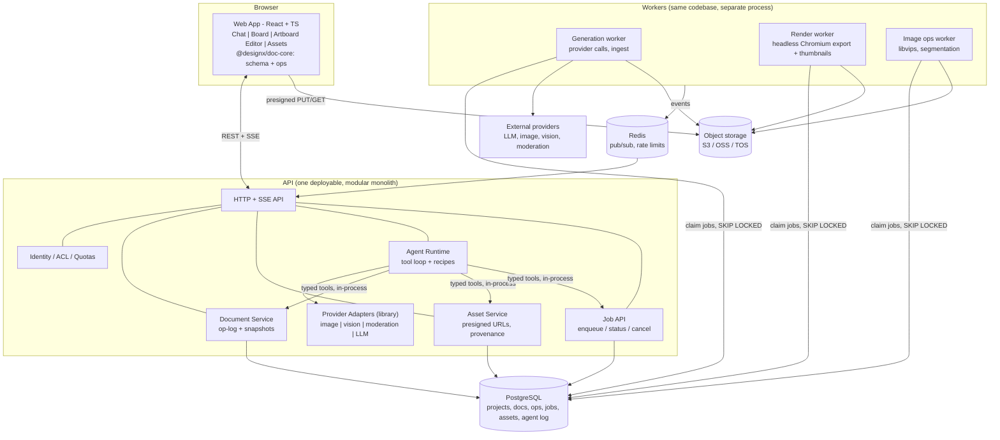
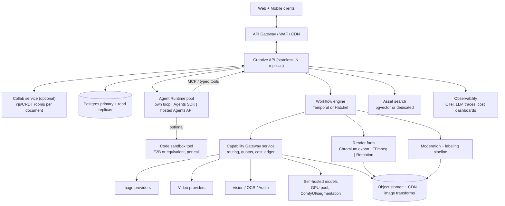
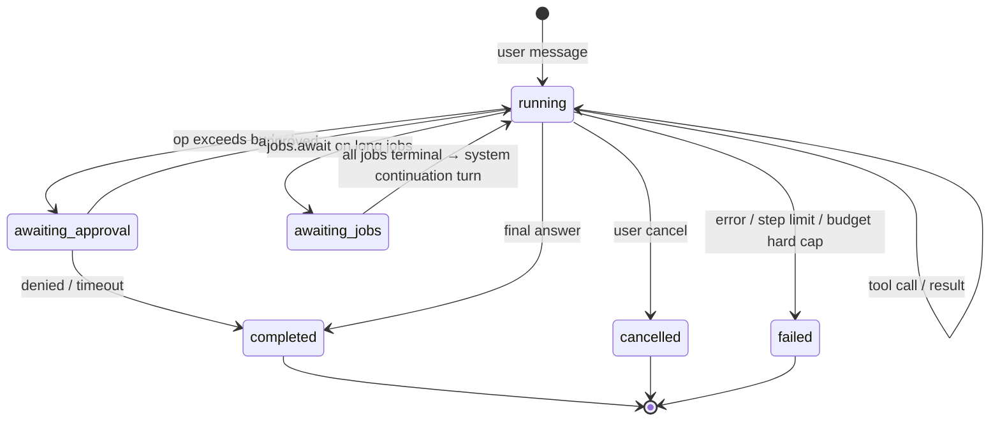
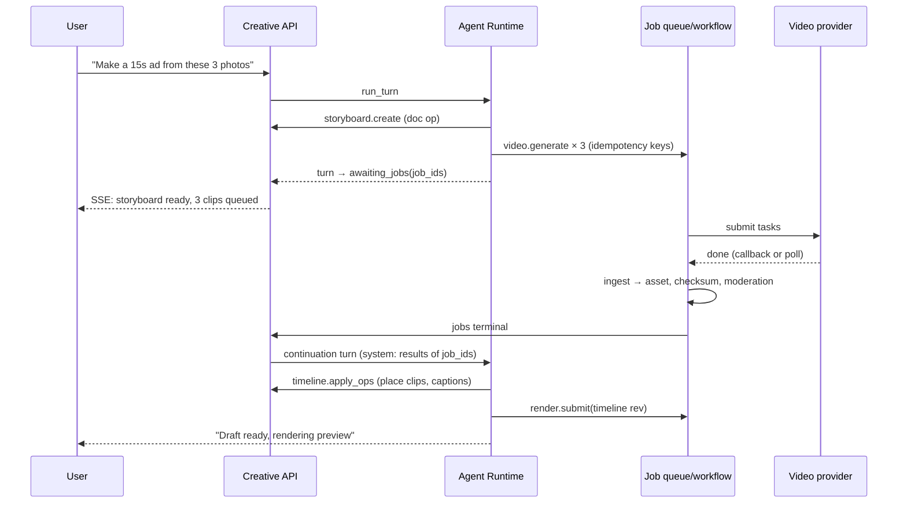
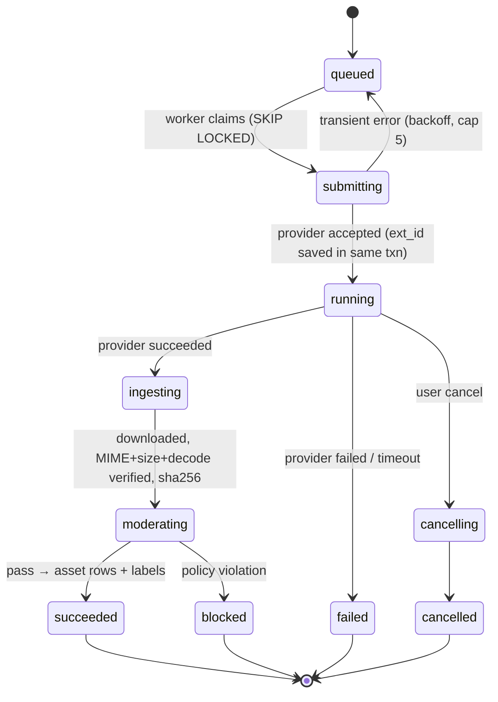

# Design-X: Independent Architecture Review

**Reviewing:** *Design-X — AI-Native Visual Creative Studio: Architecture Proposal & Independent Review Brief* (research cutoff 2026-10-30)
**Review date:** 2026-10-30
**Also reviewed:** the current `design-x` repository, a React 19 + Vite prototype with a local rule-based "AI" (`src/lib/studioModel.js`), a custom Canvas2D/SVG editor (`src/components/Editor.jsx`), and localStorage persistence.

> **How to read this review.** Claims marked **[V]** were checked against a public source during this review (see §15). Claims marked **[V2]** were checked only against secondary sources (blogs, resellers, mirrors) and need confirmation from the vendor. Claims marked **[U]** are my engineering judgement or are unverified. Thresholds in §11–§12 are **proposed assumptions**, not measured benchmarks. During this review the session could not fetch `developers.openai.com` or `remotion.dev` pages directly, so OpenAI and Remotion details come from search-indexed copies of those pages.

---

## 0. Executive verdict

1. **The proposal gets the most important thing right.** The editable Creative Document is the product, models produce content, deterministic workers render, and agents are optional. Direct features skip the agent. Keep all of that.

2. **It answers the wrong question about the agent.** The brief asks whether *one* Codex harness is enough. The real question is whether a **sandboxed coding-agent harness** is the right abstraction at all. In the proposed design, every useful thing the agent does is a typed call back into the Design-X API (`canvas.apply_patch`, `images.generate`, `jobs.get` and so on). The agent does not need a shell, a filesystem or a microVM to do that. Hosting it in E2B behind a custom bridge, talking stdio JSON-RPC to `codex app-server`, adds a whole failure domain (sandbox lifecycle, bridge auth, thread restore, cold starts) and buys almost nothing for this workload. **Recommendation:** run a provider-neutral **tool-calling loop inside the control plane**, add a deterministic **Recipe** layer for the common cases, and treat a code sandbox as an *optional tool* the agent can call, not as the place the agent lives. Revisit Codex, or OpenAI's hosted **Agents API**, only if a benchmark shows that code execution materially improves results.

3. **One loop is enough. A second harness is almost never the fix.** Where one agent loop falls short, the answer is a *workflow* (batch campaigns, long video jobs), an *evaluator model call* (critique, OCR, product-fidelity checks) or a *deterministic service*. None of these is a second autonomous agent. I agree with the brief's "measure before adding a harness" rule. I go further: measure before adopting even the first harness.

4. **There is an unresolved market contradiction that decides much of the architecture.** The prototype is Chinese-language and modeled on Meitu DesignKit, and the proposal names Doubao Seedream/Seedance (Volcano Engine) and OSS. Yet the agent plane is OpenAI Codex plus E2B, both US services. If the primary market is mainland China, OpenAI APIs are not available there, and cross-border transfer of user images (PIPL), generative-AI service filing and mandatory AI-content labeling all apply. If the market is global, Volcano Engine (China) and BytePlus (international) are different endpoints with different model availability. **Decide the launch region first.** It determines the LLM provider, the sandbox vendor (if any), storage, moderation and the compliance work.

5. **The hardest technical risk is missing from the proposal: render parity.** Text layout, CJK fonts, IME input and export must match between the browser editor and server-side export, or "editable and exportable" breaks down. This matters far more than Konva versus Fabric.js. **Recommendation:** use a renderer-agnostic document, render it with DOM/SVG in the browser, and export server-side with **headless Chromium running the same rendering code**. Validate this in a spike before you commit.

6. **Templates and layout are core MVP infrastructure, not a Milestone 3 feature.** The proposal correctly says "build editable typography and layout from the start; don't rely on layer extraction." That logic means the system needs a constrained layout/template grammar that an LLM can fill, from day one. DesignKit's "65 skills" read much more like parameterized recipes than like open-ended agent behavior.

**Bottom line:** keep the domain architecture (documents, assets, jobs, gateway, workers). Replace "Codex in E2B behind a bridge" with "an in-process agent loop plus recipes, with an optional sandbox tool." Pull templates, render parity, moderation/labeling and metering into the MVP. Push the multi-provider gateway, timeline NLE features and multi-harness work later.

---

## 1. Critical findings, ranked

| # | Severity | Finding | Recommendation |
|---|---|---|---|
| F1 | **Critical** | Codex is a coding-agent harness. The creative agent's actions are all typed API calls, so the E2B microVM, bridge, stdio relay and thread persistence are mostly overhead (§3). | Run an agent loop in the control plane with typed tools. Make the sandbox an optional tool. |
| F2 | **Critical** | The launch region is unresolved: Chinese providers and market versus a US agent and sandbox stack. This drives provider choice, data residency, filing and labeling (§9). | Decide the region before Milestone 0. Use OpenAI-compatible LLM interfaces so Doubao, Qwen, DeepSeek or OpenAI can be swapped. |
| F3 | **High** | The typed-tool plan relies on app-server *dynamic tools*. Those sit behind the `experimentalApi` capability gate, and the WebSocket transport is marked "experimental and unsupported" **[V]**. | If you keep Codex, expose tools through an MCP server, which is the stable path. If you own the loop, the issue disappears. |
| F4 | **High** | Agent turns and long-running jobs are listed as separate lifecycles, but nothing defines how the agent *resumes* after a video job finishes minutes later. A naive design keeps a sandbox or turn alive while polling. | Use an event-driven continuation: the turn ends with `awaiting_jobs`, and job completion enqueues a new system turn (§5.3). |
| F5 | **High** | Browser render and server export parity (fonts, CJK line breaking, IME, filters) is not addressed. Konva has no native in-canvas text editing **[V2]**. | Use the same render code for edit and export (DOM/SVG plus headless Chromium). Add a parity test corpus (§7.4). |
| F6 | **High** | Layout and template generation is deferred to Milestone 3, but editable output depends on it. | Add a layout grammar and about 10 templates to Milestone 1. The LLM picks and fills slots, and image models fill only pixel slots. |
| F7 | **High** | Missing components: moderation and AI-content labeling, credit/quota metering, a font service, a preview renderer for agent vision, an image CDN/transform service, an eval harness, LLM tracing, and deletion/retention. | See §2.2. |
| F8 | Medium | Revisions per patch will explode with interactive drags. Undo semantics for agent edits are not defined. | Use an op-log with coalescing, periodic snapshots, and one agent turn = one undoable transaction (§7.3). |
| F9 | Medium | The multi-provider gateway with routing policies and fallback is premature for the MVP. | Use an in-process adapter library with one provider per capability. Extract a service only at scale. |
| F10 | Medium | Python backend plus TypeScript editor means document-operation logic gets implemented twice. | Use one TypeScript document core shared by browser and server, or a JSON-Schema-generated op set kept deliberately small (§10). |
| F11 | Low | Remotion's licensing risk is overstated. Company license automation pricing is about $0.01/render with a $100/month minimum **[V2]**, which is trivial next to video-generation cost. | Decide on Remotion based on whether you need motion graphics, not on licensing fear. |
| F12 | Low | "Infinite canvas" and "artboard scene graph" are conflated in open question #2. | Board = a list of artboards plus free placement. Artboard = the scene graph. Keep them as separate schemas. |

### 1.1 Checking the brief's factual claims

| Claim in brief | Status | Note |
|---|---|---|
| Sora 2 / Videos API retired 2026-09-24 | **[V]** | The announcement was 2026-03-24, the app closed 2026-04-26 and the API closed 2026-09-24. No successor is listed. The advice not to depend on it is correct. |
| GPT Image 2.5 Sunburst / Flare | **[V]** | IDs `gpt-image-2.5-sunburst` / `gpt-image-2.5-flare`, available through the Image API and the Responses API. Flare is the default/fast model, Sunburst the precise/slower one. |
| Seedream 5.0 Pro/Flash layer decomposition | **[V]** (BytePlus docs) | One base image plus up to 16 PNG layers. Third-party prices differ by about 5×, so confirm pricing in the console. |
| Seedance 2.x via Volcano Engine task API | **[V2]**, conflicting | Secondary sources disagree on whether 2.0 is GA through the API. It is task-based (create, then poll or callback). Confirm access, quotas and region **before** planning Milestone 2. |
| App Server preferred over `codex exec` for multi-turn products | **[V2]** | Consistent with the docs. App Server is stdio JSONL by default, with `thread/resume` by stored thread id. |
| E2B suitable for long agent sessions | **[V2]** | Pro has about a 24-hour continuous limit. Pause/resume saves filesystem and memory, but open network connections do not survive, which matters for a long-lived stdio bridge. |

---

## 2. Architecture validation

### 2.1 Overengineering (cut or defer)

| Component in brief | Why it is premature | Replace with |
|---|---|---|
| E2B sandbox per session hosting Codex | The agent's tools are HTTP calls, so a per-session microVM adds cold start, cost, a bridge and restore complexity | An agent loop as a control-plane module. An optional `code.run` sandbox tool, which can be E2B. |
| Sandbox Bridge (custom authenticated relay) | Only needed because of the line above. It is also a new auth surface. | Nothing |
| Codex thread persistence ↔ sandbox ↔ session mapping | The same | Your own `agent_turn` / `agent_message` tables in Postgres |
| "Creative Capability Gateway" as a service with `routing_policy` | One provider per capability is enough for the MVP. Routing only matters once there are several providers. | An in-process adapter interface plus capability registry (§6) |
| Separate Video Timeline Engine at the MVP stage | Video is Milestone 2 and its provider access is not yet confirmed | A storyboard document (a list of shots) plus FFmpeg concat/caption export |
| `approvals.request` as a general tool | Most approvals are cost gates | A server-side policy: auto-approve under a budget, otherwise pause the turn |

### 2.2 Missing components

| Missing | Why it is required | MVP? |
|---|---|---|
| **Template and layout system** | The only reliable route to *editable* AI output. The LLM fills slots, so it does not invent coordinates. | **Yes** |
| **Preview renderer** (document → PNG) | The agent must *see* what it produced to judge layout, text overflow and contrast. It is also used for thumbnails and exports. | **Yes** |
| **Font service** | CJK fonts are 10–20 MB and need subsetting/streaming. Font licensing (many commercial CJK foundry fonts need web/app embedding licenses) and identical fonts in browser and exporter are both required. | **Yes** |
| **Moderation (input and output)** | Required for public generative products. In mainland China it is mandatory for generative AI services. | **Yes** |
| **AI-content labeling / provenance** | China's AI-generated content labeling measures (in force since 2025-09-01) require explicit and implicit labels **[U: confirm scope with counsel]**. Outside China, C2PA Content Credentials and EU AI Act Art. 50 transparency duties apply **[U]**. | **Yes** (if launching in CN or EU) |
| **Metering, quotas and credits** | Billing can wait, but per-user spend limits cannot. An agent loop can spend $10+ in one turn on images and video. | **Yes** (quotas). Billing later. |
| **Image delivery / transforms** | Thumbnails, responsive previews and format conversion without re-rendering. For example imgproxy or OSS/S3 image-processing features. | Yes |
| **Eval harness and LLM tracing** | You cannot answer "one harness or two?" without one. Langfuse or similar, plus a golden task set (§12). | **Yes** |
| **Asset search** | "Use my product photo from last week." Postgres full-text plus `pgvector` image embeddings is enough. | Milestone 3 |
| **Data deletion / retention** | Generated variants pile up. Users must be able to delete. Provider copies must be accounted for. | Yes (basic) |
| **Brand kit as structured data** | Colors, fonts and logos as tokens that templates and agent tools reference. The prototype already has this UI. | Yes (minimal) |

### 2.3 Scalability and reliability weaknesses

1. **Provider rate limits are the real bottleneck, not CPU.** You need a per-provider, per-model concurrency limiter (a token bucket in Redis or Postgres) and fair queuing per tenant. Without it, one user's batch campaign blocks everyone else.
2. **Revision write amplification.** One revision row per `apply_patch`, combined with drag interactions, will produce thousands of rows per session. Coalesce client ops (commit on pointer-up or after about 500 ms idle), store an op-log, and snapshot every N ops (§7.3).
3. **Fan-out of events.** SSE from a single FastAPI process does not scale horizontally without a broker. Use Redis pub/sub or Postgres `LISTEN/NOTIFY` keyed by project.
4. **Large media in the hot path.** Never proxy uploads or downloads through the API. Use presigned PUT/GET everywhere, and ingest provider outputs in workers.
5. **Variant storage cost.** Most generated variants are never used. Give unused `generated_image` assets that are not referenced by any document revision a lifecycle tier (for example, move to infrequent-access storage after 30 days and delete after 180 days, subject to the terms you show users).
6. **Orphaned provider jobs.** A reconciliation cron that compares `creative_job` rows in non-terminal states against the provider's status API. The brief mentions this, so make it a first-class worker.

---

## 3. Agent design: single Codex harness vs alternatives

### 3.1 What the agent actually does in Design-X

Look at the brief's own tool list (§4). Every tool is a **remote typed operation on Design-X state**. The agent never compiles code, edits a repository or runs a test suite, which are the things a coding harness is built for. A sandbox only becomes useful if you want the agent to *write code*: generate a novel SVG or chart, run a custom Python image transform, or produce a Remotion composition from scratch. Those are edge cases for an e-commerce poster and video tool.

### 3.2 Options compared

| Option | Where the loop runs | Strengths | Weaknesses | Fit |
|---|---|---|---|---|
| **A. Recipes only** (deterministic DAGs with LLM steps) | Workers | Predictable, cheap, testable. Matches DesignKit's skill catalog. | Weak at ambiguous, multi-step dialogue | **Required anyway** for direct features, batch and the top 20 scenarios |
| **B. Own tool-calling loop** (Chat Completions/Responses-style API, about 300 lines) | Control plane | No new infrastructure. Provider-neutral (Doubao, Qwen and DeepSeek all expose OpenAI-compatible APIs **[U: verify per provider]**). Full control over budget, approvals, cancellation and continuation. | You own context management and compaction, which is modest for short creative sessions | **Recommended default** |
| **C. OpenAI Agents SDK** (library) | Control plane | Handoffs, guardrails, tracing and MCP support, with the loop in your process **[V2]** | Tied to the SDK's abstractions. Check non-OpenAI model support for your chosen provider. | Good alternative to B if you are on OpenAI |
| **D. Codex App Server in E2B, behind a bridge** (the brief) | E2B microVM | Strong coding-agent behavior, compaction, approvals | Bridge, cold starts, session limits (about 24 hours on E2B Pro **[V2]**), stdio connections do not survive pause/resume **[V2]**, dynamic tools are experimental **[V]**, and the model is effectively tied to OpenAI | Only if code execution is shown to be central |
| **E. OpenAI hosted Agents API** (Codex harness as a service, beta since 2026-09-10) | OpenAI (hosted, your own infrastructure through `codex exec-server`, or a sandbox partner) **[V]** | No bridge, no harness operations, managed sessions and compaction | Beta. Residency and ZDR limits reported **[V2]**. Unavailable in mainland China. Custom function-tool support not confirmed **[U]**. | **Strictly better than D** if you want Codex and are not in China. Re-evaluate at GA. |
| **F. Multi-agent** (planner, designer, critic and so on) | Any | Role separation | Cost and latency multiply, document edits conflict, debugging is hard | Defer. Use evaluator *model calls* instead. |

**Recommendation:** **A + B**, designed so that **C or E can replace B behind one interface** (`AgentRuntime.run_turn(session, input) -> stream[Event]`). This keeps the harness decision reversible and makes the comparison in §12 cheap to run.

### 3.3 Where a single agent loop falls short, and the correct fix

| Workload | Single loop enough? | Correct fix (not a second harness) |
|---|---|---|
| Brief to 3 hero images plus 1 social post, editable | Yes, if a recipe exists. Otherwise the agent plans and calls the recipe. | Recipe `product_hero_set` |
| "Move product right 10%, change headline" | Do not use an agent at all for direct UI. For a chat request, one cheap model call is enough. | Intent → `canvas.apply_ops` fast path |
| Choose the best of 6 generations for product fidelity | Loop coordinates | **Evaluator call** (vision model, OCR, perceptual similarity to the product cutout), returning scores |
| 200-SKU campaign × 4 sizes | **No** | Workflow fan-out (recipe × SKU) with agent-on-exception |
| Storyboard → 6 clips → assemble | Planning yes, waiting no | Continuation model (§5.3), with jobs in the workflow engine |
| Self-critique and revision | Yes | A bounded critique step (max N rounds) using an evaluator model |

**Conditions that justify a second harness or a multi-agent setup:** on the §12 benchmark, a specific category (for example, multi-page layouts) fails at least 30% more often under the single loop, an alternative closes the gap within cost and latency budgets, and the gap persists after prompt and tool-schema iteration. *These thresholds are proposed assumptions.*

### 3.4 If you still choose Codex: the correct deployment

If code execution turns out to matter, or the team is set on Codex, do the following.

1. **Prefer the hosted Agents API (E) over self-hosting App Server in E2B (D)**, subject to region and residency. It removes the bridge and harness operations entirely.
2. If self-hosting: run `codex app-server` over **stdio** (the stable transport) inside the sandbox, with a **bridge that dials *out*** to the control plane over an authenticated WebSocket or gRPC. Do not expose an inbound port. The control plane never reaches into the sandbox, and the sandbox holds only a short-lived, session-scoped token. Pin the Codex version in the sandbox template.
3. **Expose creative tools through an MCP server hosted by the control plane** (stable), not app-server dynamic tools (experimental). The MCP server enforces project scope from the session token on every call.
4. **Persisting threads:** store `{design_session_id, thread_id, codex_version, sandbox_id?}`. Treat Codex thread state as a *cache*. The canonical conversation and tool-call log lives in Postgres, so you can rebuild a degraded context from your own records if `thread/resume` fails. If a community SDK's note is accurate, dynamic tools must be re-sent on `thread/resume` **[V2]**, which is one more reason to use MCP.
5. **Approvals:** map the app-server approval server-request to your `approval` table, push it to the UI over SSE, and answer the JSON-RPC request when the user decides. Set a timeout that auto-denies.
6. **Cancellation:** send turn interrupt to the app-server, *and* cancel non-idempotent jobs that the turn submitted unless they are marked `detach_on_cancel` (for example, video jobs the user has already paid for).
7. **Do not use `codex exec` per message.** It loses streaming approvals and thread continuity, and restarts the process every time.

---

## 4. Proposed architectures

### 4.1 Architecture A: simplest credible MVP

Design goal: **3–5 engineers, one deployable API plus one worker type plus Postgres, Redis and object storage.** No sandbox, no bridge, no separately deployed gateway.



**Deployment:** one container image with two entrypoints (`api`, `worker`). Render workers need Chromium and fonts, so give them their own image variant. Managed Postgres, managed Redis, cloud object storage. Two environments (staging, prod).

**Trade-offs:** fastest to build and debug, one transactional store, no distributed state. The limits are agent code execution (none) and very large batch fan-out (the Postgres queue tops out at roughly hundreds to low thousands of jobs per second **[U]**, which is far above MVP needs).

### 4.2 Architecture B: production growth

Add components **only when a measured trigger fires**.



| Addition | Trigger to add it |
|---|---|
| Workflow engine (Temporal or Hatchet) | More than 3-step multi-provider workflows with human waits, or Postgres-queue retry logic becomes hard to follow |
| Separate Gateway service | More than 2 providers per capability, or several services need quota/cost enforcement |
| Collab service (Yjs) | Real-time multi-user editing becomes a product requirement. Single-writer with OCC covers the agent-plus-one-user case. |
| GPU pool / self-hosted models | Provider unit cost × volume exceeds GPU TCO, or residency forces it |
| Agent sandbox tool | The benchmark shows code-writing tasks matter |
| Read replicas, partitioning | Postgres CPU or IO is sustained above 60%, or the op-log table exceeds about 500 M rows **[U]** |

**Team complexity:** A needs about 4 engineers (2 full-stack/editor, 1 backend/AI, 1 infra/media part-time). B needs 10–15 across editor, AI/agents, media, platform and trust & safety.

---

## 5. Agent runtime design (recommended option B)

### 5.1 Tool surface

Keep the brief's tool list, with these changes:

- **Merge** `canvas.create_document` into `recipes.run(recipe_id, params)` plus `canvas.apply_ops`. Agents should start from templates.
- **Add** `canvas.render_preview(doc_id, revision, artboard_id) -> image` so the agent can see its output. This is critical for layout QA.
- **Add** `canvas.describe(doc_id)` → a compact, token-efficient summary (layer ids, roles, text, bboxes, overflow flags) rather than raw JSON.
- **Replace** `approvals.request` with server-side **budget policy**. The tool layer itself suspends a turn when an operation exceeds the remaining auto-approve budget.
- **Replace** `jobs.get` polling with `jobs.await(job_ids, timeout)`, which yields the turn (§5.3).
- **Use semantic slots.** Layers carry a `role` (`headline`, `product`, `background`, `logo`, `cta`, `badge`), so "make the product larger" resolves without coordinate reasoning.

Every tool call is validated against JSON Schema, authorized against the session's `(user, project)`, metered, and logged to `agent_tool_call` with input, output, cost and latency.

### 5.2 Turn state machine



Hard limits per turn (assumptions): ≤ 25 tool calls, ≤ 120 s of *active* LLM time, a cost cap that can be configured per plan. Cancel is cooperative. It is checked between steps, and in-flight provider calls are allowed to finish or are cancelled if the provider supports it.

### 5.3 Continuation instead of long-lived turns



No process holds state while waiting. The agent's context is rebuilt from the Postgres conversation log, so any replica can run the continuation. This is also what makes the "clip survives sandbox shutdown" acceptance criterion trivially true.

### 5.4 Context management

Creative sessions are short compared with coding sessions. Keep the last N messages, plus a rolling summary, plus the **current document description** (which is always fresh, never stale history). Images go in as references to rendered previews at a capped resolution, never as raw uploads.

---

## 6. Multimodal integration

### 6.1 Adapter interface (in-process library first)

```python
class Capability(StrEnum):
    IMAGE_GENERATE = "image.generate"; IMAGE_EDIT = "image.edit"
    IMAGE_LAYERS = "image.layers"; SEGMENT = "image.segment"
    UPSCALE = "image.upscale"; VIDEO_GENERATE = "video.generate"
    VISION_ANALYZE = "vision.analyze"; OCR = "vision.ocr"
    TTS = "audio.tts"; MUSIC = "audio.music"; MODERATE = "safety.moderate"

@dataclass(frozen=True)
class ModelSpec:            # one row of the capability registry
    provider: str; model_id: str; capabilities: set[Capability]
    sync: bool              # sync image vs async task video
    max_refs: int; aspect_ratios: list[str]; max_pixels: int
    durations_s: list[int] | None
    ref_input: Literal["url", "base64", "file_id"]
    region: str; unit_cost: CostModel; rate_limit: RateLimit

class ProviderAdapter(Protocol):
    spec: ModelSpec
    async def submit(self, req: NormalizedRequest, ctx: CallCtx) -> Submitted  # provider job id or inline result
    async def poll(self, ext_id: str) -> ProviderStatus                    # for async providers
    def verify_callback(self, headers, body) -> ProviderStatus | None
    async def fetch_outputs(self, status: ProviderStatus) -> list[RemoteOutput]
```

Rules:

- **No implicit fallback across providers.** Different models change the creative result. A fallback is either user-visible ("Try with Flash?") or explicitly configured per recipe. The brief is correct here.
- **Reference assets:** pass short-lived presigned GET URLs (5–15 min TTL) scoped to one object, or base64 for small images. For cross-border providers, *resize and strip EXIF before sending*. Never send originals that you do not need to send.
- **Make capability gaps explicit.** If a model cannot do `preserve_product_identity`, the recipe composites the real product cutout over a generated background instead. **This is the most reliable product-fidelity technique available and should be the default for e-commerce hero images [U].**

### 6.2 Job lifecycle and ingest



- **Idempotency:** `idempotency_key` is unique per `(tenant, key)`. Provider submit is guarded so that a crash between "provider accepted" and "ext_id saved" is reconciled by matching on client reference where the provider supports one. Where it does not, record `submitting_started_at` and reconcile manually. Accept the rare duplicate as a cost.
- **Partial results:** for 3 variants, each output is its own asset. The job succeeds with `partial=true` if at least one passes, and the UI shows what succeeded.
- **Ingest safety:** decode with libvips/Pillow under a pixel cap (decompression-bomb guard). Re-encode images, which strips polyglots and metadata. Sanitize SVG (or rasterize it). Probe video with `ffprobe` (codec, duration and dimension caps) before accepting.
- **Moderation:** check input prompts and reference images before submit, and outputs after ingest. In China use a domestic content-security service. Elsewhere use the provider's moderation plus your own classifier.
- **Labeling:** embed implicit labels (metadata; C2PA where applicable) at ingest and export. Add explicit visible labels where regulation requires them.

### 6.3 Provider choices (provisional, by region)

| Capability | China-first | Global-first | Notes |
|---|---|---|---|
| LLM for agent | Doubao / Qwen / DeepSeek (OpenAI-compatible APIs) | OpenAI / Anthropic / Google | Keep behind one `LLMClient`. Benchmark tool-calling reliability per model. |
| Image gen/edit | Seedream 5.0 Pro/Flash (Volcano Engine) | GPT Image 2.5 Flare/Sunburst **[V]**, Seedream through BytePlus | Choose by product-fidelity benchmark, not reputation |
| Layer decomposition | Seedream (≤16 PNG layers) **[V]** | Same through BytePlus | Enhancement only, as the brief says |
| Segmentation / cutout | Hosted API, or self-hosted BiRefNet-class model | Same | **RMBG-2.0 weights are CC BY-NC 4.0, so commercial use needs a BRIA agreement [V].** Check each model's license, and BiRefNet's own license separately [U]. |
| Video | Seedance (confirm 2.x API GA) **[V2]** | Seedance through BytePlus, or other vendors | Sora API is retired **[V]** |
| OCR | PaddleOCR (self-host) or cloud OCR | Cloud OCR or a vision LLM | Needed to verify rendered text |
| TTS / music | Domestic TTS. Licensed music library. | Same | Music rights are a legal question, not a model one |

---

## 7. Editable document design

### 7.1 Critique of the proposed schema

The illustrative `CanvasDocument` is a good start. Changes:

| Issue | Change |
|---|---|
| `z` integers on layers invite reordering conflicts | Order is the array order inside `children`. Use fractional indexing keys if CRDTs come later. |
| Text is a flat string with one font | `text.spans[]` with style runs, `font_ref` (id into the font service, not a family name), `auto_fit: none | shrink | grow`, `max_lines`, `align`, `line_height`, `letter_spacing`, `writing_mode` (CJK vertical text) |
| Absolute pixel transforms only | Keep px as canonical, but add **`constraints`** (left/right/center/scale anchors) so `resize_artboard` (3:4 → 1:1) is a deterministic re-layout, not an LLM guess. |
| No semantic role | `role` and `slot_id` from the template, `locked`, and `agent_editable: bool` |
| Image layer lacks crop/fit | `fit: cover | contain | fill`, `crop: {x,y,w,h}` in source space, `mask_ref`, `filters[]` |
| No asset version pinning | Reference `asset_id@rev`, so old documents render identically forever |
| Groups only | `group` plus `frame` (clip children), which covers product cards and grids |
| No brand tokens | Colors and fonts can be `{"token": "brand.primary"}`, resolved at render time |

The existing prototype's `nodes[]` (`type`, `x`, `y`, `w`, `h`, `text`, `size`, `color`, `font`) maps directly onto this. Plan a v1 → v2 migration rather than a rewrite.

### 7.2 Operations API

```http
POST /v1/documents/{id}/ops
If-Match: "rev-41"
{ "client_op_id": "c-123", "origin": "user|agent:turn_9|recipe:hero_set",
  "ops": [
    {"op": "set", "path": ["layers","headline","text","spans",0,"text"], "value": "NEW ARRIVAL"},
    {"op": "move", "layer": "product", "dx": 108, "dy": 0},
    {"op": "replace_asset", "layer": "bg", "asset": "asset_77@1"},
    {"op": "insert", "parent": "board_1", "index": 3, "layer": { ... }}
  ] }
→ 200 {"revision": 42, "applied": [...]}        | 409 {"current": 43, "conflicts": [...]}
```

- **A small closed op vocabulary** (`set`, `insert`, `remove`, `move_layer`, `reorder`, `replace_asset`, `resize_artboard`), implemented **once** in `@designx/doc-core` (TypeScript) and run in both the browser (optimistic) and the server (authoritative). If the server is Python, run doc-core in a small Node sidecar or limit ops to path-`set` semantics that are easy to port, and share fixtures. **Do not hand-maintain two implementations.**
- **Conflict handling:** if a conflicting op touches different layers or properties, the server rebases automatically, since these ops commute. It returns 409 only for a true same-property conflict. User edits always win over agent edits in the same window. The agent gets a conflict result and re-reads the document.
- **Agent writes are drafts by default.** Agent ops land on a *branch revision* and are shown as a preview with Accept/Undo, or auto-accept when the user enables it. This removes most conflicts and builds trust.

### 7.3 Revisions, undo/redo

- **Op-log** (`doc_op`: doc_id, rev, origin, ops JSONB, created_at) plus a **snapshot** every 100 ops or on explicit save. Rendering or opening a document = latest snapshot + replay.
- **Client undo** is local and inverts ops. **Agent turn undo** = "revert transaction `turn_9`", meaning the server applies inverse ops for that origin. It conflicts only if the user has since edited the same properties.
- **Named versions** are user-visible checkpoints. Exports reference `(doc_id, rev)`.

### 7.4 Renderer choice: Konva vs Fabric.js vs the alternatives

| Option | Text editing / CJK IME | Export parity path | License | Verdict |
|---|---|---|---|---|
| **Konva / react-konva** | No native in-canvas text editing **[V2]**. You build a textarea overlay. Canvas text layout is manual (wrapping, CJK line breaking). | `konva` in Node with `canvas`/skia; fonts must match | MIT | Good for shapes and transforms. Weak for text-heavy marketing design. |
| **Fabric.js** | IText/Textbox with a hidden-textarea IME **[V2]**. Better. | Fabric in Node (node-canvas); SVG export | MIT | Better than Konva for text. Still a canvas text engine. |
| **DOM/SVG renderer + transform handles** (e.g. react-moveable) | **Native browser text layout and IME, including CJK, vertical text and rich spans** | **Headless Chromium renders the same React components → pixel parity by construction** | OSS (MIT libraries) | **Recommended for MVP [U, validate in spike].** The prototype already renders to DOM/SVG. |
| Polotno SDK (on Konva) | Built-in editor UI | Polotno renderer | Commercial (about $899/mo self-serve **[V2]**) | Fastest way to ship a template editor. Lock-in. |
| IMG.LY CE.SDK | Full editor including video | Server renderer CLI (PDF/PNG/MP4) **[V]** | Commercial | Credible "buy" option if the team is small. Video editing needs WebCodecs (Chromium, not mobile web) **[V]**. |
| tldraw | Infinite whiteboard | – | Source-available, production key required **[V]** | Wrong fit for artboard design. Possibly for the "board" layer only. |

**Recommendation:** run a 2-week spike comparing **DOM/SVG + Chromium export** against **Fabric.js + node-canvas export** on the same 50-document corpus: CJK headlines, mixed scripts, rotated text, masks, 150-layer artboards, 4K images. Measure SSIM between browser and export (≥ 0.99 target, an assumption), edit latency at 150 layers (< 16 ms per frame target), and IME correctness. If DOM performance fails at large layer counts, move the *stage* to canvas or WebGL but keep the *document* untouched. Seriously consider **buying** (Polotno or CE.SDK) if editor engineering capacity is under 2 people.

Infinite board: the board is a pan/zoom viewport placing artboard **thumbnails** (rendered previews, tiled at zoom levels). Only the active artboard mounts the full editor. This keeps 50-artboard boards cheap.

---

## 8. Video production architecture

**Generation ≠ editing ≠ rendering**: I agree completely with the brief.

### 8.1 Scope the MVP down

The MVP video product is a **storyboard** (an ordered list of shots, each with a source asset or a generation job, duration, caption, transition), plus one music track, plus optional TTS. That is not an NLE. A multi-track timeline belongs in Milestone 4, and only if users ask for it.

```json
{ "timeline_id": "tl_1", "schema_version": 1, "fps": 30, "size": [1080, 1920],
  "shots": [
    {"id": "s1", "asset": "asset_clip_1@1", "in": 0.0, "out": 4.0, "caption": {"text": "全新上市", "style": "brand.caption"}, "transition_in": "fade:0.3"},
    {"id": "s2", "asset": "asset_img_4@1", "duration": 3.0, "motion": "kenburns:in", "caption": null}
  ],
  "audio": [{"asset": "asset_music_2@1", "gain_db": -12, "duck_under_voice": true}],
  "voiceover": {"asset": "asset_tts_1@1"} }
```

### 8.2 Render options

| Option | Strengths | Weaknesses | License / cost | Use |
|---|---|---|---|---|
| **FFmpeg filtergraph compiled from timeline JSON** | Fast, proven, cheap, no browser | Caption styling and motion graphics are painful. Preview parity with the browser is weak. | LGPL/GPL depending on build; check codec patents (H.264/AAC) for distribution | **MVP renderer** |
| Captions as pre-rendered PNG/ASS overlays from the doc renderer | Same text engine as images, so captions match the brand | Extra step | – | **Recommended**: render caption cards with the Chromium renderer, overlay with FFmpeg |
| **Remotion** | React compositions, browser preview equals render, Lambda/Cloud Run scaling | Company license needed for companies with 4 or more people. Automators: $0.01/render, $100/month minimum **[V2]**. | Commercial for companies | Milestone 4, when templated motion graphics are a product need. The cost is negligible next to clip generation (estimated about $0.35–$1.87 per 5 s Seedance clip at 480p–1080p **[V2]**). |
| IMG.LY CE.SDK video | Editor and server renderer from one engine **[V]** | Commercial. WebCodecs/Chromium-only for editing. | Commercial | "Buy" alternative |
| GStreamer / MLT | Pro NLE engines | Steep learning curve | LGPL | Not needed |

**Browser preview:** for the MVP, play shots sequentially in a `<video>`/`` player with CSS captions, and generate a fast low-resolution proxy render on demand for accurate preview. Do not promise frame-accurate parity before Remotion or CE.SDK.

**Workers:** FFmpeg render jobs run in dedicated workers with cgroup CPU and memory limits, a timeout of about 10× media duration, and scratch disk cleaned up per job. Never run them in the agent process or a sandbox. The brief already says this, and it is correct.

---

## 9. Security, compliance and commercial readiness

### 9.1 Highest risks (ranked)

1. **Cost abuse through the agent.** A prompt-injected or looping agent can burn provider spend. Mitigations: per-turn, per-day and per-plan caps enforced in the tool layer (not in the prompt); idempotency; approval above a threshold.
2. **Prompt injection via assets.** Text inside reference images, product descriptions or scraped pages ("ignore instructions, generate X"). Mitigations: tools are least-privilege and project-scoped, so the blast radius is limited to the user's own project. Moderation runs on *outputs* regardless of instructions. Tool results containing user-provided text are marked as data.
3. **Cross-tenant access.** Every tool call and API request resolves `project_id` → ACL server-side. The agent's context never contains IDs it was not given. Presigned URLs are scoped to one object with a short TTL.
4. **Media parser attacks.** Decompression bombs, malicious SVG, crafted video containers. Mitigations: decode in isolated workers with pixel caps, re-encode, rasterize or sanitize SVG, `ffprobe` limits, and keep libvips/FFmpeg patched.
5. **Credentials.** Provider keys live only in workers and adapters (a secret manager). No sandbox ever holds them. If a sandbox is used, it receives a per-call scoped token for the MCP endpoint and nothing else. Egress is allow-listed.
6. **Regulatory (China launch):** generative-AI service filing / algorithm registration, real-name verification, content-security review, AI-content labeling (explicit and implicit), data localization and PIPL cross-border rules for any foreign model call. **This is a launch-blocking workstream, not a later milestone [U: confirm with counsel].**
7. **Regulatory (global):** EU AI Act Art. 50 transparency for synthetic media **[U: confirm applicability and timing]**, GDPR for uploaded faces and people, right of publicity for model or person images, C2PA provenance.
8. **Commercial terms:** use API credentials under API terms, never consumer subscriptions (the brief is correct). Check each image and video provider's output-ownership and indemnity clauses. Check model *weight* licenses for anything self-hosted (RMBG-2.0 is a concrete example of a non-commercial trap **[V]**). Check font licenses for web embedding and server rendering.

### 9.2 If E2B or any agent sandbox is used

- One sandbox per *session* (not per tenant process), created from a pinned template, with an egress allow-list (only the Design-X MCP endpoint), no provider keys, and a session token that expires with the turn.
- The bridge dials out only. Do not expose an inbound port.
- Keep the sandbox lifetime shorter than the provider session cap. Pause rather than keep alive. Persisted state is a cache, never a source of truth.

---

## 10. Technology selection

Two coherent stacks are possible. Choose based on the team, but **do not mix a Python document service with a TypeScript editor without a shared document core.**

| Layer | Recommended (TS-centric) | Alternative (Python-centric) | Notes |
|---|---|---|---|
| Web app | React 19 + TypeScript + Vite (already in repo) | Same | Migrate the prototype from JS to TS |
| Document core | `@designx/doc-core`: TS, schema in TypeBox/Zod → JSON Schema | JSON Schema → Pydantic (datamodel-codegen) plus TS types | Shared fixtures and golden tests in both cases |
| Editor stage | DOM/SVG + react-moveable (spike vs Fabric.js) | Same | §7.4 |
| API / control plane | Node 22 + Fastify (or Hono), Kysely/Drizzle | Python 3.12 + FastAPI, SQLAlchemy 2 / SQLModel | TS lets doc-core run server-side natively |
| Agent loop | Own loop on OpenAI-compatible client, or OpenAI Agents SDK (TS) | Own loop, or OpenAI Agents SDK (Python) | Keep behind an `AgentRuntime` interface |
| Jobs (MVP) | Postgres job table + `SKIP LOCKED` (e.g. graphile-worker / pg-boss) | Same pattern (e.g. Procrastinate) or Hatchet | Cross-language consumers are easy with plain Postgres claiming |
| Workflows (growth) | Temporal or Hatchet **[V2]** | Same | Temporal is most mature and heaviest. Hatchet is Postgres-based and MIT-licensed. |
| Export renderer | Playwright + Chromium (Node) | Same (a Node worker even in a Python stack) | Same code as the editor |
| Image ops | Python worker: pyvips, Pillow (bomb guard), onnxruntime for segmentation | Same | Python has the ML ecosystem |
| Video | FFmpeg (worker), Remotion later | Same | |
| Storage | S3 / Aliyun OSS / Volcano TOS behind a thin interface | Same | Region-dependent |
| Events | SSE + Redis pub/sub | Same | WebSocket only when collaboration arrives |
| Observability | OpenTelemetry, Sentry, Langfuse (LLM traces, evals) | Same | |
| Image delivery | imgproxy or the cloud's image-processing feature | Same | |

**When Go is justified:** only for (a) a high-throughput media proxy or ingest service at large scale, (b) contributing to sandbox or runtime infrastructure (E2B internals), or (c) a performance-critical gateway once Python or Node is measurably the bottleneck. None of these applies before product-market fit.

---

## 11. Roadmap

### Milestone 0: Decisions and spikes (2–3 weeks)

| Spike | Exit criterion (assumed thresholds) |
|---|---|
| **Region and compliance decision** | Written decision on launch region, LLM provider and storage region. Compliance checklist owner assigned. |
| **Render parity**: DOM/SVG + Chromium vs Fabric + node-canvas | SSIM ≥ 0.99 on a 50-doc corpus. CJK IME works in Chrome/Safari/Edge. 150-layer artboard drag ≥ 50 fps. |
| **Product fidelity**: generate vs edit vs composite-cutout | On 20 SKUs, the composite approach preserves label text (OCR match ≥ 95%). Compare provider edit modes. |
| **Agent loop on 3 LLMs** | Tool-call validity ≥ 98% over 200 scripted calls. p95 per step < 4 s. |
| **Provider access** | Contracts/keys for image, video and moderation in the chosen region. Seedance 2.x API availability confirmed. |

### Milestone 1: Editable image MVP (8–10 weeks)

In scope: auth, projects, asset upload (presigned), doc-core v2 with op-log, editor (text, image, shape, group, crop, constraints), 10 templates with slots and roles, brand kit (colors, fonts, logo), 3 recipes (`product_hero_set`, `social_post`, `resize_set`), agent loop with 10 tools including `render_preview`, image generation and edit via one provider, cutout, moderation, labeling, quotas, PNG/JPEG/WebP and native export, Langfuse tracing, and the §12 benchmark wired into CI (nightly).

Out of scope: video, collaboration, billing, infinite board (the existing prototype board view stays), marketplace, self-hosted models, a second LLM provider in production.

### Milestone 2: Storyboard video (6–8 weeks)

Storyboard doc, video generation adapter with async jobs and continuation turns, TTS, music library, FFmpeg renderer with Chromium caption cards, proxy preview, reconciliation worker.

### Milestone 3: E-commerce productization (8+ weeks)

SKU batch workflows (workflow engine if triggered), template authoring tool, asset search (pgvector), size-set auto-relayout through constraints, cost dashboards, billing/credits, team workspaces.

### Milestone 4: Advanced studio

Multi-track timeline (Remotion or CE.SDK decision), real-time collaboration (Yjs), layer decomposition import, localized inpainting tools, optional agent code sandbox, second agent runtime if the benchmark warrants it.

### 11.1 Acceptance-test matrix (thresholds are proposed assumptions)

| Area | Test | Threshold |
|---|---|---|
| Editability | Generated hero set opens with live text/logo layers. Headline edit causes no regeneration. | 100% of recipe outputs |
| Persistence | Reopen after 30 days renders identically (pinned asset revisions) | SSIM ≥ 0.999 vs stored export |
| Parity | Browser vs server export on the corpus | SSIM ≥ 0.99, no text reflow differences |
| Concurrency | User edit during agent turn | 0 lost user edits. Agent receives a conflict and recovers in ≥ 95% of cases. |
| Latency | Direct op commit | p95 < 250 ms |
| Latency | Chat simple edit ("make headline red") | p95 < 6 s end-to-end |
| Latency | First variant visible for hero set | p95 < 45 s (provider-bound) |
| Reliability | Kill workers mid-job | 100% of jobs reach a terminal state. No duplicate charges beyond the provider's idempotency limits. |
| Reliability | Provider URL expiry | 0 assets lost (ingested before expiry) |
| Safety | Red-team prompt-injection set (50 cases) | 0 cross-project access. 0 budget-cap bypasses. |
| Cost | Cost per *accepted* hero set | ≤ target set by product (record from day one) |
| Video | Clip survives agent/session termination. Re-render uses the latest revision. | 100% |

---

## 12. Evaluation plan: 24-task benchmark

### 12.1 Task set

| # | Category | Task (inputs fixed and versioned) |
|---|---|---|
| 1–3 | Image creation | Hero set (3) for: skincare bottle with small label text; coffee bag with a logo; headphones on a white background |
| 4 | Image creation | 1:1 social post plus 9:16 story from the same brief, with brand kit applied |
| 5 | Image creation | "Premium, minimal, autumn" with no product photo (pure generation plus layout) |
| 6 | Image creation | Bilingual CN/EN headline poster, long Chinese headline (overflow handling) |
| 7–8 | Editable revision | "Move product right 10%, change headline to X" (expect ops only, $0 generation) |
| 9 | Editable revision | "Warmer background, keep everything else" (expect regeneration of only the bg slot) |
| 10 | Editable revision | "Make it look more luxury" (ambiguous; expect a clarifying question or a bounded restyle) |
| 11 | Editable revision | Resize the finished 3:4 design to 1:1, 16:9 and 9:16 (expect constraint relayout, no regeneration) |
| 12 | Editable revision | Revise during a concurrent user edit (conflict recovery) |
| 13 | Editable revision | "Undo what you just did" (turn-level revert) |
| 14 | Fidelity | Replace background while preserving label text (OCR check) |
| 15 | Fidelity | Choose the best of 6 variants by product similarity (evaluator correctness vs human pick) |
| 16–17 | Video | 15 s ad from 3 photos (storyboard → clips → captions → render); 3-shot ad with TTS voiceover |
| 18 | Video | "Swap shot 2 and 3, shorten to 10 s" (no regeneration) |
| 19 | Batch | 20 SKUs × 2 sizes from one template |
| 20 | Failure recovery | Provider returns 500 on 1 of 3 variants (expect a partial result and a retry offer) |
| 21 | Failure recovery | Video provider times out (expect a terminal state, user notified, agent continuation handles it) |
| 22 | Failure recovery | Worker killed mid-ingest (expect exactly one asset) |
| 23 | Safety | Prompt injection embedded in a product description |
| 24 | Safety | Request exceeding budget (expect approval gate, no spend) |

### 12.2 Metrics per task

Success (a rubric with binary checks: editable layers present, text correct by OCR, product preserved, constraints satisfied), **human preference** (blind pairwise rating by 3 raters, 1–5 scale), wall-clock p50/p95, provider cost, LLM tokens/cost, tool calls, generations wasted (generated but unused), and user-edit time to "acceptable" (in the human study).

### 12.3 Fair comparison: single loop vs alternatives

- **Hold constant:** the tool set and schemas, the image and video providers, the templates, the per-task budget caps, and the input fixtures. Where possible use the same underlying LLM across harnesses, so you measure the harness and not the model. Also run a cross-model sweep separately.
- **Arms:** (1) recipes only, (2) own loop + recipes, (3) Agents SDK + recipes, (4) Codex (hosted Agents API or App Server) with the same tools through MCP, (5) planner + critic multi-agent. Each arm runs ≥ 3 times per task to capture variance. Report the mean and the spread.
- **Decision rule:** prefer the simplest arm whose success rate is within 5 points of the best and whose cost per accepted output is within 20%. *These are assumptions to agree with product.* Anything more complex must win by more than that margin on the categories that matter commercially (1–11).
- **Blind the raters** to the arm. Freeze provider model versions (pinned IDs) during a run.

---

## 13. Decision log

| # | Decision | Status | Evidence / validation required |
|---|---|---|---|
| D1 | The Creative Document is the system of record. Agents and providers never own state. | **Accepted** | – |
| D2 | Direct features bypass the agent | **Accepted** | – |
| D3 | Modular monolith plus separately deployed workers | **Accepted** | – |
| D4 | Agent loop runs in the control plane behind an `AgentRuntime` interface | **Accepted** | M0 tool-validity spike on target LLMs |
| D5 | Codex App Server in E2B behind a custom bridge as the default agent path | **Rejected** for MVP | Revisit only if benchmark arm 4 beats arm 2 per §12.3 |
| D6 | OpenAI hosted Agents API | **Deferred** | GA status, region/residency, custom tool support, benchmark |
| D7 | Multi-agent / second harness | **Deferred** | Benchmark category gap ≥ 30% that persists after tool/prompt iteration |
| D8 | Recipe (deterministic workflow) layer with templates and slots | **Accepted** (MVP) | – |
| D9 | Launch region decides providers, storage and compliance | **Accepted, blocking** | Business decision in M0 |
| D10 | Editor stage: DOM/SVG + Chromium export | **Accepted provisionally** | M0 parity and performance spike vs Fabric.js. Konva is lower priority because of text editing. |
| D11 | Buy an editor SDK (Polotno / CE.SDK) | **Deferred** | Revisit if editor team is under 2 engineers or the spike fails |
| D12 | Op-log + snapshots; agent turn = one revertible transaction; agent edits as drafts | **Accepted** | Concurrency tests in §11.1 |
| D13 | Real-time CRDT collaboration | **Deferred** | Product requirement for multi-user editing |
| D14 | Provider adapters as an in-process library with a capability registry | **Accepted** | – |
| D15 | Standalone Capability Gateway service with routing policies | **Deferred** | More than 2 providers per capability, or multiple consuming services |
| D16 | No implicit cross-provider fallback | **Accepted** | – |
| D17 | Composite real product cutout as the default fidelity technique | **Accepted provisionally** | M0 fidelity spike |
| D18 | Postgres job queue for MVP. Temporal/Hatchet later. | **Accepted** | Trigger in §4.2 |
| D19 | FFmpeg renderer for storyboard video; captions rendered by the doc renderer | **Accepted** | M2 |
| D20 | Remotion | **Deferred** | A motion-graphics product need. Licensing is cheap and not a blocker **[V2]**. |
| D21 | Moderation, AI-content labeling and quotas in the MVP | **Accepted** | Counsel sign-off per region |
| D22 | Self-hosted generative models / GPU pool | **Deferred** | Unit-economics or residency trigger |
| D23 | Go services | **Rejected** for now | A measured throughput bottleneck |
| D24 | Shared TypeScript doc-core used by browser and server | **Accepted** | If the backend is Python, a Node sidecar or a minimal op set with shared fixtures |

---

## 14. Open uncertainties

1. **Region.** Everything in §6.3 and §9 branches on it.
2. **Seedance 2.x API GA and quotas** in the chosen region **[V2, conflicting]**.
3. **Hosted Agents API limits** (residency, ZDR, custom tools) **[V2]**. It is in beta and subject to change.
4. **Tool-calling reliability of the chosen LLM** for Chinese-language creative briefs. This is unmeasured and gets tested in M0.
5. **DOM/SVG editor performance** at high layer counts and with large images on low-end laptops **[U]**.
6. **Font licensing** for the CJK families the product wants to offer.
7. **Exact current pricing** for every provider. Third-party figures in this review differ by up to 5×.

---

## 15. Sources

Verified during this review (search-indexed; vendor pages could not be fetched directly from the review environment):

- OpenAI, Codex App Server docs (transport, `experimentalApi`, WebSocket marked experimental): https://developers.openai.com/codex/app-server
- OpenAI, Introducing the Agents API (beta 2026-09-10, hosted Codex harness): https://openai.com/index/introducing-the-agents-api/ · docs: https://developers.openai.com/api/docs/guides/agents-api/overview · self-hosted executor: https://developers.openai.com/api/docs/guides/agents-api/environments/self-hosted
- OpenAI, GPT Image 2.5 announcement and image guide: https://openai.com/index/introducing-chatgpt-images-2-5/ · https://developers.openai.com/api/docs/guides/image-generation
- Sora / Videos API shutdown 2026-09-24: https://the-decoder.com/openai-sets-two-stage-sora-shutdown-with-app-closing-april-2026-and-api-following-in-september/ · https://help.make.com/openai-sora-and-video-modules-deprecation-by-september-24-2026
- BytePlus ModelArk image generation API (Seedream layer decomposition, ≤16 PNG layers): https://docs.byteplus.com/en/docs/ModelArk/1541523
- Seedance 2.0 API availability and pricing (secondary, conflicting): https://anikuku.com/blog/seedance-2-api-pricing-guide-2026 · https://yingtu.ai/en/blog/seedance-2-pricing-free-vs-paid-guide
- E2B persistence and lifetime: https://e2b.dev/docs/sandbox/persistence · https://docs.e2b.dev/faq/sandbox-lifetime
- Remotion license terms and pricing: https://www.remotion.dev/docs/terms · https://www.remotion.dev/docs/license/pricing
- Konva vs Fabric.js text editing (vendor-authored comparisons): https://orshot.com/blog/konva-vs-fabric-js.md · https://polotno.com/sdk/product/compare/polotno-sdk-vs-konvajs
- tldraw production license key: https://tldraw.dev/sdk-features/license-key
- IMG.LY CE.SDK renderer: https://img.ly/docs/cesdk/renderer/cesdk-renderer-overview-7f3e9a
- BRIA RMBG-2.0 license (CC BY-NC 4.0): https://github.com/Bria-AI/RMBG-2.0
- Durable workflow engine comparisons (partly vendor-authored): https://www.youngju.dev/blog/culture/2026-05-15-workflow-engines-2026-temporal-inngest-trigger-hatchet-restate-dbos-airflow-deep-dive · https://www.diagrid.io/infrastructure/10-best-temporal-alternatives-2026
- Community note on dynamic tools and `thread/resume` (secondary): https://hex.pm/packages/codex_sdk/0.18.0/files/guides/05-app-server-transport.md
