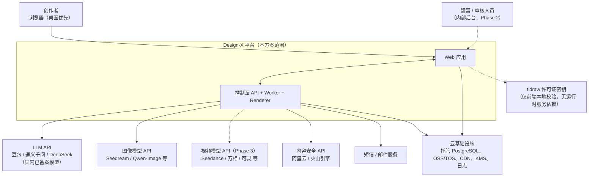
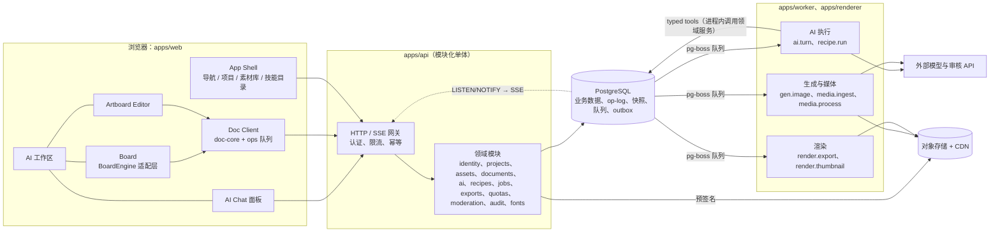
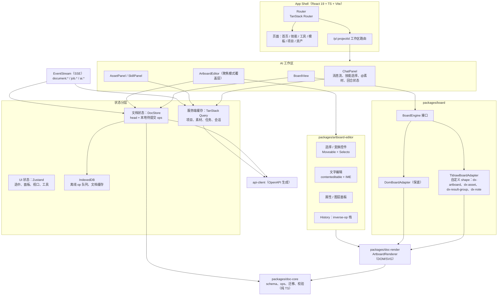
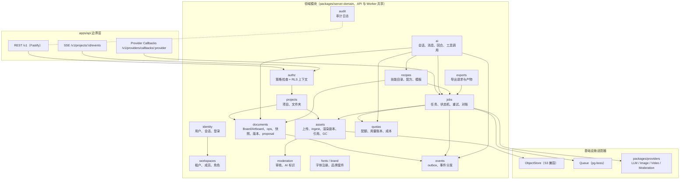
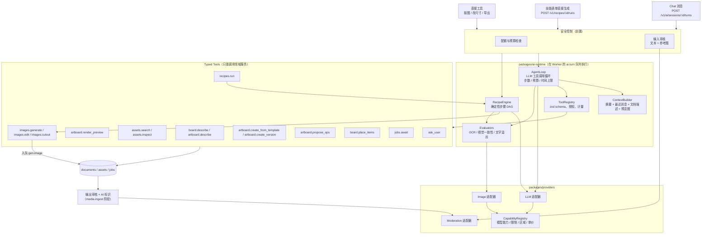
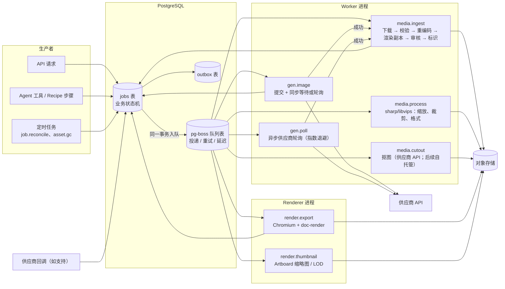
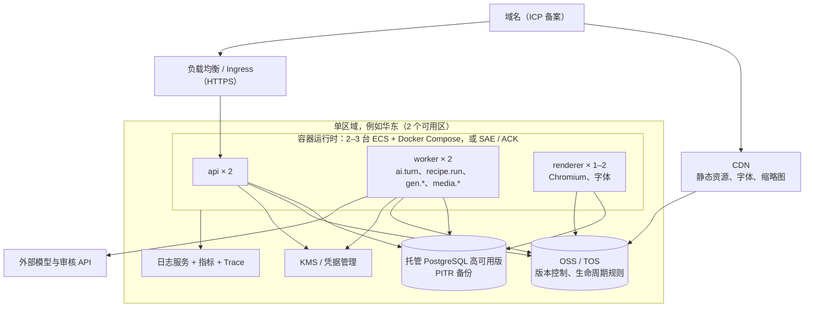
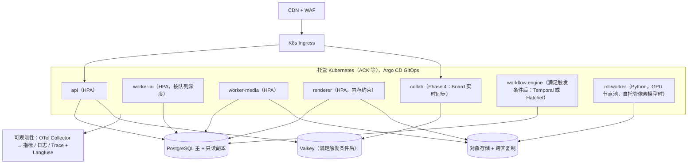
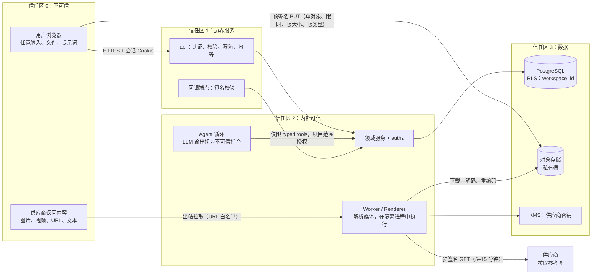
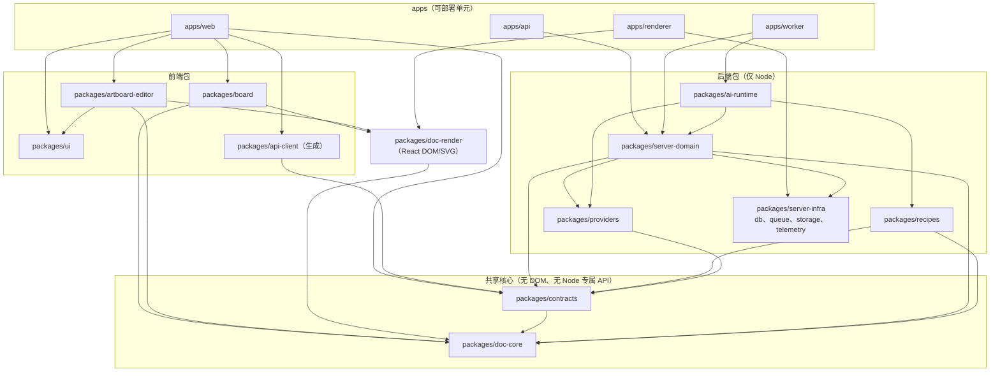

# Part 2 · 架构图（交付物 B）

本部分的组件名、模块名、队列名和包名，与 Part 4–8 保持一致。权威命名见 Part 8 §H.2（包）、Part 5 §E.2（模块）和 Part 7（表、事件、API）。

---

## B.1 系统上下文与外部依赖

**说明**

- 所有模型调用都**只从服务端发起**，浏览器拿不到任何供应商密钥。
- 浏览器只为两件事直接访问云：通过**预签名 URL** 上传和下载对象，以及读取 CDN 上的缩略图和字体。
- tldraw 的许可证密钥按官方文档在本地解码校验，不访问许可服务器 [二手：官方文档摘录]。但 LICENSE 原文写明软件“可能为合规目的传输使用数据” [已核验]，M0 需抓包确认浏览器端是否有外呼（见 Part 4 §D.2.6）。
- 视频供应商是 Phase 3 依赖（虚线）。

---

## B.2 总体逻辑架构

**说明**

- **真相源**：业务数据和文档都在 PostgreSQL，二进制都在对象存储。浏览器 IndexedDB 只是缓存和离线队列；Worker 不保存任何长期状态。
- Worker 与 API **共享同一套领域服务代码**，作为 TS 包按进程引用。所以 Agent 工具调用就是进程内函数调用，并且经过与 HTTP 请求相同的授权检查（`AuthzContext`）。
- 实时性：领域事务写入 `outbox` 表，`NOTIFY` 唤醒 API 进程，再经 SSE 推给订阅该项目的浏览器。

---

## B.3 前端架构

**说明**

- `doc-core` 不依赖 DOM 和 React，浏览器、API 和 Worker 用的是同一份操作语义。
- `doc-render` 是 **Artboard 的唯一渲染实现**，被编辑器、Board 上的 Artboard shape（高 LOD）和服务端 Renderer 共同使用。
- Board 的 tldraw store 是**视图模型**：持久化与同步以 `doc-core` 的 Board 文档为准（Part 4 §D.2.4）。

---

## B.4 后端领域模块与服务边界

**边界规则**

- 每个模块对外只暴露 `service` 接口与领域事件，**不允许跨模块直接写表**。例如 `ai` 修改文档必须调用 `documents.applyOps()` 或 `documents.createProposal()`。
- `authz` 是所有入口（HTTP、SSE、Worker 工具调用）的必经层。
- 拆分为独立服务的触发条件见 Part 5 §E.2.3。

---

## B.5 AI 运行时：技能/配方、工具调用、供应商与安全控制

**说明**

- 三种入口共用同一套 `recipes`、`jobs` 和 `documents` 服务。“技能表单直接生成”与“对话中由 Agent 选择配方”最终执行的是**同一份配方定义**，这是 DOCX“统一任务入口”建议的落地方式。
- 工具**只能**调用领域服务；没有任何工具能执行代码、访问文件系统或拿到供应商密钥。
- 预算在工具层强制执行（代码层），不靠提示词约束。

---

## B.6 异步任务与媒体处理

**说明**

- `jobs` 表是**业务状态机**（用户可见、可审计）；pg-boss 只负责**投递**（at-least-once、重试、延迟）。这样把“任务是什么状态”和“消息有没有被处理”分开，换队列实现不影响业务语义。
- 每个处理器都**幂等**：以 `jobs.id + stage` 作为幂等键，产物对象键是确定的，例如 `assets/{asset_id}/original`。
- 供应商输出 URL **一拿到就转存**到自有存储（Part 5 §E.6）。

---

## B.7 部署架构

### B.7.1 MVP（China-first，临时方案）

### B.7.2 Growth

拓扑变化的触发条件见 Part 6 §F.11。

---

## B.8 数据流与信任边界

**关键边界**

1. **浏览器 → 存储**：只能用预签名 URL 上传到 `uploads/` 隔离前缀。对象经 `media.ingest` 校验并重编码后才进入 `assets/`。
2. **LLM 输出 → 工具**：LLM 的工具参数一律当作不可信输入，先做 schema 校验和授权检查；工具只能访问当前会话所属项目。
3. **供应商输出 → 资产**：Worker 主动拉取，校验 MIME、尺寸、像素上限和时长，重编码后再审核；没通过审核的内容不会出现在 Board 上。
4. **密钥**：只有 Worker 和 API 能读 KMS，Agent 上下文里永远不出现密钥或预签名 URL。

---

## B.9 仓库包依赖图（允许的依赖方向）

**禁止的依赖**（用 dependency-cruiser 在 CI 中强制执行，MIT [已核验]）：

- `doc-core` 不能依赖任何包（只能依赖 `zod`）。
- 前端包不能依赖 `server-*`、`ai-runtime` 或 `providers`。
- `providers` 不能依赖 `server-domain`，因为适配器不知道业务实体。
- `recipes` 不能直接调用 `providers`，必须经 `ai-runtime` 或 `server-domain` 的任务接口，以保证计量和授权。
- 任何包都不能依赖 `apps/*`。
