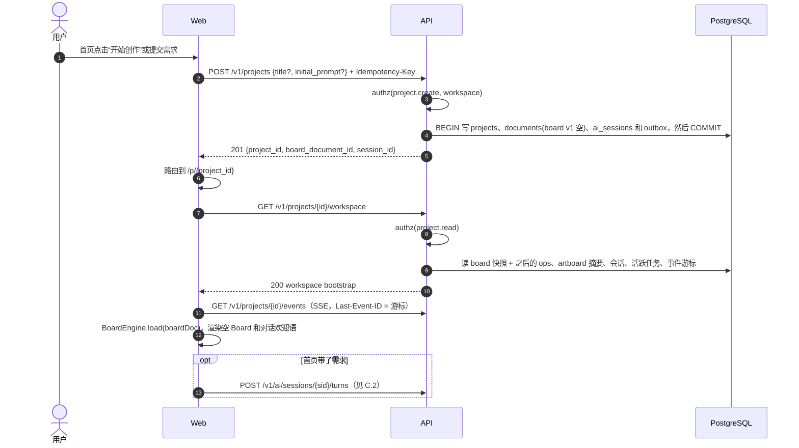
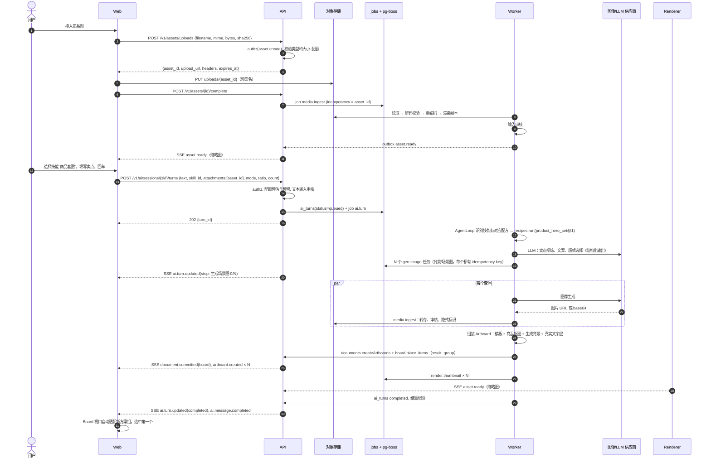
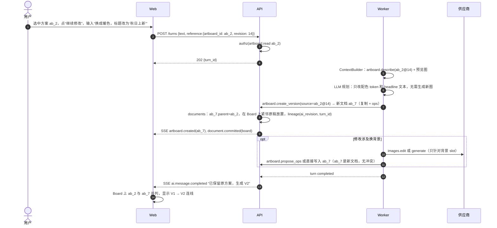
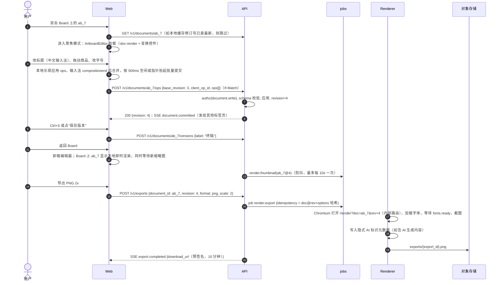
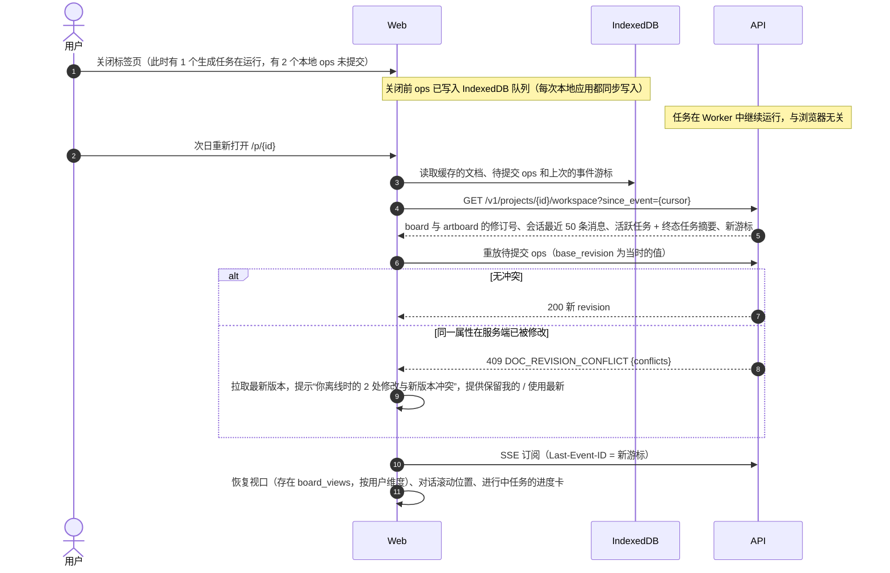
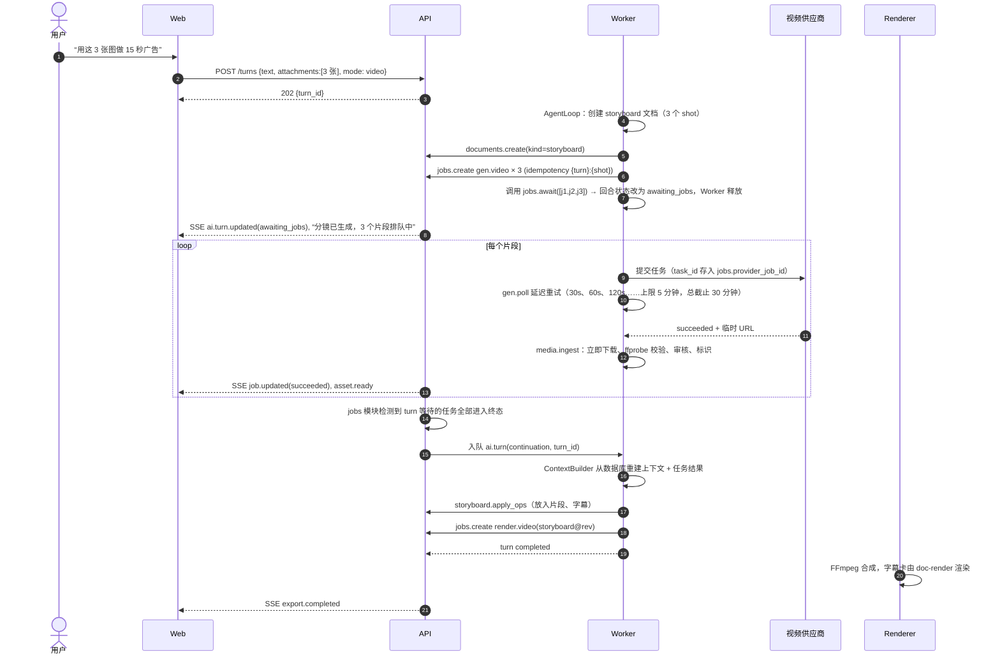
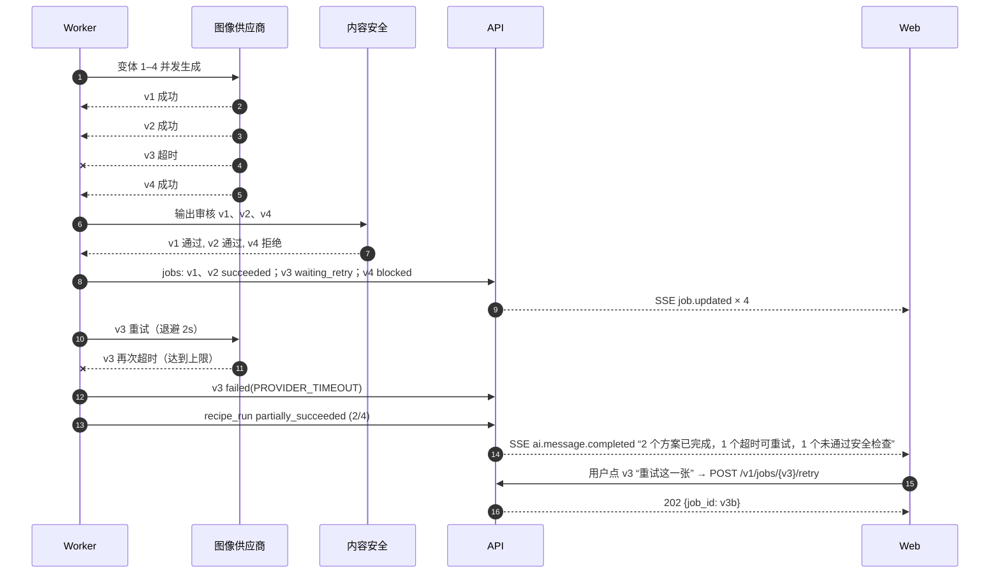
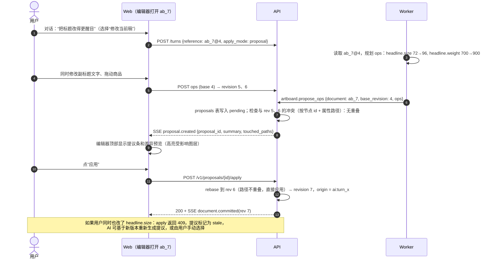

# Part 3 · 用户旅程与时序图（交付物 C）

每条流程都列出：**真相源（System of Record, SoR）**、API 调用与事件、任务状态迁移、幂等策略、授权检查和用户可见反馈。端点和事件的完整契约见 Part 7。

通用约定：

- 所有写请求带 `Idempotency-Key` 头（客户端 UUIDv7），服务端在 `idempotency_keys` 表保存 24 小时。
- 授权检查记作 `authz(action, resource)`。资源不存在和无权限都返回 `404`，避免泄露资源是否存在。
- 事件通过 SSE `GET /v1/projects/{id}/events` 推送，信封格式见 Part 7 §G.6。

---

## C.1 创建项目并打开 AI 无限画布工作区

| 项目 | 内容 |
|---|---|
| SoR | `projects`、`documents`（kind=board）、`ai_sessions` |
| 幂等 | `Idempotency-Key` 重放时返回同一个 `project_id`，避免双击建出两个项目 |
| 授权 | workspace 成员才能建项目；读 bootstrap 需要项目读权限 |
| 用户反馈 | 骨架屏 → 欢迎语与技能面板（沿用原型 `st-greeting`）；SSE 断线时顶部显示“正在重连”提示 |
| 与原型差异 | 原型“新建创作”会替换唯一的本地会话；新方案每个项目都有独立会话，可以有多个会话 |

---

## C.2 上传商品图 → 选择技能 → 提交 → 在 Board 上生成多个可编辑方案

| 项目 | 内容 |
|---|---|
| SoR | `assets`（素材与生成图）、`documents`（Artboard 和 Board 条目）、`ai_turns`、`ai_tool_calls`、`jobs`、`usage_ledger` |
| 任务状态 | `media.ingest`：queued → running → succeeded / blocked；`gen.image`：queued → dispatching → running → ingesting → moderating → succeeded / failed / blocked；`ai_turns`：queued → running → awaiting_jobs → running → completed |
| 幂等 | 上传以 `asset_id` 为键；回合以 `Idempotency-Key` 为键；`gen.image` 以 `{turn_id}:{step}:{variant}` 为键；文档写入以 `client_op_id` 为键 |
| 授权 | 附件必须属于同一 workspace 且可读；Agent 工具只能作用于 `session.project_id` |
| 用户反馈 | 对话中的步骤进度条（沿用原型三阶段，改为**真实**步骤）；Board 上先出现占位卡片（“生成中 2/4”），完成后替换；部分失败时卡片显示“重试这一张” |
| 可编辑性保证 | 文字、Logo、价格标签等都是真实 text/image 节点；模型只生成**像素区域**（背景、场景）。商品主体默认用**抠图后合成**，以保证保真 [假设：M0 验证] |

---

## C.3 选中方案 → 对话修改 → 原稿与新版本并存

| 项目 | 内容 |
|---|---|
| SoR | 原稿 `ab_2` **不变**；新版本 `ab_7` 是新文档，`parent_document_id = ab_2`，`created_from = {kind: ai_revision, turn_id, base_revision: 14}` |
| 默认语义 | **新版本**（AD-10）。用户如需“就地修改当前稿”，在输入框切换“修改当前稿”，AI 改为生成 Proposal（见 C.8） |
| 幂等 | 回合幂等键；`create_version` 以 `{turn_id}:{source_id}` 去重 |
| 授权 | 对 `ab_2` 需有读权限，在项目内写 Board 需有写权限 |
| 用户反馈 | 新卡片带“V2 · 来自 V1”徽标；对话显示“改了什么”的结构化摘要，如“配色：温暖奶油；主标题：秋日上新” |
| 与原型对应 | 原型的 `resolveStudioBrief(previous, revision)` 与 `version` 逻辑升级为真实的文档谱系 |

---

## C.4 打开 Artboard 精细编辑 → 保存 → 回到 Board → 导出

| 项目 | 内容 |
|---|---|
| SoR | `document_ops` 加 `document_snapshots`；导出产物为 `exports` 加 `assets(kind=export)` |
| 自动保存 | 没有“未保存”概念：每个提交批次都持久化。“保存版本”只是给某个修订号打命名标签。断网时 ops 进入 IndexedDB 队列，恢复后续传（Part 4 §D.5） |
| 幂等 | `client_op_id` 唯一；同一 `doc@rev + 导出参数` 的导出在 24h 内复用已有产物 |
| 授权 | 写 ops 需有 `document.write`；导出需有 `document.read`；下载 URL 绑定导出的所有者 |
| 一致性保证 | 导出用的渲染器与编辑器是同一个 `doc-render`，字体文件也是同一份（Part 4 §D.6） |
| 用户反馈 | 标题栏显示“已同步 / 同步中 / 离线（N 项待同步）”；导出显示进度，完成后自动下载 |

---

## C.5 离开并重新打开项目：恢复对话、画布、素材与任务

| 项目 | 内容 |
|---|---|
| SoR | 全部在服务端：对话 `ai_messages`、Board 和 Artboard `documents`、素材 `assets`、任务 `jobs`。IndexedDB 只是缓存和未提交 ops 的暂存 |
| 恢复内容 | 对话（分页加载）、Board（快照 + ops）、视口（`board_views` 表，按用户和 Board）、选中状态（不持久化）、运行中任务（状态与进度来自 `jobs`）、Agent 回合（终态或 `awaiting_jobs`） |
| 幂等 | 重放的 ops 用原 `client_op_id`；如果服务端已应用过，返回原结果而不是重复应用 |
| 用户反馈 | “已恢复：3 个方案在你离开期间生成完成”的提示条；冲突时用明确的对比视图 |
| 与原型差异 | 原型把运行中的生成标为“已暂停”，因为计时器在浏览器里；真实任务在服务端继续运行 |

---

## C.6 长时视频 / 分镜任务与事件驱动续跑（Phase 3，先定契约）

| 项目 | 内容 |
|---|---|
| SoR | `documents(kind=storyboard)`、`jobs`、`assets(kind=video_clip)`、`ai_turns.waiting_on_job_ids` |
| 关键设计 | **没有任何进程在等待期间持有状态**；续跑回合可在任意 Worker 执行；用户关闭浏览器不影响任务 |
| 幂等 | 每个 shot 一个幂等键；续跑以 `turn_id + continuation_seq` 去重，防止多个任务同时完成时重复触发 |
| 用户反馈 | 分镜卡片逐个变成可播放的片段；任务中心显示“排队 / 生成中 / 已完成 2/3” |

---

## C.7 失败路径

### C.7.1 汇总表

| 场景 | 检测 | 任务状态迁移 | 系统行为 | 用户可见反馈 |
|---|---|---|---|---|
| 供应商超时 | 同步调用超过 `timeout_ms`；异步任务超过 `deadline_at` | running → **waiting_retry** → running（退避）→ 超过次数上限则 **failed**(`PROVIDER_TIMEOUT`) | 指数退避（基数 2s，上限 60s，最多 3 次），带抖动；不自动换供应商（AD-11） | “这一张生成超时，可重试”；回合仍会完成其他变体 |
| 部分成功 | N 个变体中有 k 个成功 | 父级 `recipe_run` → **partially_succeeded** | 成功的变体正常落到 Board；失败的保留占位卡和原参数 | 方案组标题显示“3/4 完成”，失败卡显示“重试这一张”（只重试这一张） |
| 用户取消 | `POST /v1/ai/turns/{id}/cancel` 或 `/jobs/{id}/cancel` | turn → **cancelled**；子任务：queued 直接 **cancelled**；running 先置 `cancel_requested`，若供应商支持取消就取消，否则等结果返回后丢弃并 **cancelled** | 已产生的成本照实记账；已完成的产物按用户选择保留或丢弃（默认保留） | 对话显示“已停止，已完成的 2 张保留在画布上” |
| 用户重试 | `POST /v1/jobs/{id}/retry` | 创建**新任务**，`retry_of = 原任务`（原任务终态不变） | 复用原输入快照；用户可修改参数后重试 | 新占位卡替换失败卡 |
| 审核拒绝（输入） | 提交前文本/图片审核 | 回合 → **failed**(`MODERATION_INPUT_REJECTED`)，不调用模型 | 不消耗生成配额；在 `moderation_events` 留痕 | “提示词包含不支持生成的内容”（不暴露具体规则） |
| 审核拒绝（输出） | `media.ingest` 审核阶段 | 任务 → **blocked** | 产物进入隔离区，不对用户可见，按保留策略删除 | 占位卡显示“该结果未通过内容安全检查”，提供“换个说法重试” |
| 配额超限 | 提交时预估 + 预留；执行中实际扣减超出 | 提交被拒，返回 `429 QUOTA_EXCEEDED`；执行中超出则回合 → **failed**(`BUDGET_EXHAUSTED`) 并保留已完成部分 | 预留未用完的部分会返还 | 显示剩余额度和重置时间 |
| 输出 URL 过期 | ingest 下载返回 403/404 | ingesting → waiting_retry；若供应商支持按 task_id 重新取 URL 则重取；否则 **failed**(`OUTPUT_EXPIRED`) | 正常情况下拿到 URL 就立即 ingest，过期只出现在 Worker 长时间宕机后；对账任务会补偿 | “结果已过期，可免费重新生成”（不扣配额） |
| Worker 崩溃 | pg-boss 心跳或过期 | 投递层重新投递；业务状态由处理器按阶段幂等续做 | 对账任务每 5 分钟扫描卡住的任务（`updated_at` 超过阈值），重新查询供应商状态 | 无感知或仅有延迟 |

### C.7.2 时序：部分成功 + 重试 + 审核拦截

---

## C.8 用户编辑时 AI 正在准备修改（并发）

场景：用户让 AI“把所有标题改得更醒目”，同时自己在编辑 `ab_7` 的副标题和商品位置。

| 项目 | 内容 |
|---|---|
| SoR | 文档 `document_ops`；提议 `proposals`（pending / applied / rejected / stale） |
| 冲突判定 | 以 `(node_id, property_path)` 为粒度。插入/删除节点与对该节点的属性修改视为冲突；同一父节点下的不同节点插入不冲突（用分数索引） |
| 撤销 | 应用后的提议是**一个事务**，可以“撤销 AI 修改”（服务端用 `document_ops.inverse` 反向应用）；用户自己的本地撤销栈不包含 AI 修改（AI 修改通过远端事件到达，不进入本地 history） |
| 授权 | 应用提议需要 `document.write`；提议创建者（AI 回合）必须属于同一项目会话 |
| 用户反馈 | 提议条显示“AI 建议修改 2 处：标题字号、字重”，可预览、应用、拒绝；stale 时显示“文档已变化，重新生成建议” |
