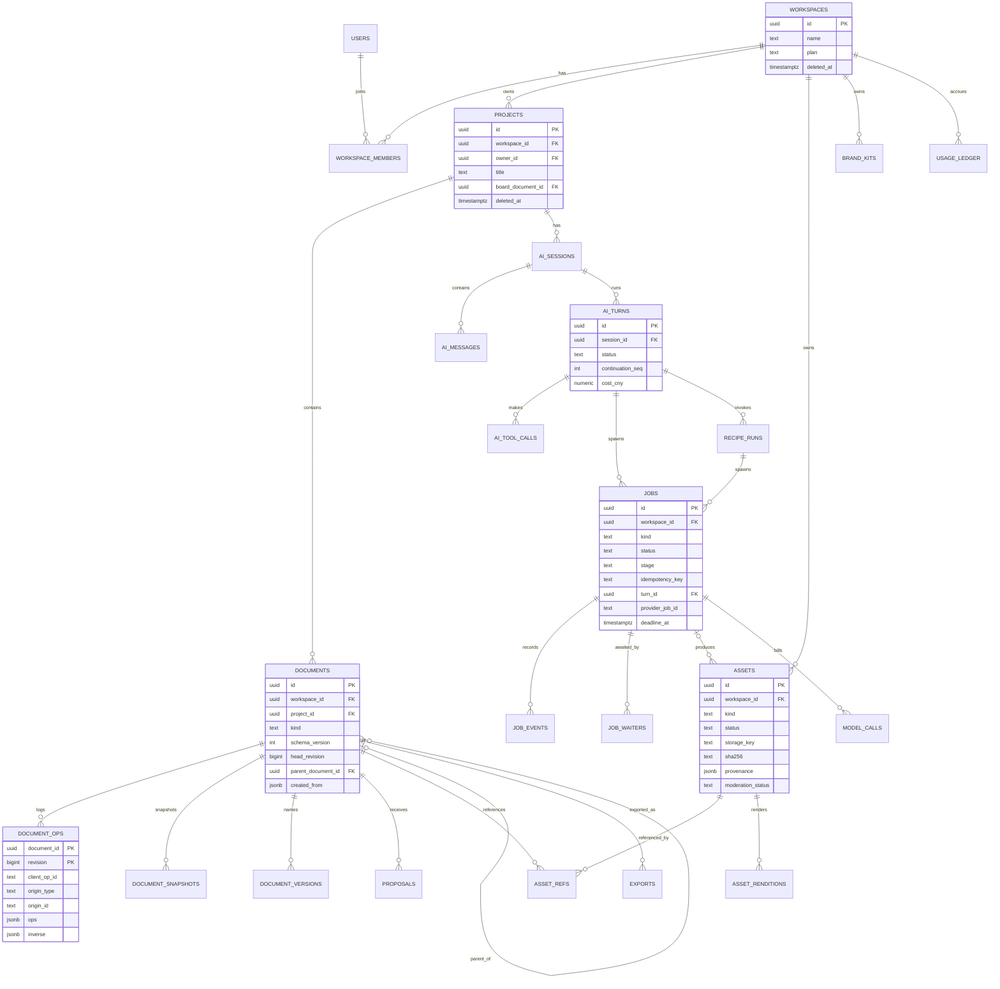
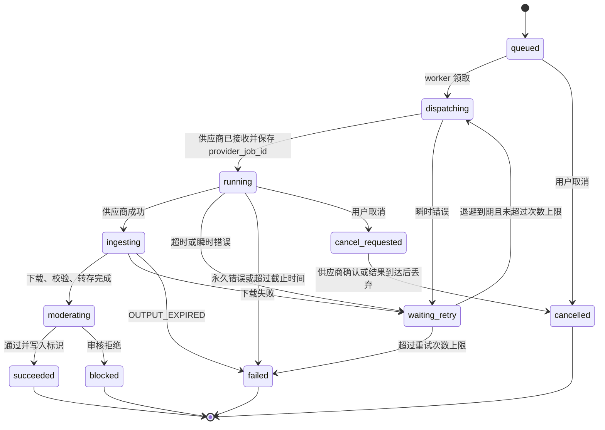
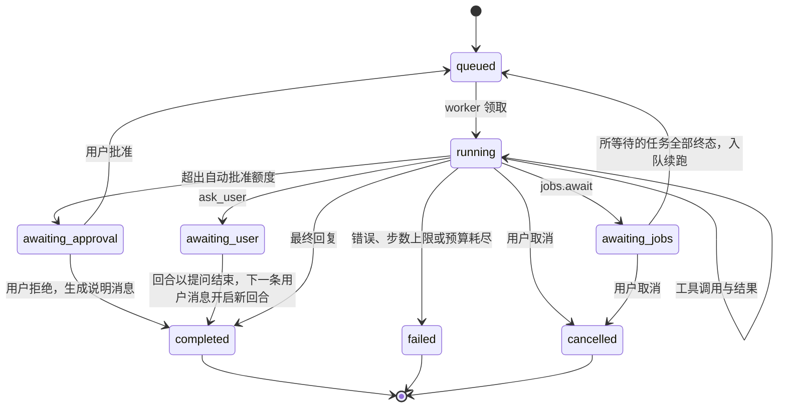

# Part 7 · 数据与接口（交付物 G）

## G.1 核心领域模型

XLSX 中的业务对象 O01–O10 与本方案实体的映射：

| 资料对象 | 本方案实体 | 说明 |
|---|---|---|
| O01 创作需求 Brief | `ai_messages`（用户消息）+ `recipe_runs.input` | Brief 是结构化输入快照，不单独建表 |
| O02 输入素材 Asset | `assets(source=upload)` | 带来源与使用权声明（`rights` 字段） |
| O03 商品/品牌/角色资料 | `brand_kits`（MVP）；`product_profiles`、`characters`（Phase 2） | — |
| O04 场景任务配方 Skill | 技能目录（`packages/recipes/catalog`）+ 配方定义（代码）+ `recipe_runs` | 技能 ≠ 模型 ≠ 模板 |
| O05 视觉模板 Template | `templates`（Artboard 文档快照 + slot 元数据） | — |
| O06 创作任务与子任务 | `ai_turns`、`recipe_runs`、`jobs`（`parent_job_id`） | — |
| O07 候选产物 Result | `documents(kind=artboard)` 与 Board 上的 `result_group` | 候选就是可编辑 Artboard，不是图片 |
| O08 设计文档、页面与元素 | `documents` + Creative Document schema | — |
| O09 项目与文件夹 | `projects`、`folders` | — |
| O10 导出规格与交付文件 | `exports` + `assets(kind=export)` | 导出 ≠ 源文档 |

## G.2 ER 图



## G.3 表设计（关键字段、索引、关系、保留与删除）

> 所有表都包含 `created_at`、`updated_at`（timestamptz）。凡含 `workspace_id` 的表都启用 RLS 策略：`workspace_id = current_setting('app.workspace_id')::uuid`。主键用 UUIDv7（按时间有序）。

| 表 | 关键字段 | 索引与约束 | 保留与删除 |
|---|---|---|---|
| `users` | id、phone_e164、email、display_name、status | unique(phone_e164)、unique(email) | 注销后 30 天匿名化 |
| `workspaces` | id、name、plan、owner_id | — | 随用户注销流程处理 |
| `workspace_members` | workspace_id、user_id、role | PK(workspace_id, user_id) | — |
| `projects` | id、workspace_id、owner_id、title、folder_id、board_document_id、last_opened_at、deleted_at | (workspace_id, updated_at desc)、`pg_trgm` 索引(title) | 软删除 → 30 天回收站 → 硬删除（级联文档和 ops；资产按引用计数 GC） |
| `folders` | id、workspace_id、parent_id、name | (workspace_id, parent_id) | 同项目 |
| `documents` | id、workspace_id、project_id、kind(`board`/`artboard`/`storyboard`)、schema_version、head_revision、head_snapshot_id、title、parent_document_id、created_from(jsonb: `{kind: recipe/ai_revision/template/duplicate/blank, turn_id, recipe_run_id, base_revision}`)、thumb_asset_id、deleted_at | (project_id, kind)、(parent_document_id) | 随项目删除 |
| `document_ops` | document_id、revision、base_revision、client_op_id、actor_id、origin_type(`user`/`ai`/`recipe`/`system`)、origin_id、ops(jsonb)、inverse(jsonb) | PK(document_id, revision)；unique(document_id, client_op_id)；(origin_type, origin_id) | 已被快照覆盖、且早于 90 天的 ops 压缩归档到对象存储（仍可用于审计和撤销 AI） |
| `document_snapshots` | id、document_id、revision、content(jsonb，> 1MB 时存对象存储并记 `storage_key`) | (document_id, revision desc) | 每个文档保留最近 20 个快照，以及所有命名版本对应的快照 |
| `document_versions` | id、document_id、revision、label、created_by | (document_id) | 用户删除前保留 |
| `proposals` | id、document_id、base_revision、ops、summary、touched_paths(text[])、status(`pending`/`applied`/`rejected`/`stale`)、turn_id、applied_revision | (document_id, status) | 已结束的提议 30 天后清理 |
| `board_views` | board_document_id、user_id、camera(jsonb) | PK(board_document_id, user_id) | — |
| `assets` | id、workspace_id、project_id(可空 = 素材库)、kind(`upload`/`generated`/`derived`/`export`/`video_clip`/`font`)、status(`pending_upload`/`ingesting`/`ready`/`blocked`/`deleted`)、storage_key、mime、bytes、width、height、duration_ms、sha256、provenance(jsonb)、rights(jsonb)、moderation_status、ai_generated(bool)、retention_class | (workspace_id, project_id, created_at desc)、(workspace_id, sha256) 用于去重 | `uploads/` 未完成的 1 天后删；`blocked` 7 天后删；`generated` 且引用为零的 30 天后删；`export` 30 天后删（可重新导出） |
| `asset_renditions` | asset_id、kind(`thumb_256`/`preview_1024`/`display_2048`)、storage_key、width、height | PK(asset_id, kind) | 随资产删除 |
| `asset_refs` | asset_id、document_id、count | PK(asset_id, document_id) | 快照写入时由 doc-core 提取引用后更新 |
| `ai_sessions` | id、workspace_id、project_id、title、summary、status | (project_id, updated_at desc) | 随项目删除 |
| `ai_messages` | id、session_id、role(`user`/`assistant`/`tool`/`system`)、content(jsonb：文本、附件引用、结构化卡片)、turn_id | (session_id, id) | 随会话删除 |
| `ai_turns` | id、session_id、status、trigger(`user`/`continuation`)、continuation_seq、step_count、budget(jsonb)、cost_cny、waiting_on(uuid[])、error_code | (session_id, created_at)、(status) where status in ('running', 'awaiting_jobs') | 随会话删除 |
| `ai_tool_calls` | id、turn_id、step、tool、input、output、status、latency_ms、cost_cny、idempotency_key | unique(idempotency_key) | 180 天后裁剪 input/output 正文，只保留元数据 |
| `model_calls` | id、workspace_id、turn_id、job_id、provider、model_id、model_version、units(jsonb)、cost_cny、latency_ms、request_hash、status | (workspace_id, created_at) | 1 年（成本审计） |
| `recipe_runs` | id、recipe_id、recipe_version、project_id、turn_id、input、status、result_document_ids | (project_id) | 随项目删除 |
| `templates` | id、version、category、ratio、content(jsonb)、slots(jsonb)、license(jsonb)、status | (category, status) | 版本永久保留 |
| `jobs` | id、workspace_id、project_id、kind、status、stage、priority、input、output、idempotency_key、parent_job_id、retry_of、turn_id、recipe_run_id、provider、provider_job_id、attempts、max_attempts、next_attempt_at、deadline_at、cancel_requested_at、error_code、error_detail | unique(workspace_id, idempotency_key)；(status, next_attempt_at)；(provider, provider_job_id) | 终态 90 天后归档 |
| `job_events` | job_id、seq、from_status、to_status、detail | PK(job_id, seq) | 同 jobs |
| `job_waiters` | job_id、waiter_type(`turn`/`recipe_run`)、waiter_id | PK(job_id, waiter_type, waiter_id) | 终态时删除 |
| `exports` | id、document_id、revision、format、options、options_hash、status、asset_id、job_id | unique(document_id, revision, options_hash) | 30 天 |
| `quota_limits` | plan/workspace_id、metric、period、limit | — | — |
| `quota_reservations` | id、workspace_id、metric、amount、status、expires_at | (workspace_id, status) | 7 天 |
| `usage_ledger` | id、workspace_id、metric、amount、cost_cny、source_type、source_id | (workspace_id, created_at) | 只追加，保留 2 年 |
| `moderation_events` | id、workspace_id、subject_type、subject_id、stage(`input`/`output`)、provider、verdict、labels | (subject_type, subject_id) | 按法规要求保留（[待定]，默认 1 年） |
| `audit_log` | id、workspace_id、actor_id、action、target、ip、ua | (workspace_id, created_at) | 180 天（提议） |
| `outbox` | id(bigserial)、project_id、type、payload、created_at | (project_id, id) | 24 小时后删除 |
| `idempotency_keys` | workspace_id、key、request_hash、response(jsonb)、status | PK(workspace_id, key) | 24 小时 |
| `fonts` | id、family、weights、license(jsonb：type、source、allowed_uses)、files(jsonb)、status | — | — |
| `brand_kits` | id、workspace_id、name、tokens(jsonb：colors、font_refs、logo_asset_ids) | (workspace_id) | 随工作空间 |

## G.4 Creative Document schema（版本化）

### G.4.1 设计原则

1. **两类文档**：`designx.board`（空间组织）和 `designx.artboard`（可编辑场景）；Phase 3 加入 `designx.storyboard`。
2. **按 id 寻址**：节点用稳定 id，顺序用 `children` 数组或分数索引键，op 不依赖数组下标。
3. **语义角色**：`role`（headline、subheadline、body、product、background、logo、cta、price、badge、decoration）。AI 靠角色定位节点，而不是推理坐标。
4. **资产引用固定版本**：`{ "asset": "ast_…", "rev": 1 }`，确保旧文档永远渲染出相同结果。
5. **字体用 `font_ref`**，并关联字体注册表的许可。
6. **约束**：`constraints` 用于确定性改尺寸。
7. **token**：颜色、字体可以引用品牌 token（`{"token": "brand.primary"}`），在渲染时解析。
8. **schema_version** 加上迁移函数链 `migrate_v{n}_to_v{n+1}`。

### G.4.2 Board 文档示例（schema_version 1）

```json
{
  "schema": "designx.board",
  "schema_version": 1,
  "id": "doc_brd_01J9Z8K2",
  "project_id": "prj_01J9Z8K0",
  "items": {
    "bi_group_1": { "kind": "result_group", "z": "a0", "frame": { "x": 0, "y": 0, "w": 1960, "h": 980 },
                    "title": "无线耳机 · 商品套图", "origin": { "turn_id": "turn_01J9Z9", "recipe_run_id": "rr_01J9Z9" } },
    "bi_ab_1":    { "kind": "artboard_ref", "z": "a1", "parent": "bi_group_1", "artboard_id": "doc_ab_01J9ZA",
                    "frame": { "x": 40, "y": 80, "w": 600, "h": 800 } },
    "bi_ab_2":    { "kind": "artboard_ref", "z": "a2", "parent": "bi_group_1", "artboard_id": "doc_ab_01J9ZB",
                    "frame": { "x": 680, "y": 80, "w": 600, "h": 800 } },
    "bi_asset_1": { "kind": "asset", "z": "a3", "asset": { "id": "ast_01J9Z7", "rev": 1 },
                    "frame": { "x": -420, "y": 80, "w": 320, "h": 320 } },
    "bi_note_1":  { "kind": "note", "z": "a4", "text": "客户偏好绿色系，避免金色", "frame": { "x": -420, "y": 440, "w": 320, "h": 120 } },
    "bi_ph_1":    { "kind": "placeholder", "z": "a5", "parent": "bi_group_1", "job_id": "job_01J9ZC",
                    "frame": { "x": 1320, "y": 80, "w": 600, "h": 800 }, "label": "生成中" }
  },
  "lineage": [
    { "from": "doc_ab_01J9ZB", "to": "doc_ab_01J9ZD", "relation": "ai_revision", "turn_id": "turn_01J9ZE" }
  ]
}
```

### G.4.3 Artboard 文档示例（schema_version 1）

```json
{
  "schema": "designx.artboard",
  "schema_version": 1,
  "id": "doc_ab_01J9ZA",
  "size": { "w": 1080, "h": 1440, "unit": "px" },
  "background": { "fill": { "token": "brand.surface", "fallback": "#E9EEE2" } },
  "brand_kit": { "id": "bk_01J9Y0", "rev": 3 },
  "template": { "id": "tpl_hero_split_v", "version": 2 },
  "fonts": [
    { "ref": "font_source_han_sans_sc", "weights": [400, 700] },
    { "ref": "font_lxgw_wenkai", "weights": [400] }
  ],
  "root": {
    "id": "root", "type": "frame", "children": ["n_bg", "n_product", "n_headline", "n_sub", "n_badge", "n_logo"]
  },
  "nodes": {
    "n_bg": {
      "id": "n_bg", "type": "image", "role": "background", "slot_id": "bg",
      "transform": { "x": 0, "y": 0, "w": 1080, "h": 1440, "rotation": 0 },
      "constraints": { "h": "stretch", "v": "stretch" },
      "image": { "asset": { "id": "ast_gen_01J9ZF", "rev": 1 }, "fit": "cover", "crop": null },
      "ai": { "editable": true, "regenerable": true },
      "provenance": { "kind": "generated", "job_id": "job_01J9ZF" }
    },
    "n_product": {
      "id": "n_product", "type": "image", "role": "product", "slot_id": "product",
      "transform": { "x": 240, "y": 420, "w": 600, "h": 720, "rotation": 0 },
      "constraints": { "h": "center", "v": "scale" },
      "image": { "asset": { "id": "ast_cut_01J9ZG", "rev": 1 }, "fit": "contain" },
      "effects": [{ "type": "shadow", "x": 0, "y": 24, "blur": 48, "color": "#00000033" }],
      "ai": { "editable": true, "regenerable": false },
      "provenance": { "kind": "derived", "from": { "id": "ast_01J9Z7", "rev": 1 }, "op": "cutout" }
    },
    "n_headline": {
      "id": "n_headline", "type": "text", "role": "headline", "slot_id": "headline",
      "transform": { "x": 96, "y": 120, "w": 888, "h": 220, "rotation": 0 },
      "constraints": { "h": "stretch", "v": "top" },
      "text": {
        "spans": [
          { "text": "安静，", "style": {} },
          { "text": "是新的力量", "style": { "fill": { "token": "brand.primary", "fallback": "#314537" } } }
        ],
        "style": {
          "font_ref": "font_source_han_sans_sc", "weight": 700, "size": 96, "line_height": 1.15,
          "letter_spacing": 0, "align": "left", "writing_mode": "horizontal-tb",
          "fill": { "token": "brand.ink", "fallback": "#1F2A22" }
        },
        "fit": "shrink", "max_lines": 2, "lang": "zh-CN"
      },
      "ai": { "editable": true }
    },
    "n_sub": {
      "id": "n_sub", "type": "text", "role": "subheadline",
      "transform": { "x": 96, "y": 350, "w": 760, "h": 60, "rotation": 0 },
      "constraints": { "h": "left", "v": "top" },
      "text": { "spans": [{ "text": "40 小时续航 · 主动降噪", "style": {} }],
                "style": { "font_ref": "font_source_han_sans_sc", "weight": 400, "size": 36, "line_height": 1.3,
                           "align": "left", "fill": { "fallback": "#45524A" } }, "fit": "none", "lang": "zh-CN" },
      "ai": { "editable": true }
    },
    "n_badge": {
      "id": "n_badge", "type": "group", "role": "badge", "children": ["n_badge_bg", "n_badge_txt"],
      "transform": { "x": 800, "y": 1180, "w": 200, "h": 200, "rotation": 0 },
      "constraints": { "h": "right", "v": "bottom" }
    },
    "n_badge_bg": { "id": "n_badge_bg", "type": "shape", "shape": { "kind": "ellipse" },
                    "transform": { "x": 0, "y": 0, "w": 200, "h": 200, "rotation": 0 },
                    "fill": { "token": "brand.accent", "fallback": "#D5E7A8" } },
    "n_badge_txt": { "id": "n_badge_txt", "type": "text",
                     "transform": { "x": 20, "y": 70, "w": 160, "h": 60, "rotation": 0 },
                     "text": { "spans": [{ "text": "新品", "style": {} }],
                               "style": { "font_ref": "font_lxgw_wenkai", "weight": 400, "size": 44, "align": "center",
                                          "fill": { "fallback": "#314537" } }, "fit": "shrink", "lang": "zh-CN" } },
    "n_logo": {
      "id": "n_logo", "type": "image", "role": "logo", "locked": true,
      "transform": { "x": 96, "y": 1320, "w": 180, "h": 60, "rotation": 0 },
      "constraints": { "h": "left", "v": "bottom" },
      "image": { "asset": { "id": "ast_logo_01J9Y1", "rev": 2 }, "fit": "contain" },
      "ai": { "editable": false }
    }
  },
  "meta": { "ai_generated_content": true, "source": { "kind": "recipe", "recipe": "product_hero_set@1", "recipe_run_id": "rr_01J9Z9" } }
}
```

### G.4.4 节点类型（schema v1）

| type | 必需字段 | 可选字段 |
|---|---|---|
| `frame`（仅 root） | children | clip |
| `group` | children、transform | — |
| `text` | transform、text.spans、text.style.font_ref、size | fit、max_lines、writing_mode、lang、effects |
| `image` | transform、image.asset | fit、crop、mask、filters、effects |
| `shape` | transform、shape.kind（`rect`、`ellipse`、`line`、`path`） | fill、stroke、radius、path_data |
| 公共 | id、type | name、role、slot_id、constraints、opacity、visible、locked、ai、provenance |

### G.4.5 从原型 `design` v0 迁移

原型结构为 `{width, height, background, nodes: [{id, type: image|text|rect|circle, x, y, w, h, src|text, size, color, weight, font, align, opacity, hidden, locked}]}`。

`migrate_v0_to_v1` 的规则：

- `rect` 映射为 `shape(rect)`，`circle` 映射为 `shape(ellipse)`。
- `src` 中的 data URL 先上传成资产，再写为 `image.asset`。
- `font` 字符串映射到最接近的 `font_ref`：苹方或雅黑映射为思源黑体，Georgia 映射为思源宋体。
- 数组顺序转为 `root.children`。
- `hidden` 转为 `visible: false`。
- `role` 根据 id 推断：`title` → headline，`photo` → background 或 product，`brand` → logo。

这个迁移函数也作为一次性导入工具，把用户在 localStorage 中的原型项目导入云端（Part 10 §J.6）。

## G.5 文档操作 API

### G.5.1 操作词汇

**基础操作（持久化格式，所有语言与进程只认这些）**

| op | 字段 | 说明 |
|---|---|---|
| `set` | `node`、`path`（如 `["text","style","size"]`）、`value` | 设置属性；`value: null` 表示删除可选属性 |
| `insert_node` | `node`（完整节点）、`parent`、`index_key` 或 `after` | 插入 |
| `remove_node` | `node` | 删除（连同子节点；inverse 保存完整子树） |
| `move_node` | `node`、`parent`、`index_key` | 改父节点或改顺序 |
| `set_doc` | `path`、`value` | 文档级属性（size、background、fonts） |

Board 文档对应的操作是 `insert_item`、`set_item`、`remove_item`、`set_lineage`。

**语义操作（AI 工具与 UI 便捷函数，由 doc-core 编译成基础操作）**：`replace_text(role|node, text)`、`set_style`、`swap_asset(node, asset)`、`move_by(node, dx, dy)`、`apply_token(token, value)`、`resize_artboard(w, h)`（按约束重排）、`apply_template(template, slot_map)`。

### G.5.2 提交

```http
POST /v1/documents/doc_ab_01J9ZA/ops
If-Match: "14"
Idempotency-Key: 0193b2f1-6a1e-7c2a-9d77-4c1e0f3a9b10
Content-Type: application/json

{
  "client_op_id": "c_7f3a",
  "base_revision": 14,
  "origin": { "type": "user" },
  "ops": [
    { "op": "set", "node": "n_headline", "path": ["text", "spans", 0, "text"], "value": "秋日，" },
    { "op": "set", "node": "n_product", "path": ["transform", "x"], "value": 300 }
  ]
}
```

```json
200 OK
{ "revision": 15, "applied_at": "2026-10-30T08:12:03.512Z" }
```

```json
409 Conflict  (application/problem+json)
{
  "type": "https://designx.example/problems/doc-revision-conflict",
  "title": "Document revision conflict",
  "status": 409,
  "code": "DOC_REVISION_CONFLICT",
  "detail": "Properties changed since base revision 14",
  "head_revision": 16,
  "conflicts": [{ "node": "n_headline", "path": ["text", "spans", 0, "text"], "by": { "type": "ai", "id": "turn_01J9ZE" } }],
  "retryable": true
}
```

### G.5.3 并发与 rebase 规则

1. `base_revision == head`：直接应用。
2. `base_revision < head`：取 `(base, head]` 区间内所有 ops 的触达集合 `touched = {(node, path 前缀)}`，与本次 ops 求交：
   - 无交集：服务端自动 rebase，按 id 寻址无需变换，然后应用；
   - 有交集：返回 409。
3. 节点删除与对该节点的任意修改视为冲突；在同一父节点下插入不同节点不冲突（分数索引键）。
4. 所有校验都在 doc-core 中：schema 校验、引用的资产存在且属于同一 workspace、字体存在且有授权、数值范围（尺寸 ≤ 16384px、文本 ≤ 5000 字）。

### G.5.4 撤销与重做

- 客户端：维护本地 inverse 栈；撤销就是提交一批新的 ops（`origin.type = user`，`meta.undo_of = client_op_id`）。
- AI 撤销：`POST /v1/documents/{id}/revert {origin: {type: "ai", id: "turn_x"}}`。服务端取出该来源的 inverse ops 逆序应用；如果其中路径之后被用户修改过，就跳过并返回 `partially_reverted`，列出跳过的路径。

### G.5.5 快照与加载

- 每 200 个 ops，或活动 5 分钟后，或创建命名版本时写快照。快照由提交 ops 的进程**在事务外异步生成**（pg-boss 任务 `doc.snapshot`）。
- 加载：`GET /v1/documents/{id}` 返回 `{snapshot_revision, content, ops_since: [...] }`（ops 数量上限 500，超过时服务端先生成快照）。
- `GET /v1/documents/{id}?revision=12`：历史查看（只读），用于版本对比。

### G.5.6 Schema 迁移

- 读取时，如果 `schema_version` 低于当前版本，doc-core 就链式迁移（纯函数，有单元测试和金样本）。
- 写入的快照总是当前版本；op-log 中的旧 ops 不重写，回放前先升级（迁移函数也要能处理 op）。
- 发布约束：新版本前端必须能读 N-1 版本；服务端先发布读能力，再开启写新版本（两阶段发布）。

## G.6 REST API 设计

### G.6.1 约定

- 前缀 `/v1`，JSON 采用 snake_case；时间用 RFC 3339 UTC；ID 带类型前缀（`prj_`、`doc_`、`ast_`、`job_`、`turn_`），便于排查问题。
- 错误格式为 **RFC 9457 `application/problem+json`**，包含 `code`、`retryable`。
- 分页：游标分页 `?limit=50&cursor=…`，响应 `{ "data": [...], "next_cursor": "…" | null }`。
- 幂等：所有 POST 都接受 `Idempotency-Key`；同 key 但请求体不同返回 `409 IDEMPOTENCY_KEY_REUSED`。
- 认证：会话 Cookie + CSRF 双提交令牌（同站部署时可用 SameSite=Lax 加 Origin 校验）。
- 契约来源：`packages/contracts` 中的 Zod schema，生成 OpenAPI 3.1（Part 8）。

### G.6.2 端点清单（MVP）

| 方法 | 路径 | 用途 |
|---|---|---|
| POST | `/v1/auth/otp`、`/v1/auth/verify`、`/v1/auth/logout` | 登录（Better Auth 路由） |
| GET | `/v1/me` | 当前用户与工作空间 |
| POST / GET | `/v1/projects` | 新建、列出项目 |
| GET / PATCH / DELETE | `/v1/projects/{id}` | 详情、重命名或移动、软删除 |
| GET | `/v1/projects/{id}/workspace?since_event=` | 工作区启动包 |
| GET | `/v1/projects/{id}/events` | SSE 事件流 |
| POST | `/v1/assets/uploads` | 申请预签名上传 |
| POST | `/v1/assets/{id}/complete` | 上传完成，触发 ingest |
| GET | `/v1/assets?project_id=&kind=&cursor=` | 素材库 |
| GET | `/v1/assets/{id}`、`/v1/assets/{id}/download` | 详情、下载 URL |
| GET | `/v1/documents/{id}` | 读取文档 |
| POST | `/v1/documents/{id}/ops` | 提交 ops |
| GET | `/v1/documents/{id}/ops?since=` | 增量 ops |
| POST | `/v1/documents/{id}/versions` | 命名版本 |
| POST | `/v1/documents/{id}/revert` | 撤销某来源（AI 回合）的修改 |
| POST | `/v1/documents/{id}/duplicate` | 复制为新 Artboard |
| PUT | `/v1/boards/{id}/view` | 保存视口 |
| POST | `/v1/proposals/{id}/apply`、`/v1/proposals/{id}/reject` | 处理 AI 提议 |
| POST / GET | `/v1/ai/sessions`、`/v1/ai/sessions/{id}/messages?cursor=` | 会话与消息 |
| POST | `/v1/ai/sessions/{id}/turns` | 发起回合 |
| POST | `/v1/ai/turns/{id}/cancel` | 取消回合 |
| POST | `/v1/ai/turns/{id}/approvals/{approval_id}` | 批准或拒绝高成本操作 |
| GET | `/v1/skills`、`/v1/templates?category=&ratio=` | 技能目录、模板 |
| POST | `/v1/recipes/{recipe_id}/runs` | 技能表单直接生成 |
| GET | `/v1/jobs/{id}`、`/v1/jobs?project_id=&status=` | 任务查询（任务中心） |
| POST | `/v1/jobs/{id}/cancel`、`/v1/jobs/{id}/retry` | 取消、重试 |
| POST / GET | `/v1/exports`、`/v1/exports/{id}` | 导出 |
| GET | `/v1/usage` | 配额与用量 |
| GET | `/v1/fonts`、`/v1/brand-kits`；PATCH `/v1/brand-kits/{id}` | 字体、品牌套件 |
| POST | `/v1/providers/callbacks/{provider}` | 供应商回调（签名校验，无会话） |

### G.6.3 示例：发起 AI 回合

```http
POST /v1/ai/sessions/ses_01J9Z8/turns
Idempotency-Key: 0193b2f4-11aa-7e00-8c3d-2b9a5c6d7e8f

{
  "text": "为这款无线耳机设计 3 张电商主图，突出轻盈、降噪和长续航，简洁绿色风格",
  "skill_id": "SC-商品套图",
  "mode": "agent",
  "attachments": [{ "asset_id": "ast_01J9Z7" }],
  "reference": null,
  "apply_mode": "new_version",
  "options": { "ratio": "3:4", "count": 3 }
}
```

```json
202 Accepted
{
  "turn_id": "turn_01J9Z9",
  "status": "queued",
  "quota": { "reserved": { "images": 3 }, "remaining_today": { "images": 37 } }
}
```

### G.6.4 错误码

| HTTP | code | 场景 | retryable |
|---|---|---|---|
| 400 | `VALIDATION_FAILED` | schema 校验失败（含 `errors[]` 指针） | 否 |
| 401 | `UNAUTHENTICATED` | 未登录 | 否 |
| 404 | `NOT_FOUND` | 不存在或无权限（统一返回 404） | 否 |
| 409 | `DOC_REVISION_CONFLICT` | 文档冲突 | 是（rebase 后） |
| 409 | `IDEMPOTENCY_KEY_REUSED` | 幂等键复用但请求体不同 | 否 |
| 409 | `PROPOSAL_STALE` | 提议已过期 | 否（需重新生成） |
| 413 | `PAYLOAD_TOO_LARGE` | 上传或请求体超限 | 否 |
| 415 | `UNSUPPORTED_MEDIA_TYPE` | 文件类型不支持 | 否 |
| 422 | `MODERATION_INPUT_REJECTED` | 输入审核未通过 | 否 |
| 429 | `RATE_LIMITED` | 频率限制（带 `Retry-After`） | 是 |
| 429 | `QUOTA_EXCEEDED` | 配额用尽（带 `resets_at`） | 否（等待重置） |
| 503 | `PROVIDER_UNAVAILABLE` | 供应商不可用（同步路径） | 是 |

## G.7 SSE 事件契约

**信封**

```json
{
  "id": "1734821",
  "type": "job.updated",
  "project_id": "prj_01J9Z8K0",
  "ts": "2026-10-30T08:12:05.004Z",
  "data": { }
}
```

SSE 的 `id:` 字段等于 `outbox.id`。客户端断线后用 `Last-Event-ID` 补发；超过 24 小时返回 `event: resync`，客户端重新拉取启动包。

| type | data 字段 | 触发 |
|---|---|---|
| `document.committed` | document_id、kind、revision、origin{type, id}、ops？（≤ 32KB 时内联，否则客户端自己拉取） | 任意文档提交 |
| `artboard.created` | document_id、board_item_id、created_from | 新 Artboard |
| `proposal.created` / `proposal.updated` | proposal_id、document_id、status、summary、touched_paths | AI 提议 |
| `asset.ready` / `asset.blocked` | asset_id、renditions{thumb_256...}、reason？ | ingest 完成 |
| `job.updated` | job_id、kind、status、stage、progress{done, total}？、error{code, message}？、output_asset_ids？ | 任务状态变化 |
| `ai.turn.updated` | turn_id、status、step、step_label、waiting_on？ | 回合状态变化 |
| `ai.message.delta` | turn_id、message_id、delta（文本片段） | 流式输出 |
| `ai.message.completed` | turn_id、message_id、content（完整结构化内容） | 消息完成 |
| `ai.approval.requested` | turn_id、approval_id、summary、estimated_cost | 需要用户确认 |
| `export.completed` / `export.failed` | export_id、download_url（10 分钟）/ error | 导出 |
| `quota.warning` | metric、remaining、resets_at | 余量 < 20% |
| `resync` | reason | 游标过期 |

## G.8 状态机

### G.8.1 Job 状态机



非生成类任务（`media.process`、`render.export`）跳过 `dispatching`/`moderating`，直接 `queued → running → succeeded / failed`。父级（`recipe_runs`、多变体）另有汇总状态 `partially_succeeded`。

### G.8.2 Agent 回合状态机



## G.9 资产生命周期与供应商输出摄取

```text
upload:     pending_upload ──complete──► ingesting ──► ready | blocked
generated:  （job 内）provider output ──ingest──► ingesting ──► ready | blocked
derived:    （cutout / resize）──► ingesting ──► ready
export:     （render）──► ready（30 天）
所有资产：  ready ──（引用为零 + 保留期到期，或用户删除）──► deleted（对象删除，行保留 30 天用于审计）
```

**所有权**：资产属于 workspace；`project_id` 为空时放在素材库，可跨项目引用。生成资产的 `provenance` 不可修改。素材 `rights` 记录用户声明，例如“我拥有或获授权使用该素材”（资料 D07）。

**供应商输出摄取规则**

1. 同步返回 base64：直接流式写入 `tmp/`，然后 ingest。
2. 返回 URL：Worker 立即流式下载（限时 60s，大小上限按能力配置，只允许供应商域名白名单），写 `tmp/` 后 ingest。
3. 校验：真实 MIME、尺寸与时长在能力注册表限制内，解码成功。
4. 重编码：图片转 WebP 或 PNG（保留透明），写入隐式标识元数据；视频转码为 H.264/AAC MP4 [待定：编解码专利评估]。
5. 审核 → `ready` 或 `blocked`。
6. 只有 `ready` 的资产才会被写入文档；`blocked` 资产不会出现在 Board 上，也不会签发访问 URL。
