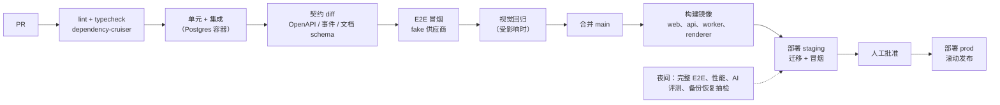

# Part 8 · 仓库与工程组织（交付物 H）

## H.1 Monorepo 还是多仓库

| 选项 | 优点 | 缺点 | 结论 |
|---|---|---|---|
| **Monorepo（pnpm workspaces + Turborepo）** | `doc-core`、`contracts`、`doc-render` 被前端、API、Worker、Renderer 同时使用，原子提交、一次评审；一致的工具链；契约改动可立即发现破坏 | 需要 CI 增量构建和缓存 | **推荐** |
| 多仓库 | 权限隔离 | 共享包要发版，版本漂移；文档 ops 不一致的风险高 | 拒绝 |

工具：pnpm（MIT [已核验]）、Turborepo（MIT [已核验]）、TypeScript project references、Vitest、Playwright、dependency-cruiser（MIT [已核验]）。

## H.2 目录结构

```text
design-x/
├── apps/
│   ├── web/                         # React SPA（由当前原型演进而来）
│   │   ├── src/
│   │   │   ├── routes/              # TanStack Router：/、/skills、/tools、/templates、/projects、/assets、/p/$projectId
│   │   │   ├── features/
│   │   │   │   ├── workspace/       # AI 工作区布局（对话 + Board + 编辑器聚焦模式）
│   │   │   │   ├── chat/            # ChatPanel、消息渲染、技能 chip、@ 引用、回合状态
│   │   │   │   ├── skills/          # 技能目录与配方表单（原 Workbench）
│   │   │   │   ├── projects/        # 项目、文件夹、最近打开（原 Workspace）
│   │   │   │   ├── assets/          # 素材库、上传、品牌套件
│   │   │   │   ├── jobs/            # 任务中心
│   │   │   │   └── export/
│   │   │   ├── state/               # Zustand stores（ui、ai、selection）
│   │   │   ├── sync/                # DocStore、ops 队列、IndexedDB、SSE EventStream
│   │   │   └── render-route/        # /render 内部路由（只供 Renderer 使用，需令牌）
│   │   ├── public/samples/          # 原型的示例摄影
│   │   └── vite.config.ts
│   ├── api/                         # Fastify：HTTP + SSE + 回调
│   │   ├── src/
│   │   │   ├── server.ts
│   │   │   ├── plugins/             # auth、authz-context、idempotency、rate-limit、problem-json、otel
│   │   │   ├── routes/v1/           # 每个领域模块一个文件，只做“契约 ↔ 领域服务”的薄适配
│   │   │   └── sse/                 # outbox LISTEN、扇出、Last-Event-ID 补发
│   ├── worker/                      # pg-boss 消费者
│   │   └── src/
│   │       ├── main.ts              # 按环境变量 WORKER_QUEUES 选择要消费的队列
│   │       └── handlers/            # ai-turn、recipe-run、gen-image、gen-poll、media-ingest、media-process、
│   │                                #   media-cutout、job-reconcile、asset-gc、quota-settle、doc-snapshot
│   └── renderer/                    # Playwright + Chromium + 字体
│       ├── src/
│       │   ├── main.ts              # 消费 render.export、render.thumbnail、render.measure
│       │   └── browser-pool.ts      # 复用浏览器上下文，限制并发和内存
│       ├── fonts/                   # 构建期从字体制品库同步的分片字体
│       └── Dockerfile
├── packages/
│   ├── doc-core/                    # ★ 纯 TS，无 DOM、无 Node API
│   │   ├── src/
│   │   │   ├── schema/              # board.v1.ts、artboard.v1.ts（Zod）→ JSON Schema
│   │   │   ├── ops/                 # 基础操作：apply、invert、validate、touchedPaths、rebase
│   │   │   ├── semantic/            # 语义操作：replace_text、swap_asset、resize_artboard（约束布局）
│   │   │   ├── migrate/             # v0→v1（原型）、v1→v2 ...
│   │   │   ├── refs/                # 提取资产与字体引用（GC、校验）
│   │   │   └── describe/            # 生成给 LLM 的紧凑文档描述
│   │   └── test/golden/             # 金样本文档和 op 序列
│   ├── doc-render/                  # ★ React DOM/SVG 渲染器：mode = edit | view | export
│   │   └── src/{ArtboardRenderer.tsx, nodes/, text/, fonts/, measure.ts}
│   ├── artboard-editor/             # 编辑器：Moveable、Selecto、文字编辑、属性面板、图层面板、History
│   ├── board/                       # BoardEngine 接口 + 适配器
│   │   └── src/{BoardEngine.ts, tldraw/, dom/, lod.ts, coords.ts}
│   ├── ui/                          # 设计系统：tokens.css、Radix 封装、图标
│   ├── contracts/                   # ★ API 与事件契约（Zod）→ OpenAPI 3.1 + 事件 JSON Schema
│   │   └── src/{http/, events/, errors.ts, ids.ts}
│   ├── api-client/                  # 由 OpenAPI 生成的类型化客户端（openapi-typescript，MIT [已核验]）
│   ├── server-domain/               # 领域模块（API 与 Worker 共享）
│   │   └── src/{identity, workspaces, authz, projects, assets, documents, ai, recipes, jobs,
│   │            exports, quotas, moderation, audit, fonts, brand, events}/
│   ├── server-infra/                # db（Drizzle schema 与连接）、queue（pg-boss）、storage（S3）、kms、otel、config
│   ├── ai-runtime/                  # AgentLoop、ContextBuilder、ToolRegistry、tools/、prompts/、evaluators/
│   ├── recipes/                     # 配方定义、技能目录（由原 catalog.json 迁移）、模板（Artboard JSON + slots）
│   │   └── src/{catalog/, product-hero-set/, marketing-poster/, social-cover/, white-bg/, poster-resize/, templates/}
│   ├── providers/                   # 适配器：volcengine-ark、dashscope、moderation-*、fake（测试）、openai（Global）
│   │   └── src/{registry.ts, llm/, image/, video/, moderation/, fake/}
│   ├── testing/                     # 测试夹具、工厂、fake 供应商（复用原型 studioModel 规则）、截图比较工具
│   └── config/                      # tsconfig、eslint、vitest 预设、dependency-cruiser 规则
├── services/
│   └── ml-worker/                   # （Phase 3+）Python：只处理像素，输入资产 → 输出资产，不接触文档
├── db/
│   ├── migrations/                  # Drizzle Kit 生成的 SQL（入库评审）
│   ├── seeds/                       # 本地开发数据：模板、字体注册、示例项目
│   └── rls/                         # RLS 策略 SQL
├── evals/                           # AI 基准任务集（Part 9 §I.3）
│   ├── tasks/                       # 每个任务一个 YAML：输入、断言、评分维度
│   ├── fixtures/                    # 商品图、品牌套件
│   └── runner/                      # 运行、打分、生成报告
├── tests/
│   ├── e2e/                         # Playwright：用户旅程 C.1–C.8
│   ├── visual/                      # 渲染一致性：50 份参考文档的浏览器与 Renderer 截图比较
│   ├── perf/                        # Board 帧率、内存；编辑器节点规模
│   └── load/                        # k6 等工具（许可另行核验）压测 API 与队列
├── infra/
│   ├── compose/                     # docker-compose.dev.yml（Postgres、SeaweedFS、mailpit 等）、docker-compose.prod.yml
│   ├── helm/                        # Growth 阶段
│   ├── terraform/                   # 云资源（RDS、OSS、CDN、KMS、SLB）
│   └── scripts/                     # 部署、迁移、备份演练
├── tools/
│   ├── font-build/                  # 字体分片脚本（fonttools）
│   └── import-prototype/            # localStorage 原型项目导入工具（v0 → v1）
├── docs/
│   ├── architecture/                # 本文档
│   ├── adr/                         # 架构决策记录（每条决策一个文件）
│   └── runbooks/                    # 运维手册：供应商故障、队列积压、恢复演练
├── .github/workflows/               # ci.yml、nightly-evals.yml、deploy.yml
├── turbo.json
├── pnpm-workspace.yaml
└── package.json
```

## H.3 职责与依赖方向

依赖图见 Part 2 §B.9。规则如下，由 `packages/config/dependency-cruiser.cjs` 在 CI 中强制执行：

| 包 | 可以依赖 | 不可依赖 |
|---|---|---|
| `doc-core` | `zod`、`fractional-indexing` | 任何内部包、DOM、Node API |
| `contracts` | `doc-core`、`zod` | 服务端与前端包 |
| `doc-render` | `doc-core`、`react` | 服务端包、`board`、`artboard-editor` |
| `artboard-editor` | `doc-core`、`doc-render`、`ui` | 服务端包 |
| `board` | `doc-core`、`doc-render`、`ui`、**tldraw（只能在 `board/src/tldraw/`）** | 服务端包 |
| `apps/web` | 所有前端包、`contracts`、`api-client` | 服务端包 |
| `providers` | `contracts` | `server-domain`（适配器不了解业务） |
| `server-infra` | `contracts` | `server-domain` |
| `server-domain` | `doc-core`、`contracts`、`server-infra`、`providers` | `ai-runtime`（避免循环；AI 通过领域接口调用文档） |
| `recipes` | `doc-core`、`contracts` | `providers`（必须经任务系统计量） |
| `ai-runtime` | `server-domain`、`recipes`、`providers`、`doc-core` | `apps/*` |
| `apps/renderer` | `doc-render`、`doc-core`、`server-infra` | `server-domain`（Renderer 只读文档快照，通过任务输入获取） |

## H.4 共享类型与契约生成

```text
Zod schema（packages/contracts、packages/doc-core）
   ├─► TS 类型（z.infer）── 前端、API、Worker 直接使用
   ├─► OpenAPI 3.1（zod-to-openapi 类工具，许可另行核验）── 生成 docs/api/openapi.json（入库，CI diff 检查）
   │        └─► api-client（openapi-typescript）── 前端类型化 fetch
   ├─► 事件 JSON Schema ── SSE 事件契约测试
   └─► 文档 JSON Schema（board.v1.json、artboard.v1.json）── 给 Python ml-worker、外部导入导出和 .dxproj 格式说明使用
```

**多语言一致性**（满足需求 H 对 polyglot 的要求）：

1. **只有 TypeScript 包可以修改 Creative Document。** Python `ml-worker` 的契约是“输入资产 id 和参数，输出资产文件”，**永远不读写文档 ops**。这条规则写进 ADR，由 CI 检查：`services/ml-worker` 不得引用文档 schema 中的写操作。
2. 如果将来非 TS 组件需要**读取**文档（例如分析），使用生成的 JSON Schema 做只读校验，并用 `doc-core/test/golden` 的金样本做跨语言契约测试。
3. 如需非 TS 组件**写**文档，必须调用 `POST /v1/documents/{id}/ops`（由 TS 服务端校验），不能直接写库。

## H.5 环境配置

| 层 | 方式 |
|---|---|
| 配置定义 | `packages/server-infra/config.ts` 用 Zod 校验环境变量，启动时校验失败立即退出 |
| 环境 | `local`、`ci`、`staging`、`prod`；配置差异仅限 URL、密钥、配额、供应商开关（`PROVIDERS_ENABLED=volc,dashscope,fake`） |
| 密钥 | local 用 `.env.local`（git 忽略）；staging/prod 由 KMS 或凭据服务注入；仓库内加密配置可用 SOPS |
| 功能开关 | `feature_flags` 表加环境变量覆盖（MVP 不引入第三方 flag 服务） |
| 前端配置 | 构建期注入公共配置；tldraw 许可证密钥为公开值（官方说明可放前端），按环境区分 |

## H.6 开发流程

```text
pnpm i
pnpm dev:infra        # docker compose：Postgres 17、SeaweedFS、mailpit
pnpm db:migrate && pnpm db:seed
pnpm dev              # turbo 并行：web（Vite）、api、worker（PROVIDERS=fake）、renderer
```

- **默认使用 fake 供应商**：本地开发和 CI 不调用真实模型。fake 供应商复用原型 `studioModel.js` 的确定性规则来生成“生成结果”，可以模拟延迟、失败、部分成功和审核拒绝（与原型的“模拟失败”开关对应）。
- 提交前：`pnpm lint typecheck test`（Turbo 只跑受影响的包）。
- PR 检查：单元与集成测试 → 契约 diff → dependency-cruiser → E2E 冒烟（fake 供应商）→ 视觉回归（受影响时）→ 预览环境（可选）。
- 夜间任务：完整 E2E、性能基准、AI 评测（真实供应商、小样本、有预算上限）。
- ADR：每条架构决策一个 `docs/adr/NNNN-title.md`，状态为 proposed、accepted、superseded。

## H.7 测试分层

| 层 | 工具 | 范围 | 例子 |
|---|---|---|---|
| 单元 | Vitest | doc-core（ops、inverse、rebase、迁移、约束布局）、配方步骤纯函数、配额计算 | `apply(invert(op)) == identity`；属性测试：随机 op 序列在 rebase 后收敛 |
| 集成 | Vitest + 测试容器（真实 Postgres、SeaweedFS） | 领域服务、RLS、队列、outbox | 跨租户读取返回空；同一幂等键只建一个任务 |
| 契约 | 生成的 OpenAPI 与事件 schema 快照 | API 与事件向后兼容 | 删除字段会让 CI 失败 |
| E2E | Playwright | C.1–C.8 用户旅程（fake 供应商） | 生成 → 续改 → 编辑 → 导出 → 重开 |
| 视觉回归 | Playwright 截图 + pixelmatch（ISC）+ SSIM | doc-render 与 Renderer 一致性、组件快照 | 50 份参考文档 SSIM ≥ 0.99 |
| 性能 | Playwright + Chrome tracing | Board 200 Artboard、编辑器 150 节点 | 帧率、长任务、内存 |
| 负载 | k6 或 autocannon（许可另行核验） | ops 提交、SSE 连接、队列吞吐 | 500 并发 SSE 连接 |
| AI 评测 | `evals/runner` | 24+ 任务基准（Part 9） | 工具调用合法率、保真度、成本 |
| 安全 | 依赖审计、SAST、模糊测试（媒体解析） | — | 解压炸弹、畸形 PNG、超长文本 |

## H.8 CI/CD 流水线



发布顺序：先执行数据库迁移（只增不删）→ 部署 Worker 与 Renderer（能读新旧两种格式）→ 部署 API → 部署 Web。回滚时只回滚应用版本，迁移通过向前修复处理。
