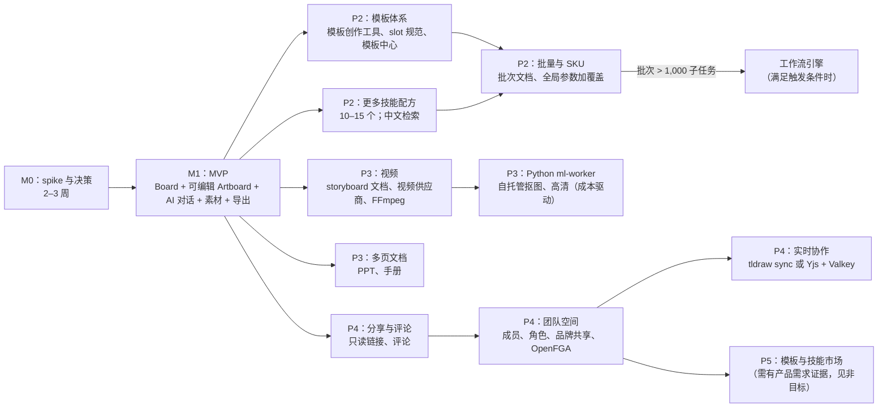

# Part 10 · 路线图与实施计划（交付物 J）

## J.1 Milestone 0：技术 spike 与 go/no-go（2–3 周）

| # | Spike | 产出 | Go 标准（提议） | No-go 时的后备 |
|---|---|---|---|---|
| S1 | **Board 引擎**：tldraw 与自研 DOM Board 各做最小实现（`BoardEngine` 接口、`dx-artboard` shape、LOD、映射层） | 两个可运行原型 + 性能报告 + 映射往返测试 | 200 Artboard ≥ 50 fps；中文输入法正确；映射往返 1,000 次操作无偏差；**许可可接受**（Q1、Q5） | 选 DOM Board，Board 工作量 +6–8 周 |
| S2 | **渲染一致性**：`doc-render` 的 DOM/SVG 加 Chromium 导出，对照 Fabric.js 加 node-canvas | 50 份语料一致性报告 | SSIM ≥ 0.99；换行 100% 一致；导出 p95 < 8s | 改选 Fabric 渲染栈（编辑器与导出都换） |
| S3 | **CJK 字体管线**：思源黑体分片、浏览器与 Renderer 共用 | 字体构建脚本 + 首屏字体加载数据 | 首屏字体下载 < 300KB（常用字分片）；无回退字体 | 减少字体数量，或预加载常用字子集 |
| S4 | **商品保真**：抠图合成、参考编辑、混合三种策略，20 个 SKU | 评分报告 + 单张成本 | 策略 A：OCR ≥ 95%，人工 ≥ 4.0 | 调整 MVP 技能，只保留合成类 |
| S5 | **Agent 工具调用**：在 2–3 个国内 LLM 上跑 200 次脚本化工具调用 | 合法率、延迟、成本 | 合法率 ≥ 98%；单步 p95 < 4s | 换模型；加强结构化输出约束；增加配方覆盖 |
| S6 | **供应商与合规**：开通模型（LLM、Seedream、审核）、核实备案号、价格、配额、回调；法务意见（登记、标识、隐私）；ICP 备案启动 | 供应商清单（填入能力注册表）+ 法律意见要点 | 每种能力至少 1 家可用；登记路径明确 | 视情况调整区域或范围 |
| S7 | **队列与续跑**：pg-boss 事务内入队，回合挂起与续跑，对账 | 可运行的最小闭环 + 故障注入测试 | Worker 被杀后 100% 任务进入终态 | graphile-worker |

**M0 出口**：AD-03、AD-04、AD-05、AD-08 状态更新为 Accepted 或 Superseded；MVP 范围冻结；排期重估。

## J.2 MVP 范围（Milestone 1）

见 Part 1 §A.5 的 12 项。以下是验收的端到端演示脚本：

1. 新用户手机号登录，看到创作首页（原型视觉）。
2. 上传耳机图，选择“商品套图”，输入卖点并发送。对话显示真实步骤进度，Board 出现占位卡，约 45 秒内出现 3 个可编辑方案。
3. 选中方案 2，说“换成暖色，标题改为‘秋日上新’”。Board 上出现 V2，V1 保留，有谱系连线。
4. 双击 V2 进入编辑器，用中文输入法修改副标题，拖动商品，撤销一次，改字号。
5. 同时让 AI“把标题改得更醒目”（修改当前稿），出现提议条，应用成功。
6. 返回 Board，导出 PNG 2x，与编辑视图一致。
7. 关闭浏览器；再发起一次生成后马上关闭；次日打开，对话、Board、新结果都在。
8. 发起会触发审核的提示词，得到明确提示且不扣配额；配额用尽时有明确提示。

## J.3 后续阶段与依赖

| 阶段 | 范围 | 前置依赖 | 关键新增组件 |
|---|---|---|---|
| P2 | 模板体系；技能扩到 10–15 个；批量与 SKU；微信登录；中文检索；内部审核后台 | M1 稳定；模板 slot 规范 | zhparser；（视需要）imgproxy |
| P3 | 视频分镜与片段生成、配乐和字幕、MP4；多页文档；图层分解导入（Seedream）；扩图、消除、高清 | 视频供应商 API 确认；FFmpeg 许可评估 | FFmpeg Worker；pgvector；（视需要）Python ml-worker |
| P4 | 分享链接与评论；团队空间；实时协作 | 授权模型升级 | OpenFGA；Valkey；协作服务 |
| P5 | 市场（模板、技能） | 明确的产品需求与运营能力 | — |

## J.4 优先级 Backlog（M1）

| 优先级 | Epic | 交付物 | 验收标准 |
|---|---|---|---|
| P0 | E01 Monorepo 与工具链 | pnpm + Turbo、TS strict、CI、dependency-cruiser、docker compose | 新人 30 分钟内跑起本地环境；CI < 10 分钟 |
| P0 | E02 doc-core v1 | Board 与 Artboard schema、基础与语义 ops、inverse、rebase、迁移 v0→v1、describe | 属性测试通过；金样本覆盖所有节点类型 |
| P0 | E03 doc-render | View、edit、export 三种模式；文字、图片、形状、组合；字体加载 | 50 份语料视觉回归基线建立 |
| P0 | E04 身份、工作空间、项目 | Better Auth（OTP）、RLS、项目 CRUD、bootstrap API | 跨租户测试全部通过 |
| P0 | E05 资产管线 | 预签名上传、ingest、渲染副本、审核、素材库 UI | 恶意文件语料全部被拒；上传到缩略图可见 p95 < 5s |
| P0 | E06 文档服务与同步 | ops API、快照、版本、SSE、DocStore、IndexedDB 队列 | 断网编辑后重连无丢失；冲突 UI 可用 |
| P0 | E07 Board | `BoardEngine` + 选定适配器、自定义 shape、LOD、视口持久化、剪贴板、快捷键 | §I.3.1 全部通过 |
| P0 | E08 Artboard 编辑器 | 选择、变换、吸附、文字编辑（输入法）、图层与属性面板、约束、品牌 token、撤销 | 编辑器 E2E 与性能基准通过 |
| P0 | E09 任务系统 | jobs 状态机、pg-boss、重试、取消、对账、awaiter | §I.3.6 全部通过 |
| P0 | E10 供应商适配器 | LLM、Image、Moderation 适配器（国内）+ fake + 能力注册表 | 契约测试；fake 可模拟全部故障模式 |
| P0 | E11 AI 运行时 | AgentLoop、ContextBuilder、ToolRegistry（13 个工具）、流式、续跑、审批 | 基准任务 1–13、20–28 达标 |
| P0 | E12 配方与模板 | 5 个配方、10 个模板、技能目录迁移（带实现状态） | 任务 16–19 达标 |
| P0 | E13 对话 UI | 原型对话区接入真实回合、步骤、提议条、审批卡、失败卡 | 旅程 C.2、C.3、C.7、C.8 E2E |
| P0 | E14 导出 | Renderer 服务、PNG/JPEG/WebP/PDF、隐式标识、`.dxproj` | 一致性 SSIM ≥ 0.99 |
| P0 | E15 配额与审计 | 预留、提交、返还；账本；熔断；审计日志 | 滥用脚本触发熔断 |
| P1 | E16 可观测性 | OTel、看板、告警、AI 调用表 | §I.4 看板上线 |
| P1 | E17 评测流水线 | `evals/` 30 项基准，夜间运行与报告 | 每夜报告自动生成 |
| P1 | E18 原型数据导入 | localStorage 项目导入工具 | 原型的 8 个模板与示例项目导入后可编辑 |
| P1 | E19 部署与备份 | Compose 生产部署、RDS 备份、PITR 演练 | 恢复演练通过 |
| P2 | E20 移动端适配 | 查看、对话、导出 | 390px 宽度无横向溢出 |

## J.5 团队与排期（基于假设的区间估计）

**情景 A：5 人团队**（AS-2 假设）

| 角色 | 人数 | 主要负责 |
|---|---|---|
| Tech Lead / 全栈 | 1 | 架构、doc-core、文档服务、同步、代码评审 |
| 前端（画布方向） | 1 | Board 引擎、LOD、性能 |
| 前端（编辑器方向） | 1 | Artboard 编辑器、doc-render、字体与 CJK、导出一致性 |
| 后端与 AI | 1 | 任务系统、供应商、AI 运行时、配方、评测 |
| 平台 / DevOps（0.5）+ 设计 / PM（0.5） | 1 | 部署、可观测性、合规事项推进；交互与视觉、验收 |

| 阶段 | 估计（周） | 说明 |
|---|---|---|
| M0 | 2–3 | 与合规、ICP 备案并行启动 |
| M1 | 12–16 | 若 Board 走自研 DOM 路线，再加 4–6 周 |
| 内测与加固 | 3–4 | 真实用户小规模内测，按评测结果调优 |
| **合计到 MVP 公测** | **约 4.5–6 个月** | 不含备案或登记的外部等待时间 [假设] |
| P2 | 8–10 | — |
| P3 | 10–14 | 视频供应商可用性是主要风险 |

**情景 B：单人作品项目**（若 Q1 确认为个人作品）

- 范围裁剪：1 个配方（商品套图）+ 通用 Agent；Board 用 tldraw hobby 许可（接受水印）；不做离线队列与提议机制（AI 只生成新版本）；不做 PDF 导出；单区域单机部署。
- 估计：**5–8 个月**业余或全职混合投入 [假设]。

> 估计基于“团队熟悉 React/TS、首次接触 tldraw”的假设，误差范围大，M0 结束后重估。

## J.6 从当前仓库迁移的步骤

| 步骤 | 内容 | 复用、重构或替换 |
|---|---|---|
| 1 | 建立 monorepo：把现有代码移到 `apps/web`（保持可运行），加 TS（`allowJs`）和 CI | 复用 |
| 2 | 把 `catalog.json`、`templates.js`、示例图迁到 `packages/recipes` 和 `public/samples`；技能加 `implementation` 字段 | 复用 + 结构化 |
| 3 | 新建 `doc-core`，实现 v0 → v1 迁移；`Editor.jsx` 改为读写 v1 文档（仍是 localStorage 后端），先完成**数据模型切换** | 重构 |
| 4 | 新建 `doc-render`，替换 `DesignPreview` 和编辑器节点渲染；删除 Canvas2D 导出（暂时用浏览器截图过渡） | 替换 |
| 5 | 引入 `BoardEngine`；先用 DOM 适配器包装现有 `AIStudio` 画布（行为不变），再按 M0 结论接入 tldraw | 重构 → 替换 |
| 6 | 后端骨架：api、worker、renderer、Postgres、对象存储、认证；`DocStore` 从 localStorage 切到 API（保留本地缓存） | 新建 |
| 7 | 生成层：`studioModel.js` 变成 fake 供应商；接入真实供应商；对话区接入回合 API | 替换（保留为测试夹具） |
| 8 | 退役 `studioSession.js` 与 localStorage 业务数据；提供“导入本地项目”入口（E18） | 退役 |
| 9 | `scripts/check-*.mjs` 断言迁移到 Vitest；新增 E2E | 复用断言 |

每一步结束时应用都可运行，适合逐步合并的小 PR。

## J.7 决策日志

| ID | 决策 | 状态 | 需要的证据或验证 |
|---|---|---|---|
| D-01 | Creative Document 由产品拥有，第三方画布只是视图（AD-01） | **Accepted** | — |
| D-02 | Board 与 Artboard 分层，编辑器独立（AD-02） | **Accepted** | — |
| D-03 | Board 引擎首选 tldraw，保底自研 DOM（AD-03） | **Proposed** | S1 结果 + 许可报价或 hobby 确认（Q1、Q5） |
| D-04 | Artboard 渲染用 DOM/SVG + Chromium 导出（AD-04） | **Proposed** | S2 |
| D-05 | TS 单语言 MVP；Python 只做像素（AD-05） | **Accepted** | — |
| D-06 | 模块化单体 + 独立 Worker 和 Renderer（AD-06） | **Accepted** | — |
| D-07 | AI 三层执行（直接操作、配方、Agent）+ 评估器（AD-07） | **Accepted** | — |
| D-08 | 自研轻量 Agent 循环，接口可替换（AD-08） | **Proposed** | S5 |
| D-09 | 在 E2B 中运行 Codex 作为 Agent 宿主 | **Rejected** | 只有基准测试显示代码执行必不可少时才重议 |
| D-10 | 多 Agent 或第二个 harness | **Deferred** | 基准测试出现差距 ≥ 30% 且迭代后仍存在 |
| D-11 | 外购编辑器 SDK（Polotno 或 CE.SDK） | **Deferred** | 编辑器工程能力 < 2 人，或 S2 失败 |
| D-12 | MVP 只用 PostgreSQL（队列、outbox、NOTIFY），不用 Redis（AD-09） | **Accepted** | 触发条件见 Part 6 §F.2 |
| D-13 | MVP 不用工作流引擎；Growth 首选 Temporal，备选 Hatchet | **Accepted / Deferred** | 触发条件见 Part 6 §F.3 |
| D-14 | AI 默认生成新版本，就地修改走 Proposal（AD-10） | **Accepted** | E2E C.8 |
| D-15 | 供应商适配器做成进程内库，无隐式回退（AD-11） | **Accepted** | — |
| D-16 | 独立网关服务 | **Deferred** | > 2 家供应商需动态路由 |
| D-17 | 默认用抠图合成保证商品保真 | **Proposed** | S4 |
| D-18 | China-first 临时部署（阿里云或火山引擎） | **Proposed** | Q2、Q4 |
| D-19 | 合规内建：审核、标识、配额、审计（AD-12） | **Accepted** | 法律意见（S6） |
| D-20 | 对象存储不用 MinIO 社区版 | **Accepted** | 官方 README 声明不再维护 [已核验] |
| D-21 | 不用 Vault（BSL），自托管时用 OpenBao | **Accepted** | — |
| D-22 | 认证用 Better Auth；企业 SSO 时迁移到 Casdoor、Logto 或 Keycloak | **Proposed** | 手机号 OTP 插件验证 |
| D-23 | Go 服务 | **Rejected**（当前） | 出现实测吞吐瓶颈时重议 |
| D-24 | 实时协作 | **Deferred**（P4） | 产品需求 |
| D-25 | Remotion | **Deferred**（P3） | 视频动效需求；若为公司（> 3 人）需购买公司许可 [已核验许可条款] |
| D-26 | 计费与支付 | **Rejected**（资料 F065） | 产品方向变化时重议 |
| D-27 | 原型渐进演进，不推倒重写（AD-13） | **Accepted** | — |

## J.8 风险登记

| # | 风险 | 可能性 | 影响 | 缓解 | 负责人 |
|---|---|---|---|---|---|
| R1 | tldraw 商业许可价格不可接受，或条款不满足（数据外呼、水印） | 中 | 高 | `BoardEngine` 隔离；M0 并行做 DOM spike；数据格式自有 | Tech Lead |
| R2 | 生成式 AI 登记、标识、ICP 备案周期拖累上线 | 中 | 高 | M0 立即启动；产品先做内测（不面向公众）[假设：法务确认内测边界] | PM + 法务 |
| R3 | 国内图像模型的商品保真与中文文字效果不达标 | 中 | 高 | 默认合成策略；文字永远是真实 text 节点，而不是模型画出来的字 | 后端与 AI |
| R4 | DOM 渲染在大量 Artboard 下性能不足 | 中 | 中 | LOD 与缩略图；挂载上限；必要时 Board 层切换到 Canvas 渲染缩略图 | 前端 |
| R5 | 导出与编辑不一致（字体、浏览器差异） | 低到中 | 高 | 同一渲染器、同一字体文件；视觉回归 CI | 前端 |
| R6 | 供应商 API 变动或下线（例如 Sora 已关停 [二手]） | 中 | 中 | 能力注册表 + 多家候选 + 适配器契约测试 | 后端 |
| R7 | 成本失控（Agent 循环、滥用） | 中 | 高 | 预算在代码中强制；熔断；配额；审批 | 后端 |
| R8 | Seedance 等视频 API 的可用性与价格不确定 | 高 | 中（P3） | P3 前再做确认；分镜功能可独立交付 | 后端 |
| R9 | 团队规模不足以同时做 Board、编辑器和 AI | 中 | 高 | 情景 B 裁剪；tldraw 节省 Board 工作量；考虑外购编辑器（D-11） | Tech Lead |
| R10 | 原型的产品定位（个人作品）与 SaaS 目标冲突，导致范围摇摆 | 中 | 中 | 先回答 Q1 | PM |
| R11 | 提示注入导致越权或违规输出 | 低到中 | 高 | 工具最小权限 + 输出审核 + 红队测试 | 后端 |
| R12 | 字体侵权 | 低 | 高 | 只用 OFL 字体；注册表强制许可字段 | 设计 |

## J.9 待决问题（只列影响决策的问题）

| # | 问题 | 为什么重要 | 未答复时的默认假设 |
|---|---|---|---|
| **Q1** | Design-X 是**商业产品**，还是**非商业的个人作品或展示项目**？ | 决定 tldraw（商业许可还是 hobby 水印）、Remotion 许可、合规范围、团队规模 | 按可商业化设计，许可按商业路径预算 |
| **Q2** | 首发区域是否确认为**中国大陆**？ | 决定模型、云、合规、登录方式 | China-first |
| **Q3** | 团队人数与预算区间（尤其是可用于 SDK 许可与模型调用的月预算）？ | 决定排期、自研或外购、Board 路线 | 5 人；模型月预算待定 |
| **Q4** | 首选云厂商：阿里云还是火山引擎（或其他）？ | 存储、数据库、审核与模型的就近整合 | 与首选模型供应商同一家（降低跨云流量与延迟） |
| **Q5** | 若为商业产品，是否接受购买 tldraw 商业许可（价格需询价）？ | Board 路线 | 先询价；M0 同时做 DOM spike |

## J.10 接下来两周的行动

1. 回答 Q1–Q5。如 Q1、Q5 有结论，tldraw 询价或申请 hobby 许可（第 1 天）。
2. 启动 ICP 备案、法务咨询（生成式 AI 登记、标识、隐私政策）（第 1 周）。
3. 开通目标云账号与模型平台，核实模型、价格、配额与备案号，填入能力注册表草稿（第 1 周）。
4. 建 monorepo 骨架，迁入原型（迁移步骤 1–2）（第 1 周）。
5. 并行启动 S1–S7 spike（第 1–3 周），每个 spike 输出一页报告和 ADR。
6. M0 评审会：冻结 MVP 范围，更新决策日志与排期（第 3 周末）。
