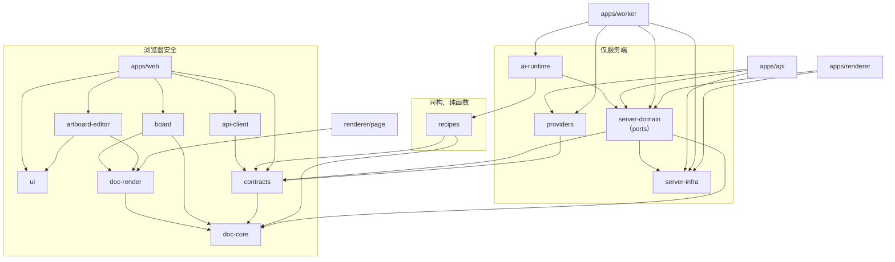

# Part 12 · 工程仓库结构（评审稿）

版本：v1.0-draft · 日期：2026-10-30 · 状态：**待产品负责人评审，批准后才创建目录**

本文件把 Part 1–11 的架构落到具体的代码组织上：仓库策略、目录树、模块边界、依赖规则、部署单元，以及原型如何过渡。本文**不是**实施计划；逐模块的实施计划在本结构批准后另行编写（见 §9）。

**推荐要点**

- 采用 **pnpm + Turborepo 单仓库**，MVP 全部使用 TypeScript。
- 可运行的应用共四个：`web`、`api`、`worker`、`renderer`。
- 产品自有的三个核心库：`doc-core`（文档模型与操作）、`doc-render`（渲染）、`contracts`（契约）。
- 画布 SDK 只能出现在 `board` 包的一个适配子目录里。
- 供应商代码放在“端口（ports）”后面：领域层只声明接口，具体实现只在各应用的启动入口里装配。
- 当前原型**原样**移入 `apps/prototype`，保持可运行，直到 `apps/web` 达到同等功能。

---

## 1. 基线

**依据的材料**

- 架构方案 `docs/architecture/01–11`。
- 评审意见 `docs/architecture-review.md` 和 `docs/architecture-review.zh-CN.md`。中文版是英文版的翻译，没有新增决策。
- 原始资料 DOCX、XLSX，以及 `product-research.md`、`design-spec.md`、`verification.md`。
- 原型源码 `src/`、`scripts/`。

**已选技术栈**

| 方面 | 选择 |
|---|---|
| 语言 | MVP 全部用 TypeScript；Python 只在后期用于像素处理 Worker |
| 前端 | React 19、Vite、TanStack Router/Query、Zustand、Radix |
| Board（无限画布） | tldraw，放在 `BoardEngine` 接口之后；自研 DOM 实现作为保底 |
| Artboard（画板） | 自研 DOM/SVG 渲染器，编辑交互用 Moveable 和 Selecto |
| 后端 | Node 24 LTS、Fastify、Zod、Drizzle、pg-boss、Better Auth |
| 数据 | PostgreSQL 承担所有有状态数据（业务数据、op-log、队列、outbox），另有 S3 兼容对象存储和 CDN |
| 渲染与导出 | 无头 Chromium（Playwright）运行同一渲染器；栅格图片处理用 sharp |
| 部署 | 模块化单体：`api`、`worker`、`renderer` 三类容器，加托管 PostgreSQL 和对象存储；China-first |

**MVP 能力**

- 登录与个人工作空间。
- AI 工作区：左侧对话，右侧无限 Board。
- 素材上传，带校验和审核。
- 3–5 个配方（recipe）加一个通用 Agent。
- 生成可编辑的多个方案并放到 Board 上；对话续改，保留原稿。
- Artboard 编辑器：支持中文输入法、撤销、自动保存、命名版本。
- 服务端导出 PNG、JPEG、WebP、PDF。
- 异步任务：重试、取消、对账；SSE 实时推送。
- 内容审核、AI 生成内容标识、配额、审计。

**来自资料的产品决策**（不是本方案的建议）：

- 不做支付和会员（F065）。
- 分析类技能延后。
- 当前原型只是模拟，不是生产能力。

**仍是临时决策、且会影响仓库结构的事项**

| 决策 | 对仓库的影响 |
|---|---|
| Q1（商业产品还是个人作品）+ Q5（tldraw 许可），由 spike S1 验证 | 决定 `packages/board/src/tldraw/` 是否随 MVP 发布，还是只有 `dom/` 适配器 |
| S2：DOM/SVG 还是 Fabric 渲染 | 只影响 `doc-render` 的内部实现，边界不变 |
| Q2/Q4：区域与云厂商 | 决定 `packages/providers` 里有哪些适配器，以及 `infra/` 的内容 |

**已完成架构中的矛盾及处理**

| # | 矛盾 | 处理方式 |
|---|---|---|
| C1 | 配方逻辑分散在三处：`packages/recipes`（Part 8）、`server-domain/recipes`（Part 5）、`ai-runtime` 中的 “RecipeEngine”（Part 2 B.5） | 配方**定义和纯布局逻辑**放在 `@dx/recipes`；**执行**放在 `@dx/ai-runtime/recipe/RecipeRunner`；**持久化和发起运行的接口**放在 `server-domain/recipes` |
| C2 | Part 8 允许 `server-domain → providers`，违背“领域不依赖供应商” | 领域在 `server-domain/src/ports` 声明端口；`@dx/providers` 实现端口；只有各应用的启动入口负责装配 |
| C3 | Part 8 规定 renderer 不能依赖 `server-domain`，但 renderer 必须读取文档、解析资产 | renderer 与 `worker` 一样作为启动入口，可以调用领域层的**只读服务** |
| C4 | Part 8 把 `/render` 页面放在 `apps/web` 里 | 改放到 `apps/renderer/page`。该页面只依赖 `doc-render`，不带应用外壳、会话和 Cookie |
| C5 | Part 8 先由 Zod 生成 OpenAPI，再由 OpenAPI 生成 TS 客户端，绕了一圈 | `@dx/api-client` 直接使用 `@dx/contracts` 的路由定义；OpenAPI 和 JSON Schema **只**用于文档和非 TS 消费者 |
| C6 | 模板与字体在 Part 7 是数据库表，在 Part 4/8 又是仓库文件 | MVP 以**仓库文件为权威**：`recipes/src/templates/*.artboard.json` 和 `tools/font-build/registry.yaml`；数据库表等到 P2 有模板创作工具时再引入 |
| C7 | Part 8 把 Drizzle 表定义放在 `server-infra`，与“每个模块拥有自己的表”冲突 | 每个领域模块自带 `tables.ts`，`db/drizzle.config.ts` 汇总生成迁移 |
| C8 | `docs/architecture/README.md` 写着 `architecture-review.zh-CN.md` 不存在 | 该文件现已存在于 `main`，README 已在本次提交中更正 |
| C9 | Part 10 J.6 计划把原型直接移入 `apps/web` 并就地演进 | 改为：原型冻结为 `apps/prototype`，新建 `apps/web` 并逐步移植，保证原型始终可用（见 §8） |

---

## 2. 架构到代码的映射

| 能力 | 负责模块 | 权威数据 | 对外接口 | 运行单元 | 阶段 |
|---|---|---|---|---|---|
| AI 对话与创作会话 | `server-domain/ai`（持久化与生命周期）、`ai-runtime/agent`（执行）、`web/features/chat`（UI） | `ai_sessions`、`ai_messages`、`ai_turns`、`ai_tool_calls` | `POST /v1/ai/sessions/{id}/turns`、`…/cancel`；SSE `ai.*` | `api` 接收请求；`worker`（队列 `ai.turn`）执行 | MVP |
| 无限 Board | `doc-core/board`（schema 与 ops）、`server-domain/documents`（持久化）、`board`（交互） | `documents(kind=board)` 及其 op-log；`board_views`（按用户保存视口） | `POST /v1/documents/{id}/ops`、`PUT /v1/boards/{id}/view`；SSE `document.committed` | `web` + `api` | MVP |
| Artboard 编辑与图层 | `artboard-editor`（交互）、`doc-render`（显示）、`doc-core`（ops） | `documents(kind=artboard)` | 同上的 ops 接口 | `web` + `api` | MVP |
| 持久化、修订、撤销 | `doc-core/ops`（apply、invert、rebase）、`server-domain/documents`、编辑器 `History` | `document_ops`、`document_snapshots`、`document_versions`、`proposals` | `…/ops`、`…/versions`、`…/revert`、`/v1/proposals/{id}/apply` | `api`；`worker`（`doc.snapshot`） | MVP |
| 技能、配方、模板、布局 | `recipes`（定义、模板、布局）、`ai-runtime/recipe`（执行器）、`server-domain/recipes`（运行记录、目录） | 仓库文件（定义、模板）；`recipe_runs` | `GET /v1/skills`、`GET /v1/templates`、`POST /v1/recipes/{id}/runs` | `api` + `worker`（`recipe.run`） | MVP（5 个配方）；P2 创作工具 |
| 素材、字体、品牌 | `server-domain/assets`、`/fonts`、`/brand`；`tools/font-build` | `assets`、`asset_renditions`、`asset_refs`；`registry.yaml`；`brand_kits` | `/v1/assets/*`、`/v1/fonts`、`/v1/brand-kits` | `api`；`worker`（`media.ingest`、`media.process`） | MVP |
| 生成任务与供应商 | `server-domain/jobs`（状态机）、`providers`（适配器）、`worker/handlers` | `jobs`、`job_events`、`job_waiters`、`model_calls` | `/v1/jobs/*`；SSE `job.updated`；供应商回调 | `worker` | MVP |
| 预览、导出、媒体处理 | `doc-render`（渲染行为）、`apps/renderer`、`server-domain/exports`；`worker` 中的 sharp | `exports`、`assets(kind=export)` | `POST /v1/exports`；SSE `export.completed` | `renderer`；`worker` | MVP |
| 审核与 AI 标识 | `server-domain/moderation`、`providers/moderation`、`renderer/metadata` | `moderation_events`、`assets.provenance` | 仅内部调用 | `api`（输入检查）、`worker`、`renderer` | MVP |
| 身份、访问、配额、审计 | `server-domain/identity`、`workspaces`、`authz`、`quotas`、`audit`；`api/plugins` | `users`、`workspace_members`、RLS 策略、`usage_ledger`、`audit_log` | `/v1/auth/*`、`/v1/me`、`/v1/usage` | `api` | MVP |
| 视频与分镜 | `doc-core` 的 storyboard schema，加 `worker` handler 和 FFmpeg | `documents(kind=storyboard)` | 复用文档与任务接口 | `worker`（之后可拆出媒体 Worker） | P3，暂不建包 |
| 批量 / SKU | 扩展 `server-domain/recipes` 和 `jobs` | `recipe_runs` 批次 | — | `worker` | P2，暂不建包 |
| 实时协作、分享、团队 | 后期 `apps/collab`；升级 `authz` | — | — | 新服务 | P4 |

**映射暴露的缺口，现已明确负责方**

- 把结果放到 Board 上：原先配方的 `place` 步骤和 Agent 工具 `board.place_items` 各做一份。现在两者都调用 `documents.placeResultGroup()`，其内部使用纯函数 `doc-core/board/placement.ts`。
- 配额：原先 `api`、Agent 预算和任务系统各自检查。现在只有 `server-domain/quotas` 负责预留、提交和返还；Agent 循环只从它读取剩余预算。
- 渲染：文档渲染只由 `renderer` 负责；栅格素材的缩略图等副本只由 `worker`（sharp）生成。

---

## 3. 仓库策略与目录树

**选择单仓库（pnpm workspaces + Turborepo）。**

- 理由：`doc-core`、`doc-render`、`contracts` 都被三到四个运行单元使用；一次文档操作的修改必须在浏览器、API、Worker、Renderer 中同时生效，并在同一个提交里评审。3–6 人的团队负担不起多仓库之间的版本协调。
- 主要代价：CI 必须按依赖图做增量构建（Turborepo 负责）；模块边界靠工具强制，而不是靠仓库隔离。

**图例**

- 类型：`app` 应用；`wkr` 后台 Worker；`lib` 库；`cfg` 部署或开发配置。
- 阶段：**MVP** 首个发布；**VAL** 验证阶段（M0 spike 与评测）；**LATER** 后期。

```text
design-x/
├── apps/
│   ├── prototype/            [app·JS/React19/Vite·仅 MVP 过渡期] 当前 src/、public/、index.html、scripts/ 原样移入；
│   │                                 冻结、可运行的参考版本，不对用户部署；达到同等功能后删除
│   ├── web/                  [app·TS/React19/Vite·MVP] 生产 SPA（静态构建 → OSS + CDN）
│   │   └── src/
│   │       ├── main.tsx · app/{providers.tsx, session.ts}
│   │       ├── routes/       __root.tsx, index.tsx, skills.tsx, templates.tsx, projects.tsx, assets.tsx,
│   │       │                 p.$projectId.tsx        # 工作区；?artboard= 打开编辑器聚焦模式
│   │       ├── features/
│   │       │   ├── workspace/  WorkspaceLayout.tsx, useWorkspaceBootstrap.ts
│   │       │   ├── chat/       ChatPanel.tsx, Composer.tsx（/ 选技能、@ 引用素材、输入法）, TurnProgress.tsx,
│   │       │   │               ProposalBar.tsx, ApprovalCard.tsx, useStartTurn.ts
│   │       │   ├── skills/     SkillCatalog.tsx, RecipeForm.tsx（按配方输入 schema 渲染表单）
│   │       │   ├── projects/ · assets/（UploadDropzone.tsx, useUpload.ts）· jobs/JobCenter.tsx · export/ExportDialog.tsx
│   │       ├── sync/         DocStore.ts, opQueue.ts（IndexedDB）, eventStream.ts（SSE）, tabLeader.ts（BroadcastChannel）
│   │       └── state/        uiStore.ts, selectionStore.ts            # Zustand；不存业务数据
│   ├── api/                  [app·TS/Node24/Fastify·MVP]
│   │   └── src/
│   │       ├── main.ts       # 启动入口：配置、数据库、密钥 → 供应商适配器 → 注入领域端口
│   │       ├── plugins/      auth.ts, request-context.ts, idempotency.ts, problem-json.ts, rate-limit.ts, telemetry.ts
│   │       ├── routes/       mount.ts（把 @dx/contracts 路由定义绑定到领域服务）, callbacks/volcengine-ark.ts
│   │       └── sse/          outbox-listener.ts（LISTEN）, project-stream.ts（按 Last-Event-ID 补发）
│   ├── worker/               [wkr·TS/Node24/pg-boss·MVP]
│   │   └── src/
│   │       ├── main.ts       # 启动入口；WORKER_QUEUES 决定启用哪些 handler
│   │       ├── runtime/      handle.ts      # 读取 job 行 → TrustedContext.fromJob → 阶段幂等 → 状态迁移
│   │       └── handlers/     ai-turn.ts, recipe-run.ts, gen-image.ts, gen-poll.ts, media-ingest.ts,
│   │                         media-process.ts, media-cutout.ts, doc-snapshot.ts, job-reconcile.ts, asset-gc.ts
│   └── renderer/             [wkr·TS/Node24/Playwright+Chromium·MVP]
│       ├── src/              main.ts, jobs/{render-export.ts, render-thumbnail.ts, render-measure.ts},
│       │                     browser-pool.ts, network-guard.ts（网络白名单）, metadata/ai-label.ts
│       ├── page/             index.html, render-page.tsx  # 只依赖 @dx/doc-render；读取 RenderInput
│       └── Dockerfile        # 内置 Chromium 与字体分片
├── packages/
│   ├── doc-core/             [lib·TS·同构·MVP] 外部依赖仅 zod、fractional-indexing
│   │   ├── src/
│   │   │   ├── index.ts                      # 唯一公开入口
│   │   │   ├── schema/   board.v1.ts, artboard.v1.ts, nodes.ts, tokens.ts, ids.ts
│   │   │   ├── ops/      primitive.ts, apply.ts, invert.ts, touched.ts, rebase.ts, validate.ts
│   │   │   ├── board/    ops.ts（insert_item / set_item / …）, placement.ts（方案组布局）
│   │   │   ├── semantic/ replace-text.ts, swap-asset.ts, resize-artboard.ts（约束布局）, apply-template.ts
│   │   │   ├── migrate/  index.ts, v0-prototype.ts     # 原型 design.nodes → artboard v1
│   │   │   ├── refs/     extract-refs.ts               # 提取资产与字体引用
│   │   │   └── describe/ describe-artboard.ts          # 给 LLM 的精简描述
│   │   └── test/         golden/*.json, property/rebase.prop.test.ts
│   ├── doc-render/           [lib·TS/React·浏览器 + renderer 页面·MVP] 拥有全部 Artboard 渲染行为
│   │   ├── src/          ArtboardRenderer.tsx（mode: edit|view|export）, RenderInput.ts,
│   │   │                 nodes/{TextNode,ImageNode,ShapeNode,GroupNode}.tsx, text/css-text.ts,
│   │   │                 fonts/{loader.ts, manifest.ts}, assets/AssetResolver.ts, tokens/resolve.ts, measure/measure-text.ts
│   │   └── fixtures/corpus/*.artboard.json      # 50 份一致性测试语料（VAL 建立，之后作为 MVP 回归）
│   ├── artboard-editor/      [lib·TS/React·浏览器·MVP]
│   │   └── src/          ArtboardEditor.tsx,
│   │                     controller/EditorController.ts   # 工具、选择、批量提交（pointerup / 500ms 空闲 / compositionend）
│   │                     interaction/{transform.tsx（Moveable）, marquee.tsx（Selecto）, snapping.ts},
│   │                     text/TextEditSession.ts（输入法）, history/History.ts（inverse-op 栈）,
│   │                     panels/{LayersPanel, PropertiesPanel, ConstraintsPanel}.tsx, shortcuts.ts
│   ├── board/                [lib·TS/React·浏览器·MVP]
│   │   └── src/          BoardEngine.ts（接口）, coords.ts, lod.ts,
│   │                     tldraw/  TldrawBoardAdapter.ts, mapping.ts（BoardDoc ⇄ tldraw 记录）,
│   │                              shapes/{ArtboardShapeUtil, AssetShapeUtil, ResultGroupShapeUtil, PlaceholderShapeUtil}.tsx
│   │                     dom/     DomBoardAdapter.ts            # 保底实现，由原型画布演进而来
│   │                     test/engine-contract.test.ts          # 同一套测试分别跑两个适配器
│   ├── ui/                   [lib·TS/React/CSS·浏览器·MVP] tokens.css（来自原型）、Radix 封装、图标
│   ├── contracts/            [lib·TS/Zod·同构·MVP] API、事件、任务契约的权威定义
│   │   └── src/          http/{projects,documents,ai,assets,jobs,exports,skills}.ts（defineRoute）,
│   │                     events/{document,job,ai,asset,export}.ts（type + v）, jobs/{gen-image.v1.ts, …},
│   │                     errors.ts, pagination.ts;  generated/{openapi.json, json-schema/*.json}  # 入库，CI 比对差异
│   ├── api-client/           [lib·TS·浏览器·MVP] 基于 contracts 路由定义的类型化 fetch（无代码生成）
│   ├── recipes/              [lib·TS·同构、纯函数·MVP]
│   │   └── src/          define-recipe.ts, catalog/{skills.json, index.ts},
│   │                     product-hero-set/v1/{input.ts, plan.schema.ts, steps.ts, compose.ts, prompts/plan.zh.md},
│   │                     marketing-poster/v1, social-cover/v1, white-bg/v1, poster-resize/v1,
│   │                     templates/{tpl_hero_split_v@2.artboard.json, …}, layout/{pick-template.ts, fit-copy.ts}
│   ├── server-domain/        [lib·TS·仅服务端·MVP] 业务规则；不引用任何供应商或厂商 SDK
│   │   └── src/
│   │       ├── context/  TrustedContext.ts（branded 类型）, authenticate.ts, fromJob.ts
│   │       ├── ports/    LlmPort.ts, ImagePort.ts, ModerationPort.ts, CutoutPort.ts, ObjectStorePort.ts, QueuePort.ts, Clock.ts
│   │       ├── identity/ workspaces/ authz/ projects/ assets/ ai/ recipes/ jobs/ exports/
│   │       │   quotas/ moderation/ audit/ fonts/ brand/ events/
│   │       └── documents/                       # 代表性模块的内部结构
│   │           ├── index.ts      # 只导出公开服务 API
│   │           ├── service.ts    # applyOps, createArtboard, createVersion, placeResultGroup, readAt, revertOrigin
│   │           ├── proposals.ts, snapshots.ts, repo.ts, tables.ts（Drizzle）, events.ts, errors.ts
│   │           └── documents.test.ts
│   ├── server-infra/         [lib·TS·仅服务端·MVP] 技术适配，不含业务规则
│   │   └── src/          db/{pool.ts, withTenant.ts}, queue/PgBossQueue.ts（实现 QueuePort）,
│   │                     storage/S3ObjectStore.ts（实现 ObjectStorePort，含预签名）, secrets/load.ts,
│   │                     telemetry/{otel.ts, redact.ts}, config/env.ts（Zod）, server-only.ts（在浏览器中加载即抛错）
│   ├── providers/            [lib·TS·仅服务端·MVP]
│   │   └── src/          registry/{capabilities.ts, models.cn.yaml},
│   │                     llm/openai-compatible.ts                 # 方舟 / 百炼 / DeepSeek 通过配置区分
│   │                     image/volcengine-seedream.ts             # 代表性适配器：
│   │                     │   请求映射、提交与轮询、错误 → 重试分类、能力上限取自注册表
│   │                     moderation/{aliyun.ts|volcengine.ts}, cutout/…,
│   │                     http/{fetch-with-timeout.ts, classify-error.ts},
│   │                     fake/{demo-rules-image.ts（移植自 studioModel）, scripted-llm.ts, faults.ts},
│   │                     test/contract/*.contract.test.ts         # 所有适配器和 fake 都跑同一套契约测试
│   ├── ai-runtime/           [lib·TS·仅服务端·MVP]
│   │   └── src/          agent/{AgentLoop.ts, ContextBuilder.ts, budget.ts, stream.ts},
│   │                     recipe/RecipeRunner.ts                    # 执行 @dx/recipes 的定义；支持挂起与续跑
│   │                     tools/{define-tool.ts, registry.ts, board-describe.ts, artboard-describe.ts,
│   │                            artboard-render-preview.ts, assets-search.ts, recipes-run.ts, images-generate.ts,
│   │                            artboard-create-version.ts, artboard-propose-ops.ts, board-place-items.ts,
│   │                            jobs-await.ts, ask-user.ts},
│   │                     evaluators/{text-overflow.ts, ocr-match.ts, product-similarity.ts}, prompts/system.zh.md
│   ├── testing/              [lib·TS·仅开发·MVP] 测试数据工厂、Postgres 测试容器、假时钟、SSE 测试客户端、SSIM 比较
│   └── config/               [cfg·MVP] tsconfig.base.json, eslint.config.js, vitest 预设, dependency-cruiser.cjs
├── db/                       [cfg·TS+SQL·MVP] drizzle.config.ts（汇总各模块 tables.ts）, migrations/*.sql（生成并入库）,
│                                     rls/*.sql, seeds/
├── evals/                    [VAL·TS] tasks/*.yaml（30 项基准）, fixtures/, runner/
├── tests/                    [MVP] e2e/（用户旅程 C.1–C.8）, visual/（一致性测试执行器 + 金样本图）, perf/（board-200、editor-150）
├── infra/                    [cfg·MVP] compose/{dev.yml, prod.yml}, docker/Dockerfile.node（api 与 worker 共用）, env/.env.example
├── tools/                    [MVP] font-build/{registry.yaml（权威字体清单与许可）, build.ts},
│                                     import-prototype/（localStorage 导出 → v1 文档）, contracts-gen/（Zod → OpenAPI / JSON Schema）
├── docs/                     现有产品资料保持原路径（架构文档引用了这些路径）
│   ├── architecture/ · architecture-review*.md · adr/ · implementation-plan/（下一个交付物）· runbooks/
├── .github/workflows/        ci.yml, nightly.yml（e2e、性能、评测）
└── pnpm-workspace.yaml · turbo.json · package.json
```

**不设通用 shared / utils 包**

- 跨模块的**技术**代码放在 `server-infra`，只能包含适配器、配置、遥测和 `withTenant`；不能包含任何了解项目、文档或任务的代码。
- 跨模块的**类型**放在 `contracts` 或 `doc-core`。
- `testing` 和 `config` 仅供开发使用，生产代码不得引用（由 dependency-cruiser 强制）。

**后期能力：暂不建包，只说明落点**

| 能力 | 落点 | 何时独立 |
|---|---|---|
| 分镜与视频（P3） | `doc-core` 新增 storyboard schema，`worker` 新增 handler 并使用 FFmpeg | FFmpeg 的 CPU 负载需要隔离时，拆出 `apps/media-worker` |
| `services/ml-worker`（Python） | — | 开始自托管抠图、OCR 或超分模型时 |
| `apps/collab`（P4） | — | 实时协作上线时 |
| `apps/admin` | — | 需要审核后台时 |
| 工作流引擎 | — | 满足 Part 6 §F.3 的触发条件时 |
| `infra/terraform` | — | 出现第二个需要自动化的环境时 |

---

## 4. 关键边界

### 4.1 Board、Artboard 与 Creative Document

| 关注点 | 位置 | 是否权威 |
|---|---|---|
| Board 条目、位置尺寸、层级、分组、谱系 | `doc-core/schema/board.v1.ts`，由 `server-domain/documents` 持久化 | **权威**（`documents` + `document_ops`） |
| 视口 / 相机 | `board`（运行时）；通过 `PUT /v1/boards/{id}/view` 存入 `board_views` | 按用户保存的偏好，不属于文档内容 |
| 选择、当前工具、打开的面板 | `web/state/selectionStore.ts`、`uiStore.ts` | 临时状态，不持久化 |
| tldraw store（shape、绑定、实例记录） | `board/src/tldraw` | **派生的视图模型；不持久化任何 tldraw 记录** |
| Artboard 节点、排版、变换、约束 | `doc-core/schema/artboard.v1.ts` | **权威** |
| 浏览器中的文档状态 | `web/sync/DocStore.ts`：已确认的 `head`（服务端数据的缓存）+ 本地待提交的 `pending` ops | `pending` 在被服务端确认前以本地为准，确认后即为服务端数据 |
| 撤销历史 | Board：tldraw history（只含用户操作）；Artboard：`artboard-editor/history`；AI 修改：服务端 `revertOrigin` | 本地状态，由 inverse ops 派生 |
| 修订与命名版本 | `document_ops`、`document_snapshots`、`document_versions` | 权威（快照只是加速用的派生数据） |
| 资产引用 | 文档内的 `{asset: {id, rev}}`；`asset_refs` 表 | 文档内引用是权威；`asset_refs` 由 `doc-core/refs` 派生 |
| 预览与缩略图 | `asset_renditions`；`renderer` 生成的 Artboard 缩略图 | **派生**，随时可以重新生成 |

**tldraw 适配器边界**

- 只有 `packages/board/src/tldraw/**` 可以 `import 'tldraw'`。
- `mapping.ts` 负责双向翻译：
  - 用户操作：通过 `store.listen`（只监听用户产生的文档变更）翻译为 `BoardOp[]`；
  - 远端和 AI 的 ops：通过 `mergeRemoteChanges` 应用，因此不会进入用户的撤销栈。
- 映射规则：shape id = `"shape:" + item.id`；`shape.index` = `item.z`；shape props 只放渲染提示（`artboard_id`、缩略图、尺寸），**不放 Artboard 内容**。
- **替换 tldraw 的代价**：让 `DomBoardAdapter` 通过 `board/test/engine-contract.test.ts`，然后切换一个工厂函数即可，**无需迁移任何数据**。
- 以上 API 名称来自间接获得的 tldraw 文档，需在 spike S1 中对照 5.6 版本逐一确认。

### 4.2 AI、工作流与 Worker

```text
同步（api 请求内）                                     │ 异步（事务提交后，在 worker 中）
routes/mount.ts → server-domain/ai.startTurn()       │ handlers/ai-turn.ts → ai-runtime AgentLoop
  authz · quotas.reserve · moderation.checkText      │   tools/* ──只能调用──► server-domain 服务
  写入 ai_turns + jobs.enqueue('ai.turn@1')          │ handlers/recipe-run.ts → ai-runtime RecipeRunner（执行 @dx/recipes 定义）
  → 202 {turn_id}                                    │ handlers/gen-image.ts → jobs.transition · ImagePort · assets.ingestProviderOutput
直接操作：documents.applyOps() 全程同步                │ 任务完成 → jobs（job_waiters）→ 入队续跑（ai.turn / recipe.run）
```

- **不重复编排或业务逻辑**：API 路由、Agent 工具、Worker handler 都只是薄适配层；业务规则只在 `server-domain` 写一份，编排逻辑只在 `ai-runtime` 写一份。
- `@dx/recipes` 只包含**纯**定义和布局函数，没有 I/O，因此可以单元测试，也能在浏览器里做预览。
- 供应商适配器只返回规范化结果，或标明 `retryable` / `permanent` 的错误；不接触数据库。
- 生成结果的摄取和写入文档都是领域函数（`assets.ingestProviderOutput`、`documents.createArtboard`、`documents.placeResultGroup`），由执行器调用。

### 4.3 渲染与导出

- **`@dx/doc-render` 拥有全部 Artboard 渲染行为**，被以下场景复用：
  - 编辑器（`mode=edit`）；
  - Board 上近距离缩放时的 shape（`mode=view`）；
  - `apps/renderer/page/render-page.tsx`（`mode=export`），用于缩略图、给 Agent 看的预览、导出和文字测量。
- **字体**：加载器在 `doc-render/src/fonts`；权威字体清单与许可在 `tools/font-build/registry.yaml`；构建产出 `font-manifest.json` 和 woff2 分片，发布到 CDN，同时打包进 renderer 镜像。
- **资产解析**：`doc-render` 通过注入的 `AssetResolver` 获取图片地址。浏览器端返回 CDN 渲染副本地址；renderer 端返回导出所需的原图签名地址。
- **测试语料与金样本**：语料在 `doc-render/fixtures/corpus`，金样本图在 `tests/visual`。
- **一致性测试**：由于只有一个渲染器，测试比较 `edit`/`view` 截图与 `export` 输出（SSIM ≥ 0.99，提议目标）。
- 如果 S2 最终改选 Fabric，只有 `doc-render` 的内部实现需要改变。

---

## 5. 依赖规则



### 5.1 规则（由 dependency-cruiser 在 CI 中强制，含循环检测）

1. `doc-core` 不依赖任何内部包。
2. 浏览器包（`web`、`board`、`artboard-editor`、`ui`、`doc-render`、`api-client`）不能直接或间接引用 `server-*`、`providers`、`ai-runtime`、`node:*` 或 `apps/*`。
3. `server-domain` 不能引用 `providers`、任何厂商 SDK 或 `ai-runtime`，只能通过 `ports/*` 访问外部。
4. `providers` 不能引用 `server-domain`（适配器不了解业务实体）。
5. `recipes` 不能引用 `providers` 或 `server-*`，必须保持纯函数。
6. 只有 `board/src/tldraw/**` 可以引用 `tldraw`。
7. 只有 `apps/*/src/main.ts` 可以构造供应商适配器或调用 `server-infra/secrets`。
8. 禁止循环依赖，禁止深层路径引用：每个包只通过 `package.json` 的 `exports` 暴露入口（`index.ts` 加显式子路径，如 `server-infra/db`）。
9. `testing` 和 `config` 只能被开发和测试代码引用。

### 5.2 其他强制手段

- TS project references：按包划分类型边界。
- pnpm 严格依赖解析：禁止引用未在 `package.json` 声明的依赖。
- `apps/web` 的 Vite 插件：任何模块解析到 `@dx/server-*`、`@dx/providers`、`@dx/ai-runtime` 或 `node:*` 时构建失败。
- `server-infra/server-only.ts`：在浏览器中被加载时直接抛错，作为第二道防线。
- CI 中运行密钥扫描（工具待定，需先核验许可）。

### 5.3 可信上下文

- `TrustedContext` 是 branded 类型，只有两个工厂函数：
  - `authenticate(session)`：在 API 插件中使用；
  - `fromJob(jobRow)`：在 worker 和 renderer 中使用，从数据库中的 job 行重建 actor 和 workspace，**从不信任 payload 字段**。
- 所有领域服务的第一个参数都是 `ctx`；`server-infra/db/withTenant(ctx, fn)` 设置 `app.workspace_id`，使 Postgres RLS 生效。
- Agent 工具只能拿到回合的上下文，不能自行构造。

### 5.4 凭据

- 密钥只在启动入口通过 `server-infra/secrets` 读取，再传入适配器构造函数。
- 工具的输入输出、LLM 上下文中从不出现密钥或签名 URL。
- 日志脱敏在 `server-infra/telemetry/redact.ts`。

### 5.5 契约版本与权威来源

| 契约 | 权威定义 | 版本规则 | 生成物（是否入库） |
|---|---|---|---|
| HTTP API | `contracts/src/http/*.ts` | `/v1`；只做增量修改；破坏性变更用新路由或 `/v2` | `generated/openapi.json`（入库，CI 比对差异） |
| SSE 事件 | `contracts/src/events/*.ts` | `{type, v}` | JSON Schema（入库） |
| 任务 payload | `contracts/src/jobs/*.ts` | 任务类型加版本，如 `gen.image@1`；发布期间 Worker 同时处理 N 与 N−1 | JSON Schema（入库） |
| 文档 | `doc-core/src/schema/*` | `schema_version` 加 `migrate/` 迁移链；读取方兼容 N−1 | `board.v1.json`、`artboard.v1.json`（入库） |
| 数据库 | `server-domain/*/tables.ts` | expand / contract 两阶段迁移 | `db/migrations/*.sql`（入库并评审） |
| Renderer 页面输入 | `doc-render/src/RenderInput.ts` | 与 renderer 镜像一起发布 | — |

### 5.6 多语言一致性

- MVP 只有 TypeScript，目前不存在跨语言问题。
- 将来引入 `services/ml-worker`（Python）时：
  - 用**生成的 JSON Schema** 校验它收到的任务 payload；
  - CI 用 `contracts/fixtures/jobs/*.json` 共享样例，同时在 Zod 和 Python 两侧做校验；
  - Python **永远不应用文档 ops**：输入是资产 id，输出是资产文件。任何文档修改都回到 TS（`documents.applyOps` 或 HTTP API），因此文档操作只有一份实现。

---

## 6. 两条代表性流程

标记说明：**[fn]** 进程内函数调用 · **[HTTP]** 网络请求 · **[Q]** pg-boss 任务 · **[SSE]** 服务端推送事件 · **[ext]** 外部供应商调用。

### A. 提交创作需求 → 生成多个方案 → 可编辑结果放到 Board

1. **[fn]** `web/features/chat/Composer.tsx` → `useStartTurn.ts` → `api-client.ai.startTurn`。
2. **[HTTP]** `POST /v1/ai/sessions/{id}/turns`，契约为 `contracts/http/ai.ts#startTurn`。
3. **[fn]** `api/routes/mount.ts`（先经过 `plugins/request-context.ts` 构造上下文）调用 `server-domain/ai.startTurn(ctx)`：
   - `authz.can`、`quotas.reserve`，以及通过 `ModerationPort` 调用 `moderation.checkText`（**[ext]**）；
   - 同一事务内：写入 `ai_turns`、`jobs.enqueue('ai.turn@1')`、写 `outbox`；
   - 返回 202。
4. **[Q]** `worker/handlers/ai-turn.ts` → `runtime/handle.ts`（`fromJob`）→ `ai-runtime/agent/AgentLoop` → `LlmPort`（`providers/llm/openai-compatible.ts`，**[ext]**）：
   - 工具 `recipes-run.ts` → `server-domain/recipes.startRun` → 入队 `recipe.run@1`；
   - 工具 `jobs-await.ts` 把回合置为 `awaiting_jobs`，释放 Worker。
5. **[Q]** `handlers/recipe-run.ts` → `RecipeRunner` 执行 `recipes/product-hero-set/v1/steps.ts`：
   - 通过 `LlmPort` 规划（**[ext]**）；
   - 入队 `media.cutout@1` 和 N 个 `gen.image@1`，然后挂起等待。
6. **[Q]** `handlers/gen-image.ts`：
   - `jobs.transition` → `ImagePort`（`providers/image/volcengine-seedream.ts`，**[ext]**）；
   - `assets.ingestProviderOutput`：流式写入 `ObjectStorePort`，sharp 重编码，审核，写入标识；
   - 任务置为成功；`job_waiters` 触发 `recipe.run` 续跑入队。
7. **[fn]** 执行器的 compose 步骤：`recipes/.../compose.ts`（纯函数，使用 `doc-core/semantic/apply-template.ts`）→ N 次 `documents.createArtboard` → `documents.placeResultGroup`（使用 `doc-core/board/placement.ts`）→ 写入 `outbox`（`artboard.created`、`document.committed`）→ 入队 `render.thumbnail@1`。
8. 配方完成后，等待者触发 **[Q]** `ai.turn` 续跑，生成最终消息，产生 `ai.message.completed` 事件。
9. **[SSE]** `api/sse/project-stream.ts` → `web/sync/eventStream.ts` → `DocStore` 应用 Board ops → `board/tldraw/TldrawBoardAdapter.applyRemote` → `ArtboardShapeUtil` 通过 `doc-render` 或缩略图显示新方案。

### B. 编辑 Artboard → 保存版本 → 导出最终图片

1. **[fn]** 双击 `dx-artboard`：`BoardEngine` 发出 `openArtboard`，路由设置 `?artboard=`，`artboard-editor/ArtboardEditor.tsx` 挂载 `DocStore` 中的文档。
2. **[fn]** 用户编辑：`EditorController` → `doc-core.apply` → `History.push(invert)` → `DocStore.pending`；在指针抬起、500ms 空闲或输入法组合结束时批量提交。
3. **[HTTP]** `POST /v1/documents/{id}/ops`（带 `If-Match`），契约为 `contracts/http/documents.ts#applyOps`，op schema 来自 `doc-core`。
4. **[fn]** `server-domain/documents.applyOps(ctx)`：
   - `doc-core` 校验并 rebase；
   - 写入 `document_ops`，更新 head 修订号和 `asset_refs`，写 `outbox`；
   - 需要时入队 `doc.snapshot@1`；
   - 返回 200 和新的 `revision`。其他标签页收到 **[SSE]** `document.committed`。
5. **[HTTP]** `POST /v1/documents/{id}/versions` → `documents.createVersion`，入队 `doc.snapshot` 和 `render.thumbnail`。
6. **[HTTP]** `web/features/export/ExportDialog.tsx` 发送 `POST /v1/exports` → `server-domain/exports.requestExport`：授权检查、按 `options_hash` 去重、预留配额、入队 `render.export@1 {document_id, revision, format, scale}`，返回 202。
7. **[Q]** `renderer/src/jobs/render-export.ts`：
   - `fromJob` 构造上下文；
   - `documents.readAt(rev)` 与 `assets.resolveForRender` 读取内容；
   - `browser-pool` 打开 `page/render-page.tsx` 并传入 `RenderInput`；
   - `doc-render`（`mode=export`）加载字体、解码图片后截图；
   - `metadata/ai-label.ts` 写入标识；`ObjectStorePort.put`；`exports.complete` 写 `outbox`。
8. **[SSE]** `export.completed`（附 10 分钟有效的签名 URL）到达 `ExportDialog`，触发下载。

---

## 7. 包与部署单元

| 包 | 构建产物 | 运行进程 | 所需基础设施 | 独立部署的理由 |
|---|---|---|---|---|
| `apps/web`，含 `board`、`artboard-editor`、`doc-render`、`ui`、`api-client`、`contracts`、`doc-core` | 静态文件 | 无（OSS + CDN 托管） | 对象存储、CDN | 不需要服务端运行时 |
| `apps/api`，含 `server-domain`、`server-infra`、`providers`、`contracts`、`doc-core` | `Dockerfile.node` 镜像 | `api` × 2 | Postgres、对象存储、KMS | 无状态请求处理；SSE 长连接 |
| `apps/worker`，含 `ai-runtime`、`recipes` 及 API 的依赖 | **与 api 同一镜像**，启动命令不同 | `worker` × 1–2 | 同上，另需访问外部供应商 | 长任务、大量外呼；按队列深度伸缩 |
| `apps/renderer`（含 `page/`），含 `doc-render`、`server-domain`（只读）、`server-infra` | 独立镜像（Chromium + 字体） | `renderer` × 1 | Postgres、对象存储 | 隔离 Chromium 的内存与攻击面；网络白名单 |
| `db/` | CI/CD 中的迁移任务 | 一次性运行 | Postgres | — |
| `evals/`、`tests/`、`tools/`、`apps/prototype` | 不部署 | — | — | — |

一个模块只有在满足 Part 5 §E.2.3 的拆分触发条件时才独立成服务（例如 Agent 回合并发 > 200、FFmpeg 负载、实时协作上线）。

### 7.1 本地开发流程

**现在已存在的命令**（原型的 npm 脚本）：`npm install`、`npm run dev`、`npm run build`、`npm run check`、`npm run preview`。

**以下全部是提议的命令**，目前尚不存在：

```bash
corepack enable && pnpm install
```

```bash
cp infra/env/.env.example .env.local
```

```bash
pnpm infra:up
```

```bash
pnpm db:migrate && pnpm db:seed
```

```bash
pnpm dev
```

```bash
pnpm contracts:gen
```

```bash
pnpm check
```

```bash
pnpm test:e2e && pnpm test:visual
```

```bash
pnpm --filter prototype dev
```

各命令的作用：

- `.env.local` 被 git 忽略；staging 和 prod 的配置值由 KMS 注入。
- `pnpm infra:up`：用 Docker Compose 启动 Postgres 17 和 SeaweedFS。
- `pnpm dev`：通过 Turborepo 同时启动 web、api、worker（`PROVIDERS=fake`）和 renderer。
- `pnpm contracts:gen`：重新生成 OpenAPI 和 JSON Schema；与已提交版本不一致时 CI 失败。
- `pnpm check`：对受影响的包运行 lint、typecheck、dependency-cruiser 和 Vitest。
- fake 供应商和 fake 短信/邮件发送器保证本地开发不需要任何真实凭据。
- 最后一条命令运行冻结的原型。

---

## 8. 从原型过渡

| 现有文件 | 目标位置 | 分类 |
|---|---|---|
| 整个原型（`src/`、`public/`、`index.html`、`scripts/`、`package.json`） | `apps/prototype/` | **暂时保留**：原样移入，仍可运行 |
| `src/App.jsx`（应用外壳、首页、模板页） | `web/routes/*`、`web/app/*` | 重构 |
| `AIStudio.jsx` 的对话栏 | `web/features/chat/*` | 重构（保留 UI，替换数据层） |
| `AIStudio.jsx` 的画布（平移、缩放、适配视图） | `board/src/dom/DomBoardAdapter.ts` | 重构（保底适配器） |
| `AIStudio.jsx` 中的 `DesignPreview` | `doc-render` | 替换 |
| `Editor.jsx` 的面板和节点 UI | `artboard-editor/panels/*` | 重构 |
| `Editor.jsx` 的快照式撤销与 Canvas2D/SVG 导出 | `artboard-editor/history`、`apps/renderer` | 替换 |
| `Workbench.jsx` | `web/features/skills/RecipeForm.tsx` | 重构 |
| `Workspace.jsx` | `web/features/{projects,assets}` | 重构 |
| `Catalog.jsx` | `web/features/skills/SkillCatalog.tsx` | 复用（改为 TS） |
| `*.css`、`styles.css` | `ui/tokens.css` + 各功能的 CSS Modules | 复用 / 重构 |
| `lib/studioModel.js` | `providers/fake/demo-rules-image.ts` | 重构；其规则成为测试用 fake 供应商 |
| `lib/studioSession.js` | — | 保留在原型中，之后退役 |
| `data/catalog.json` | `recipes/src/catalog/skills.json`（新增 `implementation` 字段） | 复用 |
| `data/templates.js` | 经 `doc-core/migrate/v0-prototype.ts` 转换为 `recipes/src/templates/*.artboard.json` | 替换（转换） |
| `public/assets/*.jpg` | `web/public/samples`、`evals/fixtures` | 复用 |
| `scripts/check-*.mjs` | `providers/fake` 和 `doc-core/migrate` 中的 Vitest 测试 | 重构（保留断言） |
| `docs/*`（DOCX、XLSX、规格、评审、`architecture/`） | 原路径不变 | 作为参考保留（移动会破坏链接） |

**过渡策略**

1. 把原型原样移入工作区（`apps/prototype`），不改代码。
2. 先建 `doc-core`、`contracts` 和后端。
3. `apps/web` **起步只有工作区路由**（对话、Board、编辑器、导出）；其他页面在此期间仍以原型为参考。
4. 逐页移植其余页面（技能、模板、项目、素材），复用原型组件。
5. 用 `tools/import-prototype` 导入原型 localStorage 中的项目。
6. `apps/web` 通过原型的验收清单（`docs/verification.md`）和 C.1–C.8 用户旅程测试后，才删除 `apps/prototype`。

---

## 9. 评审要点

### 9.1 关键结构决策

1. 单仓库，MVP 仅 TypeScript。
2. 三个产品自有核心库（`doc-core`、`doc-render`、`contracts`）是骨架，所有运行单元共享同一份文档与渲染行为。
3. 领域逻辑在端口之后；供应商适配器和密钥只在应用启动入口装配。
4. 画布 SDK 被限制在 `board` 的一个子目录里，接口后面有共享的契约测试。
5. 路由、工具、handler 都是薄适配层；业务规则只在 `server-domain`，编排只在 `ai-runtime`。
6. 共四个部署单元，其中 `api` 和 `worker` 共用一个镜像。

### 9.2 最重要的权衡

| 选择 | 收益 | 代价与缓解 |
|---|---|---|
| 编辑和导出共用一个渲染器 | 完全一致 | DOM 性能有上限；用 LOD 缓解，并由 spike S2 验证 |
| 配方是经过评审的代码，而不是数据 | 安全、可测试 | P2 之前非工程人员无法创作配方 |
| Renderer 通过领域层读取 | 比单独写一套读取 API 简单 | renderer 镜像与领域包版本耦合 |
| `apps/prototype` 与 `apps/web` 并存 | 演示永远不会被破坏 | 部分 UI 暂时存在两份 |

### 9.3 阻塞实施的决策

1. **Q1 商业产品还是个人作品 + Q5 tldraw 许可 → spike S1**：决定 `board/src/tldraw` 是否随 MVP 发布。
2. **Q2/Q4 区域与云厂商**：决定 `providers/` 首批适配器和 `infra/` 内容。
3. **批准 C1–C9 的处理方式**，尤其是 C4（渲染页面的位置）和 C9（用 `apps/prototype` 代替就地演进）。
4. **npm 作用域名称**：建议 `@dx/*`，备选 `@designx/*`。只是命名问题，但在创建目录前必须确定。

S2（渲染器选择）不阻塞仓库结构，只影响 `doc-render` 的内部实现。

### 9.4 下一个交付物

本结构批准后，在 `docs/implementation-plan/` 中编写逐模块实施计划。每个包包含：

- 设计与公开 API；
- 依赖关系；
- 从 M0 到 MVP 的分阶段任务；
- 验收标准；
- 验证结果记录；
- 相关 ADR。

同时把 C1–C7、C9 的修正同步回 `docs/architecture/` 的对应章节（C8 已在本次提交中更正）。
