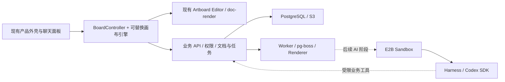

# Board 与 tldraw 接入复评

日期：2026-10-31。状态：**调研与接入建议，尚未决定切换默认引擎**。核对代码基线：`7676690`；本次没有安装 SDK、迁移数据或接入 AI，也没有运行 tldraw 性能试验。本文更新 Part 4 的 Board 选型假设；不把旧架构示意当作已实现能力。

## 结论与产品边界

建议继续以无限 Board 作为项目创作中心，把 **tldraw 列为下一阶段优先验证的交互引擎**。先抽取适配边界，再在内部开关下接入真实项目；许可、语义兼容和性能验收通过后才切换默认实现。保留已有高仿真外壳、Artboard 精修编辑器和真实后端。

采用的主要价值是减少选择、吸附、工具状态机、快捷键和未来连线等交互能力的长期维护成本；当前 DOM Board 已有有效虚拟化，不能用“换库就更快”论证迁移。

画布已被多款 AI 创作产品采用，但本次资料没有市场份额证据，也没有证明这些产品都使用 tldraw。更适合 Design-X 的组合是：**Board 组织创作上下文，聊天表达意图，节点图描述可复用流程，Editor 完成精修**。项目列表、素材检索、任务记录和设置继续使用列表、表单与面板。

| 官方产品资料 | 可确认的形态 | 对本项目的判断 |
|---|---|---|
| [Adobe Firefly 工作区](https://helpx.adobe.com/firefly/web/get-started/access-the-app/firefly-workspace-overview.html) | Boards 自由组织参考与方案；Graph（beta）承担节点工作流；另有 Assistant 和管理界面 | 自由创作空间与执行图需要明确分工 |
| [FLORA Canvas](https://flora.ai/product-canvas)、[FAUNA](https://docs.flora.ai/editor/fauna) | 节点画布与聊天侧栏配合，另有 Layer Editor | 对话可以读取选择和操作画布，同时保留精修入口 |
| [Spaces 官方页](https://www.magnific.com/spaces) | Freepik Spaces 地址当前跳转至 Magnific Spaces；定位协作式节点创作空间，提供生成、处理和模板 | 工作流模板与成品版式模板可以并存 |
| [ComfyUI App Mode](https://docs.comfy.org/interface/app-mode) | 同一工作流也可以通过输入/输出界面使用，隐藏节点图 | 不必要求普通创作者每次都手动连线 |

上述“对本项目的判断”是产品设计推论，不是厂商功能承诺。

## 引擎范围与候选

| 需求 | 建议 |
|---|---|
| 自由摆放画板、素材、便签、分区，兼顾未来连线 | 优先验证 tldraw；当前 DOM Board 保持可用作对照和回退 |
| 固定尺寸作品的图层、排版、裁剪和导出 | 保留现有 Editor、Creative Document 与 `doc-render` |
| 明确输入/输出端口、依赖与运行状态的节点编辑 | 若它成为主工作界面，另行比较 React Flow；若只是 Board 中的流程区域，优先验证 tldraw 自定义节点/绑定 |
| 任务执行、重试、取消、产物持久化 | 后端控制面负责；画布库不承担运行时职责 |

[tldraw 官方仓库](https://github.com/tldraw/tldraw)提供自定义 shape、工具和 UI 扩展，适合围绕已有产品构建创作空间。[React Flow](https://reactflow.dev/)是 MIT 的 React 节点编辑库，适合以端口和边为核心的工作流界面。首期不同时叠加两套画布引擎管理同一空间的相机、选择和事件。

[tldraw Workflow starter](https://tldraw.dev/starter-kits/workflow)可参考节点、端口和连线交互；官方明确其执行模型只是演示，可替换为服务端引擎。它不能直接替代本项目的持久任务系统。Starter 的 MIT 许可也不改变底层 SDK 的许可要求。

## 已核验的 SDK 条件

以下结论来自当前官方文档；UI、history 和 culling 的源码复核使用官方主线 `9e700c63f66c040f172dbd7fef936a888ac4b8cc`。主线可能领先 npm 发行版，安装后的行为以锁定版本的契约测试为准。

- 2026-10-31 直接读取 npm registry，`tldraw`、`@tldraw/editor`、`@tldraw/sync` 的 latest 均为 `5.6.0`，React peer 为 `^18.2.0 || ^19.2.1`；仓库锁定的 React 为 `19.3.1`，满足该声明，但不等于集成已通过。试验时锁定同版本，避免直接跟踪 GitHub main。来源：[tldraw 元数据](https://registry.npmjs.org/tldraw/latest)、[editor 元数据](https://registry.npmjs.org/@tldraw/editor/latest)、[sync 元数据](https://registry.npmjs.org/@tldraw/sync/latest)。
- SDK 是 source-available，并非 MIT/OSI 宽松开源。默认许可允许内部开发测试；生产须有适用的有效许可。商业年度许可采用询价，官方未公布金额；另有 100 天试用和需申请的非商业 hobby 路径。不能把传闻价格纳入预算，也不能用 starter 的许可覆盖 SDK。来源：[LICENSE](https://github.com/tldraw/tldraw/blob/main/LICENSE.md)、[定价](https://tldraw.dev/pricing)、[许可说明](https://tldraw.dev/community/license)。
- React DOM 自定义 shape 适合承载我们的只读预览，但不能视为自动获得 GPU 绘制性能。官方 culling 会保留 shape 的 DOM 并设置 `display:none`，选中/编辑中的对象还会排除剔除；重内容的卸载、缩略图与分帧策略仍需设计。来源：[FAQ](https://tldraw.dev/faq)、[culling](https://tldraw.dev/sdk-features/culling)。
- 可以定制 UI 保留现有外壳；隐藏默认工具栏不代表菜单、快捷键、剪贴板和焦点事件都已关闭。安装的发行版需要逐项验证事件路由。来源：[Custom UI 示例](https://tldraw.dev/examples/custom-ui)、[固定版本 UI 源码](https://github.com/tldraw/tldraw/blob/9e700c63f66c040f172dbd7fef936a888ac4b8cc/packages/tldraw/src/lib/ui/TldrawUi.tsx#L91-L104)。
- 许可校验与外部请求不能混为一谈。官方 FAQ 与许可页对静态资源、试用和 hobby 请求的描述不同；生产验证应针对选定版本、许可类型及自托管资源配置抓包，不作“天然零外呼”承诺。来源：[FAQ](https://tldraw.dev/faq)、[许可说明](https://tldraw.dev/community/license)。

## 当前仓库需要怎样调整

### 1. 先抽出实际可用的 BoardController / BoardEngine

`BoardEngine` 目前只存在于 [Part 4](04-frontend.md) 的示意代码，没有 `packages/board` 实现。当前交互、组织历史和保存集中在 [AIStudio.jsx](../../src/components/AIStudio.jsx)，[BoardWorld.jsx](../../src/components/BoardWorld.jsx) 已分离预览与可见性处理。

建议分成三部分：产品外壳保留布局与工具按钮；Controller 处理业务命令、映射、保存与冲突；Engine 管理当前交互中的 shape、选择、相机和 Board 历史。先让现有 DOM 实现通过这一边界，再增加 `TldrawBoardAdapter`。业务模块不直接依赖 SDK。

运行时只允许一个引擎修改 Board 几何。tldraw store 可以成为即时交互状态，Controller 在事务边界投影为自有 Board；服务端仍拥有已提交文档。避免旧 React `results` 与 SDK store 双向无限同步，也避免旧组织撤销栈与 SDK history 同时处理一次操作。

### 2. 自定义三类 shape，保持现有语义

| 对象 | 首期映射与约束 |
|---|---|
| Artboard | `dx-artboard` 只保存业务引用与显示几何，通过外部文档缓存和 `doc-render` 渲染；双击进入原 Editor。首期保留当前固定显示尺寸，禁止新增旋转、自由缩放和任意置顶能力 |
| 便签 | `dx-note` 保留纯文本、六位颜色和宽高；不要默认改成 SDK 富文本格式 |
| 分区 | `dx-section` 保留显式 `itemIds` 和平面绝对坐标；删除分区保留成员，不自动改变成员归属 |

现有 [BoardSchema](../../packages/doc-core/src/board.ts) 使用 `results/notes/sections`，尚无通用 `items/frame/z`。分区不可嵌套、成员只能属于一个分区；[board-state.js](../../src/components/board-state.js) 明确定义移动与删除行为。tldraw 内置 frame 具有父子坐标、裁剪和重设父项等语义，直接替换会改变现有行为。来源：[shape 关系](https://tldraw.dev/sdk-features/shapes)、[parenting](https://tldraw.dev/sdk-features/parenting)。

`shape:<业务ID>` 仅是适配层 ID，写回时恢复原 ID；后端 ID 校验不允许冒号。复制画板必须通过真实创建 API 建立新的 Artboard 文档，并保留返回的 `boardRevision`；仅复制 shape 会错误地共享同一份作品。

### 3. 先兼容真实保存，再演进数据和协作

当前 [saveStudio](../../packages/server-domain/src/projects.ts) 是 `baseRevision` 乐观锁下的整份 Board 更新，支持轻量 ack；[document-ops](../../packages/server-domain/src/document-ops.ts) 对 Board 记录 `replace_board`。这不是已实现的逐项 BoardOp 或实时协作协议。

首期复用 `PUT /projects/:id/studio?response=ack`、串行保存、409 提示及恢复机制，确保键盘、粘贴、删除、撤销/重做也触发保存，不能只监听 pointerup。服务端载入及远端更新应排除用户本地历史；先完成异步取数，再同步应用，检验自定义 side effect 是否产生额外 user 写入，防止保存回路。Artboard 内部编辑历史继续独立。来源：[tldraw history](https://tldraw.dev/sdk-features/history)、[remote 来源与后续写入源码](https://github.com/tldraw/tldraw/blob/9e700c63f66c040f172dbd7fef936a888ac4b8cc/packages/store/src/lib/Store.ts#L1301-L1348)。

现有 [`.dxproj` 包](../../packages/server-domain/src/import-format.ts) 为 schemaVersion 1，[导入器](../../apps/worker/src/import-project.ts)会重映射业务 ID 和素材引用。首期保持自有包格式，不嵌入 SDK snapshot；仅当增加 z-order、缩放、嵌套、绑定等新业务语义时，再扩展 Board schema、包版本和迁移器。**可争取兼容旧数据，但不能承诺任何功能扩展都零迁移。**

多人协作另立阶段，选择一个实时权威及其持久化协议；不能让 tldraw room 与现有整包 PUT 同时独立覆盖同一 Board。鉴权、房间生命周期、资源限制、素材存取和持久化仍须接入本项目后端。[官方 sync](https://tldraw.dev/docs/sync)提供能力，不等于现有 PostgreSQL/SSE 已获得协作。

### 4. 相机与选择拆出共享内容

当前 view/selection 随 Studio 保存，数据库尚无按用户的 `board_views`。建议先按账户、项目和浏览器标签页保存 session，旧 view 作为首次载入默认；若需要跨设备恢复，再实现用户级视口存储。来源：[SDK 持久化与 session](https://tldraw.dev/sdk-features/persistence)。

当前 CSS 是 `translate(view.x, view.y) scale(view.zoom)`；tldraw camera 使用 page-space 偏移。同一 viewport 原点下应映射为 `{x: view.x / view.zoom, y: view.y / view.zoom, z: view.zoom}`，反向乘回 zoom。侧栏宽度、容器偏移、缩放锚点和原视口边界都需要契约与浏览器验证，不能直接复用 x/y。[官方 camera](https://tldraw.dev/sdk-features/camera)。

### 5. 为未来工作流留边界，当前不接 AI

创作关系与执行关系分开：分区成员、摆放位置、版本谱系属于 Board；节点类型、输入输出端口、依赖、参数与版本属于 `WorkflowDefinition`；执行状态和产物引用属于 `WorkflowRun/Step`。画一条线不应自动启动任务，也不能把所有谱系箭头解释为执行依赖。

这些是后续模型建议，当前没有完整的 Workflow 编辑器或执行图服务。接入顺序仍遵守 [ADR-0001](../adr/0001-codex-e2b.md)：

tldraw 不改变 E2B 内运行 Codex SDK 的既定路线；未来 AI 和节点工作流通过服务端业务命令生成成果，浏览器不是执行权威。

## 分阶段验证与退出条件

| 阶段 | 可交付结果 | 放行条件 |
|---|---|---|
| A：隔离现有引擎 | DOM Board 通过 Controller/Engine 工作，UI 和 API 行为保持一致 | 当前 Board、Editor、导入及 200 板回归通过后单独提交 |
| B：tldraw 内部试验 | 同一真实项目在内部特性开关下使用三类自定义 shape；加载、编辑、保存、重开、导入导出完整 | 映射/历史/事件语义通过；使用适用的开发许可；不接 AI、不改默认引擎 |
| C：同负载比较 | DOM 与 tldraw production build 的功能、内存、帧间隔和 DOM 报告 | 达既有预算，解释相对基线的退化；完成许可成本判断后决定是否切换 |
| D：后续能力 | 按需求演进 schema、协作、工作流模型 | 每项独立版本和回归；AI 仍需单独阶段 |

旧稿“2–4 周对比 8–12 周”的估计早于当前实现，不再作为工期依据。先完成 B/C 的测量，再估算迁移成本；不为本次调研承诺固定时间。

**性能基线复用，不重新定义成轻量空卡片测试。** 已有 [验证报告](../implementation/board-performance.md)是本机 200 板 × 50 图层、100 便签、20 分区，初始只挂载 20 板，3,217 个页面 DOM，首板 DOM 三轮中位数 192.322 ms。平移 RAF p95 为 16.70 ms；这是固定本机的调度采样，不是普遍帧率保证。初始 GET 仍加载完整设计内容，不能靠引入 SDK 解决这一网络成本。

复用 `test:board`、`test:board-scale`、`test:editor`、`test:import`、`test:render` 和 `test:perf` 的真实 API 链路；更换引擎时允许调整 DOM 定位器，但不削减业务断言。另补：

- shape/业务 ID 和 camera 双向转换；新旧包往返、复制文档引用正确、退出并重开保留位置。
- 分区删除与屏外成员移动、全选 320 项、撤销/重做、pointercancel、取消拖动、失焦和卸载时保存。
- 中文输入法真实组合输入、剪贴板、键盘焦点在 Board/便签/Editor/侧栏间切换。
- 200 个 Artboard 的预览子树按视野管理；保留 shape 选择几何不应强制挂载所有重内容，尤其 SDK 将选中对象排除剔除时。
- 同 fixture、同视口、同浏览器的 production 三轮比较，记录重预览数、DOM、堆与长任务、RAF、输入脚本时间、首屏和网络；保留既有六项预算。
- 新增独立压力组：每板 150 图层、不同私有素材、真正完整 200 板低倍率总览。既有样本共用图片，现有最低 20% 的 fit 并未显示完整 200 板，不能冒用为这些场景的结果。

若许可不合适、旧语义无法兼容或性能退化无法解释，继续使用 DOM 实现；已抽取的适配边界和测试仍有价值。不能以本次官方文档调研代替上述安装后验证。
