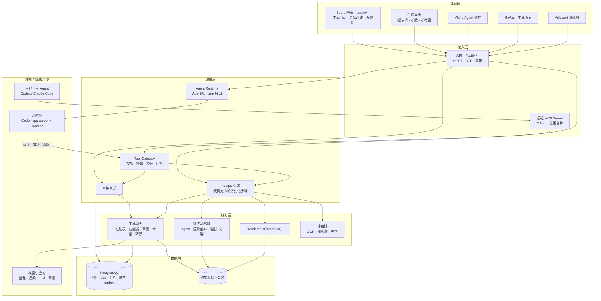
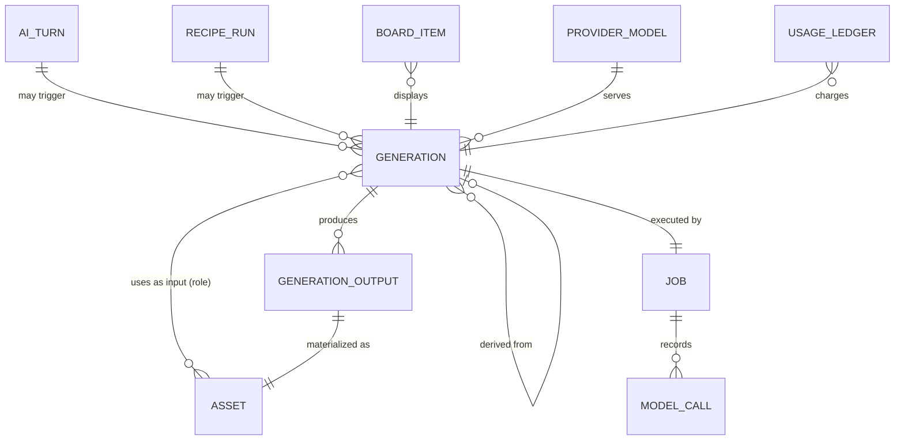
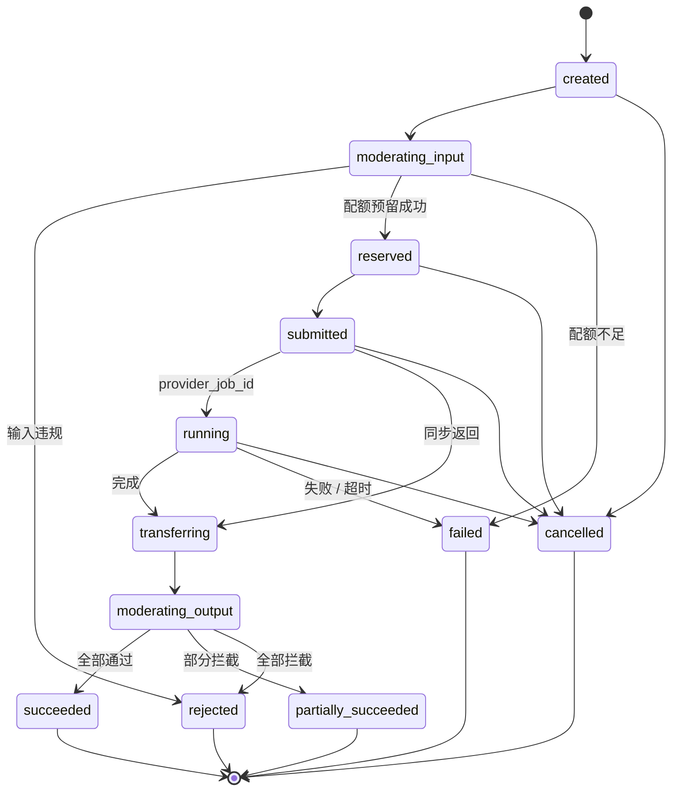
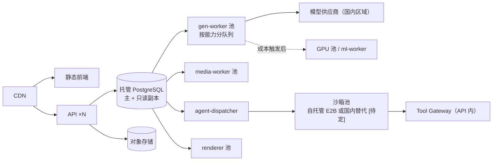

# Part 13 · 创作型 AI 平台架构设计方案

- 日期：2026-11-08
- 状态：**提议（Proposed）**。其中修订 ADR-0001 的部分（§6.3）需用户确认后另立 ADR
- 关系：补充 [Part 5](05-backend-and-ai.md) 和 [Part 7](07-data-and-interfaces.md)；在 [ADR-0001](../adr/0001-codex-e2b.md) 基础上细化 Agent 层
- 参考：Design X 现有代码（`apps/harness`、`packages/ai-runtime`、`apps/worker`）、WorkX Codex Harness、开源项目 [infinite-canvas](https://github.com/basketikun/infinite-canvas)（MIT，2026-10-25 快照）
- 标注约定同 [README](README.md#标注约定)：[已核验] / [二手] / [假设] / [待定]

## 0. 摘要

Design X 的目标是从"AI 可编辑设计"扩展成类似即梦的创作型 AI 平台：生图、改图、生视频、画布编排、资产沉淀，再加 Agent 协作。本方案的核心判断如下：

1. **地基是"生成"，不是"Agent"。** 创作平台的大部分请求是"提示词 + 参数 + 参考图 → 生成"，不需要 Agent。要先建**生成网关**和**一等生成记录（`generations`）**，Agent 只是调用它们的上层客户端之一。
2. **每一次生成都是可重放、可派生的记录。** 再次生成、做同款、变体、局部重绘、高清、扩图、图生视频，本质上都是在**生成谱系图**上派生新节点。这张图在画布上可以直接看到，借鉴 infinite-canvas 的"配置节点 → 结果节点 + 连线"。
3. **三个可替换接缝**：模型供应商（`GenerationAdapter`）、Agent 宿主（`AgentRuntime`）、执行沙箱（`SandboxProvider`）。产品数据只放在 Design X 控制面，任何一个接缝换实现都不动地基。
4. **业务工具统一用 MCP 暴露。** 同一套工具既服务平台托管的 Agent（Codex app-server），也服务用户自带的 Agent（本机 Codex 或 Claude Code 通过远程 MCP 接入）。
5. **合规、成本、地域是一等约束。** 审核、AI 标识、计量账本、部署地域在第一条生成链路里就要做，不留到上线前补。**沙箱和模型的部署地域是当前最大的返工风险，要最先验证。**

## 1. 背景与目标

### 1.1 产品能力范围

| 能力域 | 内容 | 阶段 |
|---|---|---|
| 生成 | 文生图、图生图、多参考图、风格/主体参考 | G1 |
| 编辑 | 局部重绘、消除、扩图、高清、抠图、图层分解 | G2 |
| 设计 | 可编辑 Artboard（文字、图层、模板）；位图转可编辑 | 已有，G2 扩展 |
| 视频 | 文生视频、图生视频、首尾帧、续写、配音配乐 | G4 |
| 画布 | 无限 Board：生成节点、谱系连线、方案组、对比 | G1 起 |
| 资产 | 素材库、生成历史、收藏、标签、相似检索、品牌套件 | G1 起 |
| Agent | 多步创作、澄清提问、批量与组合任务、自带 Agent 接入 | G3 |
| 社区 | 作品发布、做同款（需要产品证据，见 Part 1 非目标） | 后续 |

### 1.2 与现有定位的关系

Part 7 §G.1 规定"候选就是可编辑 Artboard，不是图片"。本方案保留这一点，同时把**位图生成结果**也作为一等产物：

- **位图产物**：`generation_outputs → assets(kind=generated)`，放在 Board 上作为图片节点。
- **设计产物**：`documents(kind=artboard)`，仍然是可编辑的 Creative Document。
- **两者之间的桥梁**：图层分解、抠图、OCR 把位图转成 Artboard；Renderer 把 Artboard 导出成位图，再作为下一次生成的参考图。

"位图生成 + 可编辑设计"在同一张画布上互相转换，这是 Design X 相对纯生图平台的差异点。

### 1.3 非目标

- 不自研基础生成模型。自托管只在成本触发时引入（§5.7）。
- 不做通用工作流搭建器（ComfyUI 那种节点编程）。画布节点表达的是**创作谱系**，不是可编程 DAG。
- 不让模型或 Agent 直接写业务数据（延续 AD-10）。

## 2. 设计原则

| # | 原则 | 落地方式 |
|---|---|---|
| P1 | 控制面是唯一真相源 | PostgreSQL 加对象存储。SDK thread、沙箱文件、供应商 URL 都不是产品数据 |
| P2 | 生成优先，Agent 其次 | 直接生成不经过 Agent 和沙箱；Agent 只通过工具触发同一条生成路径 |
| P3 | 生成即记录 | 每次生成都完整记下输入、参数、模型版本、seed 和父生成，支持重放与派生 |
| P4 | 接缝可替换 | Adapter、AgentRuntime、SandboxProvider 三个接口，配契约测试 |
| P5 | 异步是默认 | 所有生成都走 jobs 状态机；同步返回的供应商也按异步模型处理 |
| P6 | 显式路由，不隐式回退 | 延续 AD-11：换模型会改变创作结果，必须由配置或用户选择触发 |
| P7 | 合规内建 | 生成前后审核、隐式与显式标识、来源记录都在主链路上 |
| P8 | 成本可见 | 提交前预估，执行时预留，完成后结算；每个产物都能追溯到成本 |

## 3. 总体架构



横切能力：身份与租户（RLS）、配额计费、审核合规、审计、可观测（OpenTelemetry），贯穿 L2 到 L5。

### 3.1 三种请求路径

| 路径 | 场景 | 是否经过 LLM | 是否经过沙箱 | 预计占比 |
|---|---|---|---|---|
| 直接生成 | 面板提交、画布节点"运行"、再次生成、派生操作 | 只在可选的提示词增强步骤 | 否 | 绝大多数 [假设] |
| Recipe | 商品套图、海报改尺寸等固定流程 | 只在结构化步骤 | 否 | 中等 |
| Agent 回合 | 模糊、多步、需要澄清或组合的请求 | 是 | 平台托管时是 | 少数，但单次成本最高 |

三条路径最后都汇入**同一个生成网关**。生成记录、审核、计量、谱系只实现一次。

## 4. 核心领域模型

### 4.1 实体关系



### 4.2 `generations`：用户可见的创作记录

**generation 和 job 分开建模**：generation 是长期保存、可重放的创作记录；job 是一次执行，可以重试，也可以清理。

| 字段 | 说明 |
|---|---|
| `id`, `workspace_id`, `project_id`, `created_by` | 租户与归属，开启 RLS |
| `origin`, `origin_ref` | `direct \| recipe \| agent \| mcp \| api`，以及对应的 turn、recipe_run 或 MCP 会话 |
| `capability` | 例如 `image.generate`，见 §5.1 |
| `provider_model_id`, `model_version` | 指向 `provider_models`，记录实际调用的版本 |
| `prompt`, `negative_prompt` | 用户原文 |
| `prompt_final`, `prompt_enhancer` | 增强后实际发给模型的提示词，以及增强用的模型；不增强时为空 |
| `params` | 归一化参数：比例、尺寸、数量、强度、风格预设、时长等 |
| `provider_params` | 供应商特有参数的透传，按 schema 校验 |
| `seed` | 用户指定或平台生成；供应商不支持时记为空 |
| `inputs` | `[{asset_id, role, weight?}]`。role 取值：`reference \| init \| mask \| style \| subject \| first_frame \| last_frame \| audio` |
| `parent_generation_id`, `derive_kind` | `regenerate \| variation \| edit \| inpaint \| outpaint \| upscale \| cutout \| decompose \| animate \| extend \| remix` |
| `status`, `stage` | 见 §5.4 状态机 |
| `idempotency_key` | `(workspace_id, idempotency_key)` 唯一 |
| `cost_estimate`, `cost_actual`, `credits` | 平台积分与人民币成本，分开记录 |
| `moderation` | 输入和输出的审核结论摘要 |
| `error_class`, `error_public` | 错误分类，加上可以展示给用户的错误信息 |

`generation_outputs`：`generation_id, index, asset_id, status, seed_actual, moderation_verdict, scores(jsonb)`。一次请求生成 4 张图时，**单张失败或被审核拦截不影响其他几张**。

`asset_lineage`：在生成提交时写入边 `(from_asset_id, to_asset_id, generation_id, kind)`，用来快速查询"这张图从哪来、派生出了什么"。它可以从 `generations` 重建，但为了查询性能单独物化。

### 4.3 与现有实体的关系

| 现有实体 | 变化 |
|---|---|
| `assets` | 新增 `kind=generated`；`provenance` 改为引用 `generation_id`，不再内嵌一份 JSON |
| `jobs` | `kind=gen.image / gen.video / gen.poll` 指向 `generation_id`；仍是执行状态机 |
| `model_calls` | 每次供应商调用一行，包括重试和轮询之外的调用；关联 job 和 generation |
| `ai_turns` / `ai_attempts` | 保留。Agent 通过工具触发的生成，其 `origin_ref` 指向 turn |
| Board 文档 | 新增 `generation` 类型的条目（引用 `generation_id`）和谱系连线，见 §7.1 |

## 5. 生成网关

生成网关是平台的心脏。它在进程内以库的形式实现（`packages/generation`），由 Worker 执行；满足 Part 5 §E.2.3 的拆分条件后再独立部署。

### 5.1 能力模型

```text
image.generate   image.edit     image.inpaint   image.outpaint
image.upscale    image.cutout   image.decompose image.describe
video.t2v        video.i2v      video.extend    video.lipsync
audio.tts        audio.music    llm.chat        llm.structured
vision.analyze   moderation.text moderation.image
```

每种能力都有平台定义的**归一化请求 schema**。供应商的差异放进 `provider_params` 和注册表里的 `limits`。

### 5.2 模型注册表

注册表是代码里的配置，经过代码评审，按环境覆盖，同时同步一份到 `provider_models` 表供审计和展示（延续 Part 5 §E.4.6）：

```yaml
- id: volc.seedream-x            # 示例，实际 model_id 以控制台为准 [待定]
  provider: volcengine-ark
  version: "2026-xx"
  capabilities: [image.generate, image.edit]
  region: cn
  mode: async                    # sync | async | callback
  limits: { max_refs: 10, ratios: ["1:1","3:4","9:16","16:9"], max_pixels: 4194304, max_count: 4 }
  supports: { seed: true, negative_prompt: false, cancel: false }
  pricing: { unit: image, cny: null, credits: null }   # 上线前从控制台录入 [待定]
  concurrency: { per_provider: 20, per_workspace: 4 }
  status: candidate              # candidate | active | deprecated | disabled
  display: { name: "…", badge: "…", tier: standard }
```

规则：

- `status=deprecated` 的模型仍然能**重放**历史生成（如果供应商还在提供），但新建时不再展示。
- 模型下线后，历史生成的"再次生成"要明确提示"原模型已下线"，让用户选择替代模型，不能静默替换。
- 自托管模型（§5.7）也作为普通条目注册，`provider=self-hosted`。

### 5.3 适配器接口

```ts
interface GenerationAdapter {
  readonly provider: string;
  validate(req: NormalizedRequest, model: ModelSpec): ProviderRequest;      // 不满足 limits 就抛出 permanent 错误
  estimate(req: NormalizedRequest, model: ModelSpec): CostEstimate;
  submit(req: ProviderRequest, ctx: CallCtx): Promise<
    | { kind: "done"; outputs: ProviderOutput[] }
    | { kind: "pending"; providerJobId: string; pollAfterMs?: number }
  >;
  poll?(providerJobId: string, ctx: CallCtx): Promise<ProviderStatus>;
  verifyCallback?(headers: Headers, body: unknown): ProviderStatus | null;
  cancel?(providerJobId: string, ctx: CallCtx): Promise<void>;
  classify(error: unknown): "transient" | "permanent" | "moderation" | "quota" | "unknown";
}
```

- 参考图通过短时效的预签名 GET 或供应商文件 API 传入（Part 5 §E.6）。
- `ProviderOutput` 只能是字节流，或者网关下载后立即转存的临时 URL。**供应商 URL 永远不写进文档，也不返回给浏览器。**
- 每个适配器都有契约测试：录制回放加少量真实冒烟调用，覆盖成功、审核拒绝、超时、429、部分失败。

### 5.4 生成状态机



- 每个阶段都有完成标记，重新投递时从未完成的阶段继续（Part 5 §E.5）。
- `job.reconcile` 负责补拉"有 `provider_job_id` 但没有结果"的任务。如果供应商不支持取消，结果晚到时直接丢弃，并删除已转存的对象。
- 进入终态时结算配额：按实际产出的张数或秒数提交，失败和被拦截的部分返还。

### 5.5 提示词层

- **增强是可选步骤**：用户开启后，用一个廉价 LLM 改写提示词。改写前后都记进 `generations`，界面可以对比、回退。
- **风格预设、模板提示词、负向提示词**作为版本化资源（`prompt_presets`），生成时记录预设的 ID 和版本，避免预设改动后无法重放。
- 用户文本、OCR 文字、文件名一律放进数据区（Part 5 §E.4.5），防止提示注入。

### 5.6 背压与公平

- 每个供应商、每个模型各有一组并发令牌；每个 workspace 有生成并发上限；按套餐分优先级队列 [假设]。
- 对用户展示排队位置和预计耗时，提供方式是 SSE 推送 `generation.progress`。
- 设全局成本熔断（Part 5 §E.7）。

### 5.7 自托管模型

触发条件（满足任一）：某个能力的月成本超过阈值；需要供应商不提供的能力（如私有 LoRA、品牌风格模型）；数据不能出域。

做法：`ml-worker`（Python，GPU 池）作为一个 `GenerationAdapter` 接入。如果要用 ComfyUI 一类的工作流后端，**也只作为某个 Adapter 内部的实现细节**，不作为平台的编排层，避免两套编排语义。抠图、高清这类小模型优先自托管（Part 5 已列出 BiRefNet 的许可核验结论）。

## 6. 编排层

### 6.1 直接生成

`POST /v1/generations` → 事务内写 `generations` 和 `jobs`，并 `boss.send()` → 返回 `generation_id` → 前端订阅 SSE。

派生操作是同一个接口，带上 `parent_generation_id` 和 `derive_kind`：

| 用户操作 | 请求 |
|---|---|
| 再次生成 | 复制父生成的参数，换一个新 seed |
| 做同款 | 复制参数和提示词，替换主体参考图 |
| 变体 | `derive_kind=variation`，输入为父产物 |
| 局部重绘 / 扩图 / 高清 / 抠图 | 对应的 `image.*` 能力，输入为父产物加 mask 或参数 |
| 图生视频 | `video.i2v`，`first_frame` 为父产物 |

### 6.2 Recipe 引擎

延续 Part 5 §E.4.2：代码定义、版本化、每步有 schema、预算、超时和幂等键。补充三点：

- Recipe 里的生成步骤**一律调用生成网关**，产出普通的 `generations`。这样谱系、计量、审核都不需要特殊处理。
- 长时子任务（比如视频）用 `job_waiters` 挂起，不占用 Worker。
- 引入工作流引擎（Temporal、Restate、DBOS 等）的触发条件：单个 Recipe 超过约 20 步或包含人工审批；或批次超过 1,000 个子任务（Part 10 已列）；或 pg-boss 加 awaiter 的状态机复杂到难以测试 [假设]。触发前不引入。

### 6.3 Agent Runtime

#### 6.3.1 接口

```ts
interface AgentRuntime {
  open(spec: RunSpec): Promise<RunHandle>;                // 绑定沙箱，启动宿主进程，注入 MCP 配置
  turn(h: RunHandle, input: TurnInput): AsyncIterable<AgentEvent>;
  interrupt(h: RunHandle, turnId: string): Promise<void>;
  answer(h: RunHandle, requestId: string, answer: unknown): Promise<void>;
  close(h: RunHandle, mode: "pause" | "destroy"): Promise<void>;
}

type AgentEvent =
  | { type: "message.delta" | "message.completed"; text: string }
  | { type: "reasoning.summary"; text: string }
  | { type: "plan.updated"; steps: PlanStep[] }
  | { type: "tool.started" | "tool.completed"; toolCallId: string; name: string }
  | { type: "ask_user"; requestId: string; question: string; options?: string[] }
  | { type: "turn.completed"; usage: Usage }
  | { type: "error"; class: ErrorClass; message: string };
```

控制面只认识 `AgentEvent`。事件按 `(run_id, attempt, seq)` 去重、落库，再通过 outbox 和 SSE 推给浏览器（ADR-0001 协议不变）。

#### 6.3.2 适配器

| 适配器 | 状态 | 说明 |
|---|---|---|
| `codex-exec` | 现状（ADR-0001） | `@openai/codex-sdk` → `codex exec --experimental-json`。单向，适合一次提交、一次取回 |
| `codex-app-server` | **建议作为主适配器** | 沙箱内运行 `codex app-server`，走 JSON-RPC：`thread/start / resume / fork`、`turn/start`（可带 `outputSchema`）、`turn/interrupt`。支持执行中提问、中断、同一 thread 连续多轮。infinite-canvas 的 `canvas-agent/src/agent/codex-client.ts` 是同技术栈的现成参考 |
| 其他宿主 | 预留 | Claude Agent SDK、OpenAI Agents SDK，或自研循环。只要实现 `AgentRuntime` 并消费同一套 MCP 工具即可 |

**从 `codex-exec` 切换到 `codex-app-server` 修订了 ADR-0001 的"当前 SDK 路线保持不变"，需要用户确认后另立 ADR。** 切换前要用真实 E2B、目标 Codex 版本和 DeepSeek 跑通下面四个验收场景：

1. 带参考图生成可编辑画板，继续修改时正确保留原版本。
2. 执行中提问，收到回答后继续；用户停止后没有迟到的提交。
3. Worker 重启或沙箱丢失后，从业务上下文恢复，或者明确结束；结果是否已提交不确定时先对账。
4. 并发执行时，授权、预算、超时依然生效；实测首个结果耗时和每轮成本。

另外，Codex 版本要在模板里固定，并和 WorkX 统一升级节奏，避免两个仓库各自漂移（目前一个是 0.144，一个是 0.166）。

#### 6.3.3 状态与恢复

- **真相源是业务上下文**：会话消息、Board 和 Artboard 当前版本、已确认的工具调用、生成记录。任何一轮都能从这些数据重建 thread。
- **原生 thread 续接只是优化**：同一个沙箱还活着时，用 `thread/resume` 节省 token 和延迟。**不把 Codex 原生会话文件当作持久化格式**，因为它是上游的内部格式，随版本变化。WorkX 保存原生文件再恢复的做法不作为 Design X 的地基。
- **沙箱按会话复用**：同一个 AI 会话内多轮复用一个沙箱，空闲时暂停，超时后销毁 [假设：以 E2B 暂停和恢复的实测成本与延迟为准]。不再每一轮新建沙箱。

#### 6.3.4 工具面（MCP）

工具由控制面的 **Tool Gateway** 实现，以 MCP 协议暴露。平台托管的沙箱通过出站白名单加能力令牌访问；用户自带的 Agent 通过远程 MCP 加 OAuth 访问。两边用**同一份**工具定义。

| 级别 | 工具（示例） | 规则 |
|---|---|---|
| 读 | `board.describe`、`artboard.describe`、`assets.search`、`generations.get`、`lineage.get` | 免费；返回 ID 和摘要，**不返回 URL** |
| 提议 | `artboard.propose_ops`、`artboard.create_version`、`board.place_items` | 只产生 Proposal 或新版本；位置由确定性布局算法决定 |
| 生成 | `generations.create`（含派生）、`recipes.run` | 有成本；按预算扣减；超过单次阈值时转成用户审批 |
| 等待 | `jobs.await` | 挂起回合，释放 Worker |
| 交互 | `ask_user` | 通过 `AgentEvent.ask_user` 推给前端 |

工具设计参考 infinite-canvas：底层提供一个判别联合的 `apply_ops`，上层提供 `create_image_prompt_flow`、`run_generation` 这类高层工具，减少 Agent 的调用步数和出错面。

所有工具调用都带稳定的 `tool_call_id`，Tool Gateway 逐次校验租约、租户、权限、schema、预算和幂等（ADR-0001）。

#### 6.3.5 用户自带 Agent（BYO Agent）

- 对外提供远程 MCP 端点 `/mcp`，用 OAuth 授权，令牌限定项目、工具集、预算和有效期。
- 用户在自己电脑上的 Codex 或 Claude Code 里添加这个 MCP 后，就能操作云端 Board。Agent 的算力和 token 由用户承担，生成费用仍然从平台积分扣。
- 写操作照样走 Proposal，网页端可以确认，和平台托管的 Agent 一样。

## 7. 画布、资产与可编辑性

### 7.1 Board 上的生成节点

- 新增 Board 条目 `generation`：显示提示词摘要、模型、参数，以及 1 到 N 个产物缩略图。点开就是参数面板，可以修改后运行（产生一个新的子生成）。
- **谱系连线**：输入素材 → generation → 产物，用 tldraw binding 实现。删除连线不删除谱系记录；谱系以 `generations` 为准，Board 只是视图（延续 AD-01）。
- 方案组（`result_group`）继续承载 Artboard 候选；位图产物可以拖进 Artboard 成为图层。

### 7.2 资产库

- **内容寻址**：用 sha256 去重，生成多种渲染副本（缩略图、预览、原图）。
- **自动标注**：ingest 后异步调用 `vision.analyze` 生成标签、主色、主体描述。之后引入向量检索（pgvector）来做"相似图"和语义搜索 [假设：评估 pgvector 在国内托管 PostgreSQL 上是否可用]。
- **生成历史**就是 `generations` 的列表视图，可以按模型、能力、项目、时间筛选，可以从任意一条"再次生成"。
- 使用权：`assets.rights` 记录上传方声明；生成产物记录模型来源和服务协议版本。

### 7.3 位图转可编辑

`image.decompose`（图层分解）、`image.cutout`（抠图）、OCR 识别文字 → `doc-core` 组装成 Artboard v1。文字变成真实文字节点，可以修改。这条链路是 Design X 的差异化能力，放在 G2 阶段。

## 8. 异步、事件与实时

- `jobs` 是业务状态机，pg-boss 负责投递，两者在同一事务内写入（Part 5 §E.5）。
- 事件统一走 outbox，SSE 带游标补发。新增 `generation.*` 事件族：`created / progress / output.ready / completed / failed`。
- 视频这类长任务（分钟级）要支持离开页面后的站内通知；回调要验签，并且以轮询兜底。
- 队列按能力和供应商分开，避免视频任务拖慢生图。pg-boss 吞吐的瓶颈阈值在 G1 压测中实测 [假设]。

## 9. 安全、多租户与合规

| 主题 | 设计 |
|---|---|
| 租户隔离 | workspace 为租户；应用层 `authz.can()` 加 PostgreSQL RLS（Part 5 §E.3） |
| 凭证 | 模型 Key、E2B 管理凭证、对象存储主凭证只在控制面；沙箱拿到的是绑定运行的能力令牌；模型凭证由出站代理注入（现有实现） |
| 沙箱网络 | 入站私有；出站只允许模型端点和 Tool Gateway |
| 插件 | 吸取 infinite-canvas 的教训：它的模型插件用 `new Function`、节点插件用动态 `import()`，都直接跑在主页面。多租户平台里这等于 XSS。插件必须跑在隔离的 iframe 或 Worker 里，通过 postMessage 加能力白名单通信；模型适配一律在服务端声明式注册 |
| 审核 | 文本输入、参考图、生成产物都要审核；分级处置（拦截、打码、人工复核）；审核结果写进 `moderation_events` |
| AI 标识 | 隐式标识写进文件元数据，显式标识在界面和导出时标注，按 GB 45438-2025 实现 [待定：取得标准全文] |
| 备案 | 生成式 AI 服务和算法备案，以及所用模型的备案信息公示 [假设：法务确认] |
| **数据地域** | 用户素材和生成内容是否允许出境，决定沙箱和模型的选型。**这是 G0 的首要验证项（§13）** |

## 10. 计量、配额与计费

- **积分模型**：用户看到的是积分，内部同时记录人民币成本。价格表版本化（`price_books`），每次生成记录所用的价格版本。
- 流程是预估、预留、结算、返还，账本只追加（Part 5 §E.7）。**提交前在界面上显示预估积分。**
- Agent 回合单独计量：LLM token、沙箱时长、工具触发的生成分别记账，汇总到 turn。
- 防滥用：新账号限额、并发上限、异常速率检测、全局成本熔断。

## 11. 可观测性与质量

| 维度 | 指标 |
|---|---|
| 链路 | 一个 trace 贯穿 API → job → adapter → 供应商；`model_calls` 记录耗时、成本和请求哈希 |
| 体验 | 首图耗时（TTFI）、排队时长、取消率 |
| 可靠性 | 分模型的成功率、各类错误占比、重试率、对账修复数 |
| 成本 | 单张、单秒视频、单个 Agent 回合的成本，按模型和套餐分别统计 |
| 质量 | 隐式反馈（下载、收藏、再次生成、删除）、评估器分数、固定评测集的回归结果 |
| 合规 | 输入和输出的拦截率、人工复核积压 |

新模型上线流程：`candidate` → 内部评测集 → 小流量灰度（用户主动选择）→ `active`。没有隐式切换。

## 12. 部署拓扑（目标）



按 Part 5 §E.2.3 的触发条件拆分服务。首个拆出的大概率是 gen-worker（按能力扩缩），其次是 Tool Gateway 和远程 MCP（独立暴露面）[假设]。

## 13. 现状差距

| 领域 | 现状（2026-11-08 代码） | 目标 | 差距 |
|---|---|---|---|
| 生图 | 无。`gen.image`、`ImageAdapter`、注册表都只在文档里 | 生成网关加至少 1 个国内图片模型 | **大** |
| 生成记录与谱系 | 只有 `assets.provenance` 的设计 | `generations`、`generation_outputs`、`asset_lineage` | **大** |
| Agent 宿主 | `codex exec`，每轮一个新沙箱和新 thread | `AgentRuntime` 加 app-server 适配器，会话级沙箱 | 中 |
| 工具桥 | 没有业务工具，Agent 用 shell 写 `artifact.json` | 控制面 Tool Gateway 通过 MCP 暴露 | 中 |
| 产物校验与提交 | 已有：manifest 校验、Proposal、版本 CAS、fencing | 保留，并扩展到工具产物 | 小 |
| 控制面基础 | 已有：PostgreSQL、pg-boss、对象存储、SSE、Renderer | 保留 | 小 |
| 计量与审核 | 只有设计 | 账本、价格表、审核适配器 | 大 |
| 部署地域 | E2B 云服务（海外托管） | 符合数据地域要求的沙箱 | **未验证，风险最高** |

## 14. 演进路线

和 Part 10 的 M 系列里程碑并行，这条是"AI 地基"轨道。每个阶段都有退出条件。

| 阶段 | 范围 | 退出条件 |
|---|---|---|
| **G0 地基验证**（2–3 周） | ① 沙箱地域：在目标云上自托管 E2B，或选定国内替代，用 `SandboxProvider` 接口跑通现有 Harness；② 选定 1 个国内图片模型并核实开通状态、价格、备案；③ `generations` 和谱系的 schema 评审 | 地域方案 go/no-go；模型可调用；本文档相关部分转为 ADR |
| **G1 生成闭环** | 生成网关、1 个模型、直接生成、Board 生成节点、生成历史、输入输出审核、积分账本、SSE 进度 | 端到端：提交 → 审核 → 生成 → 转存 → 标识 → 上画布 → 再次生成和派生；故障注入（超时、429、审核拦截、Worker 重启）都通过 |
| **G2 编辑与可编辑化** | 局部重绘、扩图、高清、抠图、图层分解转 Artboard；第 2 个供应商；Recipe 改为调用网关 | 同一能力两个供应商通过同一套契约测试；位图转可编辑的验收集 |
| **G3 Agent 平台化** | `AgentRuntime` 接口；把 `codex-exec` 包成适配器；Tool Gateway 加 MCP；app-server 适配器通过 §6.3.2 的四个场景；会话级沙箱；远程 MCP（BYO Agent） | 切换 ADR 获批；两种宿主共用一份工具定义；预算和审批生效 |
| **G4 视频与长流程** | `video.*` 能力、分镜文档、长任务通知、FFmpeg 链路；评估是否需要工作流引擎 | 30 分钟级任务的取消、恢复、对账、部分结果都能验证 |
| G5 及以后 | 团队协作、模板和技能市场、社区作品、自托管模型 | 按产品证据和成本触发 |

**顺序的关键**：G0 先于一切；G1 先于 G3。Agent 层在生成网关就位之后再平台化，这时它只是替换适配器、接上工具，不再牵动地基。

## 15. 待立决策（提议）

| ID | 决策 | 状态 |
|---|---|---|
| AD-14 | 生成网关加 `generations` 一等记录；generation 与 job 分离；谱系物化 | 提议 |
| AD-15 | `AgentRuntime` 接口加 MCP Tool Gateway；Codex app-server 为主适配器（修订 ADR-0001） | 提议，**需用户决策** |
| AD-16 | 沙箱与模型的部署地域；`SandboxProvider` 接口 | 待定（G0 验证） |
| AD-17 | 远程 MCP 对外开放（BYO Agent） | 提议 |
| AD-18 | 插件隔离：前端插件只能在 iframe 或 Worker 里运行；模型适配只在服务端注册 | 提议 |
| AD-19 | Agent 会话以业务上下文为真相源；原生 thread 只作缓存 | 提议 |

## 16. 风险

| 风险 | 影响 | 应对 |
|---|---|---|
| 沙箱或模型地域不合规 | 执行层重做 | G0 最先验证；有 `SandboxProvider` 接缝 |
| Codex 上游协议变化（`experimental` 字段、配置项） | Agent 层中断 | 固定版本；契约测试；`AgentRuntime` 可替换 |
| 非 OpenAI 模型在 Codex 上的工具调用质量不稳 | Agent 效果差 | 固定评测集；必要时更换 Agent 宿主，工具不变 |
| 供应商下线或改价 | 历史生成无法重放，成本失控 | 注册表版本化、价格表版本化、显式替代提示 |
| 生成成本被滥用 | 账单失控 | 预留式扣费、并发限额、熔断 |
| 谱系模型设计不足 | 后期补派生能力时要迁移数据 | G0 评审 schema，覆盖 §6.1 全部派生类型 |
| pg-boss 吞吐瓶颈 | 高峰排队变长 | G1 压测；按能力分队列；预留迁移到专用队列的接缝 |
