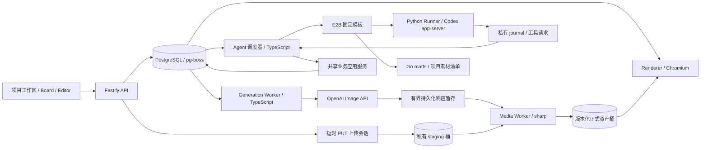
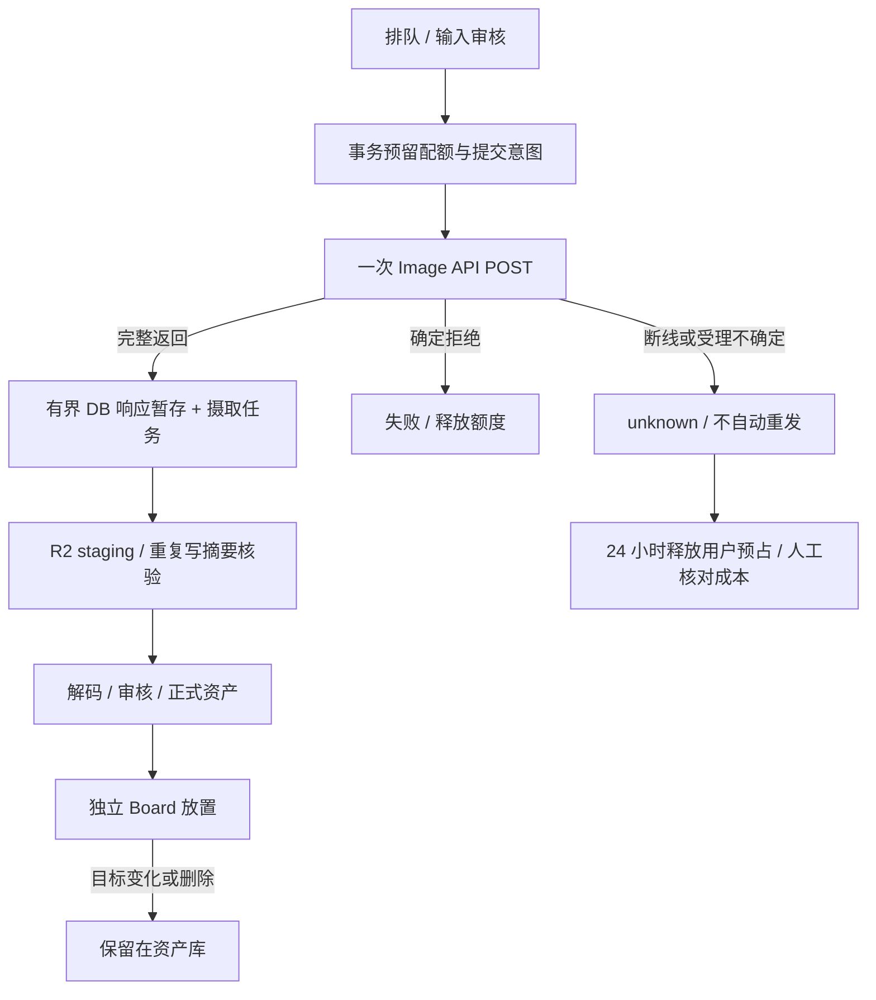

# Design X v2：创作平台与独立执行组件

日期：2026-11-08。本文是用户已批准方案的实施基线；取代 Part 13 中尚未实施的泛平台假设。真实验收与尚未完成的环境检查分别记录在 [v2 验收记录](../implementation/v2-verification.md)。

## 边界与进程

Design X 独立部署、独立数据库、权限、R2 桶及 E2B 模板，不调用 WorkX 在线业务服务。业务后端保持 TypeScript。Python 只运行沙箱 Runner，Go 只运行 root 所有的 matfs；两者均没有业务 HTTP 服务。首期支持图片、可编辑设计、三个 Recipe、对话续改和导出，不启用视频、支付、实时协作、外部 MCP、插件市场或自托管 GPU。

生产进程角色为 API、generation、media、agent、import、renderer；开发可以使用 `WORKER_ROLE=all`。保留 pg-boss，没有增加 Redis、Kafka 或 Temporal。Web 静态构建由独立 Nginx 镜像提供，API/SSE 经同源代理进入控制面。

## 产品闭环与能力目录

首页、模板、提示词预设、可执行 Recipe、素材库均创建或进入真实项目。提示词预设只填充输入，执行配方必须提供 `recipeId + recipeVersion + parameters`。服务端 `/api/capabilities` 是模式、参考图上限、数量、模型、图片尺寸、配方和配额的来源。未启用能力在提交前禁用。

图片生成保存为独立 `kind: image` Board 条目，绑定资产版本和生成记录，没有伪造 Artboard 文档。明确操作“加入画板”才生成可编辑图片图层文档。营销海报、商品套图使用生成视觉素材，再确定性组合独立标题、正文、品牌和 CTA 图层；多尺寸配方基于既有 Artboard 创建新文档，保持原稿。位图分解不在本期。

对话续改默认创建新版本；勾选覆盖才进入既有 Proposal/CAS。Editor 保存先接受成功响应里的 revision，项目列表后台刷新失败只提示列表问题，不能把成功保存改判失败。远程结果继续进入现有三方合并、撤销基线更新和草稿保护流程。项目活动聚合 Agent、生成、交互、文档版本和导出。原生提问、回答及停止使用持久化命令 ID，可跨刷新恢复。

## 领域模型及不可变输入

| 表 | 职责 |
|---|---|
| `asset_versions` | 版本路径、桶、字节数、SHA-256、媒体信息、来源；禁止 UPDATE |
| `project_assets` | 显式项目关联、可选锁定版本、撤权时间 |
| `upload_sessions` | 声明大小/摘要、短期 staging 路径、摄取任务和状态 |
| `creative_requests` | 不可变请求快照；执行、产物、取消、结算四个独立字段 |
| `generation_attempts` | 单张提交身份、fence、deadline、提交状态 |
| `provider_calls` | 提交意图、供应商 request ID、原始 usage、成本与核对状态 |
| `generation_outputs` / `generation_inputs` | 独立产物摄取及多输入版本谱系 |
| `quota_accounts/reservations/ledger` | 预占、消费、释放；按摄取重试 cycle 追加预占/释放/消费，动作唯一约束 |
| `creative_sessions/messages` | 默认项目会话、业务上下文、恢复边界 |
| `agent_runtime_events/interactions/commands` | 连续事件序号、原生提问和持久化控制命令 |
| `storage_candidates/migrations` | 对象提交窗口、复制核验、切换与回滚映射 |
| `asset_version_refs` | 新文档及历史版本对素材版本的保留引用 |
| `provider_reconciliations` | 人工供应商核对与实际成本审计，不触发模型重发 |

所有新增业务表都有 workspace RLS；跨项目素材读取另由 `project_assets` 控制。workspace 归属本身不授予 Agent 素材访问。任务提交冻结版本、路径、摘要；改名或新增版本不会改变已提交任务。撤权和项目删除在摄取提交时重新校验并持锁，旧执行无法提交迟到结果。

## 上传与对象存储

浏览器先创建上传会话，获得十分钟有效的 staging PUT；完成确认使用 HEAD 和带源 ETag 条件的服务端复制，把仍可被签名 URL 改写的 incoming 对象冻结到不暴露的路径。API 不承载主路径文件 Buffer。媒体 Worker 校验字节数、声明 SHA、实际格式和解码像素预算，输出标准 PNG 与 WebP 缩略图后，事务提交正式版本。

所有正式资产路径包含版本 UUID；导出路径包含 job/attempt。对象存储与数据库不假装具有分布式事务：预登记 candidate，对象先写、数据库后引用；失败由保守 GC 清理。GC 不删除任何已登记资产版本或迁移原对象，失败摄取仍可恢复；成功生成 staging 保留七天。候选锁关闭 GC 检查与业务发布的竞态。签名 URL 不存进业务文档。

兼容的 `/assets/:id/file` 别名在迁移切换后绑定最早版本，避免历史文档随 current version 漂移；新 UI 使用版本 URL。旧资产尚未完成迁移时不允许直接创建新版本。存储迁移为复制→大小和 SHA 核验→逐项切换，保留原对象和回滚映射；回滚不删除新增版本。`storage:migrate` 默认只复制核验，`--apply` 切换，`--rollback ID` 恢复旧指针。

R2 正式环境必须先创建独立私有桶，`S3_REGION=auto`，staging CORS 只允许产品 Origin 的 PUT/HEAD。凭据只进入可信进程；生产启动不自动创建桶或更改桶权限。

本地切换若新旧 endpoint 的主桶同名，先停写并使用 `mirror-storage.ts` 完整复制、校验每个对象及复制前后的源清单，再整体切换默认 endpoint。历史附加桶通过受配置约束的单层别名映射到独立前缀，所有对象操作使用相同解析规则，不修改不可变引用。切换后新增写入必须先反向完整镜像才能退回旧存储，不能仅还原环境文件。此次本机 R2/Runner 默认切换和数据保护证据见 [切换记录](../implementation/v2-cutover.md)。

## Image API 与恢复语义

固定模型 `gpt-image-2.5-sunburst-2026-09-08`、quality `medium`。直接使用 `images/generations` 或 `images/edits`，不额外调用对话模型。每张图片单独 `n=1`，三张请求展开为三个持久化尝试，可部分成功。参考图上限统一为三张。

平台对浏览器异步，供应商调用按同步处理，没有可轮询的供应商任务 ID。`x-request-id` 只用于审计。传输不自动重试；HTTP 408、5xx 或响应读取不完整进入 unknown。模型不可用明确失败，不替换模型。普通 jobs retry 禁止重发生成；“再次生成”创建新请求，“重试摄取”只读取已持久化产物。

完整返回后使用有界 DB spool 暂存一次 base64 响应，再投递媒体任务。这是为关闭模型成功而 R2 暂时不可用的窗口；写入 staging 的事务确认后删除 spool。响应上限 48 MiB，解码结果上限 32 MiB，媒体像素上限 4000 万。staging 对象已存在但数据库未确认时，读取并核验大小/摘要后继续。

成功供应商响应记录原始 token usage。只有完整、版本化费率配置才能计算内部成本；没有费率或供应商结果未知时 monetary cost 保持 NULL，绝不写零。人工核对脚本需要明确 call、outcome、cost、evidence、actor，默认 dry run；追加审计记录并释放用户预占，不补发旧生成。

## Renderer 与放置

Renderer 继续复用 `doc-render`、内置 CJK 字体和 Playwright/Chromium。导出创建时冻结文档 revision、资产版本及对象路径；渲染时核验摘要，浏览器网络全部禁止，只允许已嵌入的字体和图片。缓存指纹包含渲染器版本、文档、素材、参数以及实际 HTML/字体内容。导出对象使用 attempt 独立路径，旧 Worker 无法覆盖新结果。

生成资产提交与文档放置通过保存点隔离。目标不在 Board、目标 revision 变化或 Board 容量校验失败，只将放置标记为 library，不丢产物、不覆盖编辑、不复活删除的节点。新图片追加到最新 Board 后，由前端现有合并机制保留本地拖动和撤销历史。重放已提交摄取不会重新放置已被用户删除的节点。

## WorkX 提取与 E2B

来源固定为 WorkX `f81c31a3b09d13d8955248ec7bdefbdfc1f08a6e`。`runtime/provenance.json` 记录原文件与适配文件摘要，matfs 构建另有二进制摘要；CI 校验再构建模板。仅移植 RPC、journal、事件与控制语义、matfs 和 R2 协议。伙伴、飞书、知识库及 WorkX 完整 Python 后端不迁入。

目标 Codex app-server 为 `0.166.0`；WorkX `0.144.0` 测试只提供来源用例。原生动态工具 schema 和 request_user_input 的目标版本 feature flag 已按实际二进制验证。运行请求包含 attempt、数值 fence、deadline、素材清单、工具目录和预算。journal/命令目录由 root 所有，Codex 以真实 user UID 运行，沙箱不持有数据库、E2B 管理密钥或 R2 主凭据。

项目默认会话同一时刻只容许一个活动 attempt；每轮重算权限，暂停后重新准备清单和短期凭据。业务历史来自数据库；原生 thread 是固定版本的优化。权限身份集合、模型或运行协议改变时记录 boundary 并建立新上下文；检查点不可恢复不会假装继续原 thread。空闲暂停，保留 24 小时后清理。

复用 VM 时先停止旧用户进程、卸载上一轮只读素材视图，再创建目录和新清单；卸载失败即停止准备。相同 attempt 的观察者恢复只跟读原执行，保留已授权网络与挂载，不把缺少新凭据当成撤销旧 R2 出站的依据。文档提交与沙箱暂停存在短暂收尾窗口，API 在旧 attempt 未关闭时拒绝新提交且不创建任务，避免收到成功回执后才因会话占用失败。

观察者使用 30 秒租约，过期后只接管相同 attempt 的 journal 游标，不重新启动 Runner。重复事件比较身份、fence、序号和内容；缺号/冲突拒绝。工具请求通过 root journal 进入 TS 共享应用服务，按 turn/callId 幂等、最多十二次调用并逐次校验租约和素材权限。生成、配方、素材读取、预览共用 API 业务服务；提案应用留给用户界面确认。

Codex 原生 token `total` 是 thread 累计值。控制面在 `session.ready` 固定当前 attempt 的计量基线，再将 `usage.updated` 规范化为差额，与事件游标同事务保存；不逐条累加快照，也不使用最终输出覆盖为整个 thread 的总量。续接找不到可信前序基线时标记 unknown；业务历史恢复和原生用量恢复分别判断。

项目内容池只含该项目版本内容。root 持有短期只读池前缀凭据，matfs 依据清单精确暴露路径，打开校验 SHA 和大小；凭据本身不是逐文件 ACL。限制相对路径、重复/文件目录冲突、单文件 100 MiB、每轮读取 2 GiB。挂载失败终止准备，不能降级暴露整桶。用户撤权后控制面阻止新副作用并结束旧执行；已经读取的内容无法从模型记忆中抹除，因此缩小权限建立新上下文。

## API 与事件

沿用 `/api`、camelCase 和持久化 SSE 游标。

| 入口 | 结果 |
|---|---|
| `GET /api/capabilities` | 模式、参数限制、Recipe 版本、配额 |
| `POST /api/uploads`、`/:id/complete`、`GET /:id` | 签名上传、摄取状态 |
| `GET/POST /api/projects/:id/assets`、`DELETE /:assetId` | 显式素材关联和撤权 |
| `GET/POST /api/projects/:id/generations` | 批次及不可变请求 |
| `GET /api/generations/:id` | 独立执行/产物/取消/结算状态 |
| `POST /api/generations/:id/cancel/regenerate/retry-ingestion` | 取消、新请求、仅摄取恢复 |
| `POST /api/projects/:id/recipes` | 固定版本结构化配方 |
| `GET /api/projects/:id/agent-session` | 业务消息、提问和控制命令 |
| `POST /api/ai-turns/:id/commands` | 持久化 answer/stop 命令 |
| `GET /api/projects/:id/activities` | 项目统一活动 |

生成、Recipe 和控制动作使用幂等身份。新增 `generation.updated`、`asset.*`、`interaction.*`、`activity.*` 事件，不另起独立实时系统。

## 发布与回退

新增迁移 0005–0012，不删除原项目、文档、版本和 Agent 表。先备份和验证恢复，再迁移、复制存储、逐项核验。灰度开关分别为 `STORAGE_DIRECT_UPLOADS_ENABLED`、`IMAGE_GENERATION_ENABLED`、`DESIGNX_RUNNER_V2`；Runner 协议在创建 turn 时冻结，切开关不改变在途任务宿主。

先排空旧执行。部署时以不可变镜像 digest 和 `<template-id>:<build-id>` 配置。回退关闭新派发，保留兼容读路径与新表，先对账 unknown；不得将未知任务自动换宿主或重发。备份恢复到独立空数据库后校验文档和素材摘要，再切换连接。应用回退不做 schema down migration，不清空历史项目。

容器配置和 CI 已落库；用户明确本轮以本地启动验证为准，不要求镜像构建，生产部署没有执行。用户授权的 `designx` 单桶测试已验证真实 R2 浏览器直传、数据面、matfs 挂载和业务 Worker 到文档/PNG 的闭环；它不替代生产双桶配置、部署环境压测与恢复切流验收。不能从 WorkX 历史报告或本地 S3 测试推断云端通过。

官方接口依据：[OpenAI Image API](https://developers.openai.com/api/docs/guides/image-generation)、[固定模型说明](https://developers.openai.com/api/docs/models/gpt-image-2.5-sunburst)、[R2 签名 URL](https://developers.cloudflare.com/r2/api/s3/presigned-urls/)。
