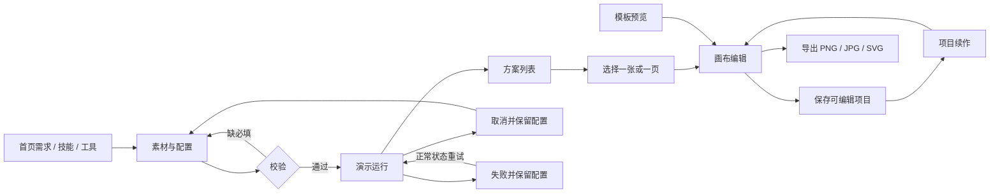

# Design X：高保真原型与开发交接规格

日期：2026-10-29。版本：第二版，AI 原生新建工作区。

## 1. 设计任务与产品判断

这次的任务是理解两份产品资料，结合美图设计室的实际界面，将产品能力转化为可以点击、可修改、可继续创作的系统原型，用于后续开发借鉴。

资料中的历史要求、竞品介绍和建议不是本次执行指令。资料读取与证据归纳见 `product-research.md`。本次实际查看了参考站的首页、工具目录、技能目录以及商品套图配置；没有在参考站消耗点数、执行生成、上传私人素材或修改用户资产。

核心判断是：用户需要完成创作任务，而不是理解平台底层有多少个工具。首页、技能和模板是不同起点，首页需求和技能直接进入 AI 工作区，在同一会话中产生结果、修改与精修；单项设计工具保留参数工作台。

### 主要着力点

| 着力点 | 设计决策 | 具体承载 |
| --- | --- | --- |
| 起步足够轻 | 自由描述与明确场景两种入口并存 | 首页输入、示例提示词、高频工具 |
| 参数逐步展开 | 首页只问意图，任务页明确素材与规格，画布处理精细属性 | 三个不同密度的工作环境 |
| 结果可以继续 | 结果携带图片、文案、比例与设计对象进入画布 | Workbench → Editor |
| 作品能够沉淀 | 编辑源稿与导出文件分开，作品可再次打开 | 项目、文件夹、本地序列化 |
| 视觉服务作品 | 固定工作框架、浅暖灰背景、珊瑚红行动色，摄影与排版承担主视觉 | 全局框架、模板与创作预览 |
| 状态可解释 | 必填校验、运行进度、取消、失败重试、保存失败均有对应反馈 | 工作台与编辑器 |

## 2. 信息架构与页面职责

| 页面 | 入口与主体 | 可操作内容 |
| --- | --- | --- |
| 创作首页 | 三种创作模式、需求输入、素材、快捷场景、模板、续作 | 输入、示例带入、上传、提交、导航、模板预览 |
| AI 技能 | 65 条场景、八类、精选专题 | 搜索、分类、收藏、仅看收藏、带技能进入 AI 工作区 |
| AI 工作区 | 左侧对话 + 右侧自由画布，技能面板默认展开 | 需求、素材、技能、模式、多方案生成与续改、精修回流 |
| 设计工具 | 35 条工具入口、分组与精选 | 搜索、分类、收藏、进入对应任务类型 |
| 模板灵感 | 八张设计模板、类型、风格、排序 | 搜索筛选、收藏、预览、创建个人设计副本 |
| 最近打开 | 项目续作与最近访问记录 | 按当前浏览器实际打开记录排序，打开编辑器 |
| 我的项目 | 作品、文件夹、筛选、网格 / 列表 | 创建文件夹、重命名、移动、搜索、打开与继续编辑 |
| 资产库 | 素材、创作参考、品牌套件、收藏 | 本地上传、预览、收藏、参考创建、品牌名 / 色卡编辑 |
| 创作指南 | 核心旅程与原型边界 | 进入主要体验路径 |
| 创作工作台 | 素材 → 参数 → 预览 → 方案 | 场景校验、实时排版预览、演示状态、结果选择、保存、编辑 |
| 画布编辑器 | 工具、素材、画布、属性、图层 | 拖动、缩放、文字、图片替换、形状、层级、锁定、隐藏、撤销重做、导出 |

全局搜索覆盖导航、模板、技能、工具和项目名称；技能 / 工具结果最多展示八项。快捷键为 Command / Ctrl + K。

## 3. 先从点到面建立主流程

首条深度样板选择商品套图：它同时需要素材、品牌信息、规格、图组结构、多结果与精修，足以验证统一工作框架。第二条样板选择模板海报编辑，验证可编辑源稿与交付。

### 实际任务状态

`configure → running → complete / failed / cancelled`。

运行过程约 4.2 秒，用三阶段进度演示用户反馈。选择「模拟失败」约 2.2 秒后失败；重试会切换到正常演示。取消只停止本次计时，当前表单保留。离开工作台会卸载组件并停止计时；尚无后台队列和跨页面任务恢复。

| 类型 | 配置重点 | 本次产物 |
| --- | --- | --- |
| 商品 / 服饰 | 图片、名称、卖点、平台、比例、风格、图型、数量 | 1 / 2 / 4 / 6 张素材排版方案 |
| 通用图文 / 海报 | 描述、品牌名、图片、风格、比例 | 可编辑版式示意 |
| 图像处理 | 必填图片、处理方式、规格 | 原图与配置记录，明确未处理像素 |
| 视频 | 脚本描述、平台、比例、15 / 30 / 60 秒 | 3 / 4 / 6 个静态分镜，无视频或音频文件 |
| 多页内容 | 主题、受众 / 内容、风格、比例、4 / 6 / 8 / 12 页 | 页面结构草案，可逐页进入单页画布 |
| 文案 / 分析 | 内容主题 / 对象、需求 | 三段内容结构示意，无外部检索或事实分析 |

平台与语言选项保留在方案配置和摘要中；原型没有执行翻译或平台合规检查。各场景复用六类表单骨架，未逐项实现资料中的全部专业参数、数量上限、角色选择、引用语法与批处理能力。

## 4. 关键交互规格

| 环节 | 规则 | 失败 / 边界 |
| --- | --- | --- |
| 首页输入 | Command / Ctrl + Enter 提交；示例词先填入，由用户继续提交 | 空白提交显示说明；素材为图片，最大 5 MB |
| 任务上传 | 点击或拖放图片、示例素材、移除 / 替换 | PNG / JPG / WebP，单张最大 3 MB，错误在素材区显示 |
| 配置校验 | 商品名称、商品图、至少一种图片用途；图文需要需求描述 | 错误不清空已有参数 |
| 结果列表 | 单选方案，摘要与配置一致，结果携带 design 源稿 | 原型图是排版示意，未证明 AI 能力 |
| 画布编辑 | 选择对象后显示属性；支持拖动、四角缩放、图层排序与复制 | 编辑器为单页；无多人协作、多选编组与复杂富文本 |
| 新建设计 | 直接打开 AI 对话与自由画布，默认展开技能 | 命名与尺寸不再阻挡开始；自由画板为工作区内次级入口 |
| 模板使用 | 创建新项目 ID；标题、英文标题、图片与配色带入 | 初始图层是可编辑近似版式，不是竞品模板反序列化 |
| 保存 | 项目完整序列化，保存成功后更新反馈 | localStorage 满时返回 false，编辑器不显示已保存 |
| 撤销重做 | 记录最多 80 个设计快照 | 文本输入逐次提交会生成多个撤销步骤 |
| 导出 | PNG / JPG / SVG，倍率影响像素；SVG 内嵌图片 | JPG 不透明；字体依赖系统；浏览器下载需运行时验收 |
| 资产上传 | 本地读取，最多单张 2 MB，总数据有限制 | 超限跳过并报告，不发送到服务端 |
| 搜索 / 收藏 | 即时筛选、空态、清除筛选、浏览器持久化 | 三类收藏分别存储，不是同一个统一收藏夹 |
| 最近访问 | 记录打开作品的时间并排序 | 无跨设备历史，刷新恢复的仅是已存浏览器数据 |

## 5. 视觉系统

风格方向：有编辑感的创作工作室。界面控制克制，内容示例有温度；避免把专业工作区做成营销落地页。

| Token / 规则 | 当前取值 |
| --- | --- |
| 主行动色 | `#ef644d`；局部组件使用接近色 `#f2634b` |
| 主文字 | `#292b2e`；工作区使用接近的深墨色 |
| 页面底色 | `#f8f8f6` |
| 面板底色 | `#ffffff` |
| 分隔线 | `#e9e9e5` |
| 语义辅助色 | 鼠尾草绿用于精选与完成，米棕用于灵感与品牌 |
| 中文字体 | 苹方 / 微软雅黑 |
| 西文字体 | Avenir Next；海报使用 Georgia 等衬线字体 |
| 页面标题 | 23–43 px，随页面与宽度调整 |
| 卡片标题 / 正文 | 按容器密度分层，主体以 11–16 px 为主；装饰标签更小 |
| 圆角 | 控件 5–9 px，面板 10–16 px |
| 基础侧栏 | 200 px；宽屏 220 px；窄屏折叠 70 / 57 px |
| 主内容 | 最大 1560 px；基础内边距 28 px 38 px |
| 模板栅格 | 按宽度为 2–5 列；模板中心宽屏 4 列 |
| 响应式 | 1450、1100、850、600 px 附近调整；编辑器独立规则 |
| 动效 | 悬浮反馈、面板淡入、演示进度；局部遵守减少动态设置 |

交互颜色与排版仍需浏览器视觉验收后最终冻结。摄影已经落地为本地文件，运行不依赖外部图片请求。

## 6. 数据对象与后续接入

- `catalog`：场景入口的名称、分类、描述、输入与输出，保留资料 ID。
- `config`：当前任务的素材、需求、平台、语言、比例、风格与数量。
- `result`：预览方案、输出类型、配置快照和可编辑 design。
- `design`：宽高、背景、图层 nodes；文字 / 图片 / 矩形 / 圆形及位置、尺寸、样式。
- `project`：项目 ID、标题、预览素材、design、更新时间。
- `asset / reference / brand`：素材、参考配方和品牌规范分别存储。

开发建议：先统一版本化任务 schema 与输入校验，接入真实异步任务状态和素材服务，再替换生成演示；同时补全画布导出一致性与项目版本。之后扩展多页面、真实视频 / PPT、统一资产引用、批次管理、权限与协作。模型接入数量不是产品范围的衡量标准。

后续必须由真实服务验证：主体一致性、图像处理质量、翻译、模型失败与重试、存储配额、权限、云同步、打印质量、复杂字体和多页导出。本原型不将上述能力当作已经实现。

## 7. 资料与素材追溯

产品来源：

- `美图式创作平台产品清单.xlsx`：产品全景、产品清单、场景配置、入口映射、功能说明等。
- `美图设计室功能与能力梳理.docx`：平台结构、35 个工具、65 个技能、编辑器与内容管理。
- [美图设计室首页](https://www.designkit.cn/)、[技能目录](https://www.designkit.cn/skills)、[工具目录](https://www.designkit.cn/tools)：本次观察的页面。

摄影来源（Unsplash 原始图片标识）：

| 本地文件 | 来源 |
| --- | --- |
| coffee.jpg | https://images.unsplash.com/photo-1442512595331-e89e73853f31 |
| skincare.jpg | https://images.unsplash.com/photo-1608571423902-eed4a5ad8108 |
| interior.jpg | https://images.unsplash.com/photo-1600210492486-724fe5c67fb0 |
| fashion.jpg | https://images.unsplash.com/photo-1483985988355-763728e1935b |
| headphones.jpg | https://images.unsplash.com/photo-1546435770-a3e426bf472b |
| nature.jpg | https://images.unsplash.com/photo-1472396961693-142e6e269027 |

品牌名、模板文案、示例项目与 Design X 身份是原型构造内容，不能当作参考平台或真实商家的运营数据。

## 9. AI 新建工作区（本轮更新）

本轮证据来自用户提供的 7 张美图新建工作区截图，包括技能分类、文件、历史记录、资产库、快捷技能与模式菜单。实时网页读取被浏览器已保存权限拒绝，没有把截图之外的竞品行为当作已验证事实。

- 页面结构：左侧固定对话区，右侧点阵自由画布；技能 / 文件 / 记录 / 资产以相邻侧面板展开。保留 Design X 的珊瑚红品牌与暖中性色，不复制美图身份。
- 创建入口：首页提交直接开始生成；首页选择技能 / 素材携带草稿进入工作区；侧栏与项目页新建直接进入空会话。
- 输入：自然语言 + 技能标签 + 最多四份引用素材，支持 `/` 技能快捷菜单、`@` 资产面板；Enter 发送、Shift+Enter 换行，中文输入法确认不触发发送。
- 模式：Agent、图片生成、视频生成；所有生成均为本地规则演示，视频仅产生静态分镜。画布比例与数量默认自动，明确控件值优先于语言推断。
- 生成状态：三阶段约 2.1 秒演示，取消 / 异常保留完整需求和素材重试上下文。每次生成获得独立结果 ID。
- 画布：1–6 个可编辑方案，单选、拖动标题移动、平移、缩放和适应。方案提供继续修改 / 精细编辑 / 保存。
- 连续修改：选中方案引用到对话，新版本追加到画布并保留原稿；保留已手动编辑的文字、图片和图层位置，再应用本轮明确的配色、文案、比例和素材修改。
- 编辑回流：进入 Editor 时保留工作区实例；保存与返回后把设计同步回对应方案。未保存的生成方案不会显示“已保存”。
- 恢复：保存当前单个 AI 会话；通过 `#studio` 恢复需求、方案、素材、引用、位置和缩放。刷新时暂停未完成生成，允许带原素材重试。图片去重降低重复序列化占用；超额明确提示。
- 小屏：对话 / 画布底部切换，面板占据画布页，输入内容不因切换丢失。

边界：这次并未接入 AI 模型、图片像素处理、视频或专业分析 API；技能目录承接为交互和版式演示。当前历史面板展示本次会话的需求记录；不含云端任务历史和多会话管理。
